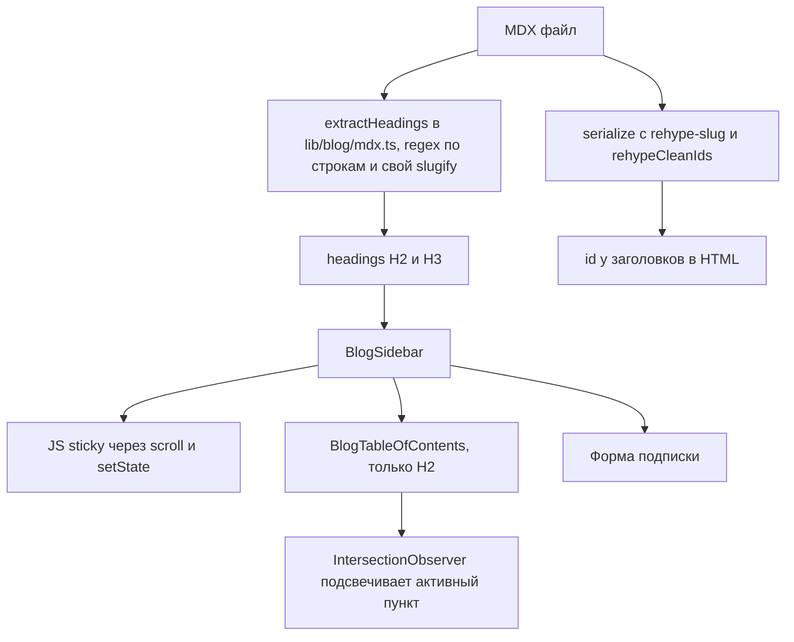

# Боковая навигация в постах блога: аудит и план улучшений

## Как устроено сейчас

Файлы:
- `components/blog/BlogSidebar.tsx`: JS-sticky + форма подписки
- `components/blog/BlogTableOfContents.tsx`: список H2 + scroll-spy
- `lib/blog/mdx.ts`: `extractHeadings()` + `slugify()`
- `hooks/useStickyInContainer.ts`: нигде не используется (мёртвый код)
- Копии той же логики: `components/sections/FreebieArticle.tsx`, `components/pages/LicensePage.tsx`
- CSS: `.blogpost_*` в `public/css/setproduct.webflow.shared.css`, переопределения в `styles/globals.css`

## Найденные проблемы

### Баги
1. **Observer пересоздаётся на каждый рендер.** `visibleHeadings = headings.filter(...)` создаёт новый массив на каждый рендер и стоит в зависимостях `useEffect`. Каждая смена активного пункта = disconnect + создание нового observer.
2. **Подсветка «теряется» в длинных разделах.** Observer реагирует только на заголовок, попавший в узкую зону вверху экрана. Пока читаешь длинный раздел, ни одного заголовка в зоне нет. При скролле вверх подсвеченным остаётся не тот пункт. `break` берёт первый изменившийся entry, а не верхний видимый.
3. **Два источника id.** Оглавление берёт id из своего `slugify`, а HTML получает id от `rehype-slug` (github-slugger). Они расходятся на повторяющихся заголовках (slugger добавляет `-1`, а свой slugify нет) и на заголовках с переносом строки внутри (`top-20-recent-design-resources`, `figma-resources-review-1`). Итог: ссылка в оглавлении никуда не ведёт.
4. **Нижние пункты длинного оглавления недоступны.** В `button-ui-design` 22 пункта H2 плюс форма подписки, и блок выше экрана. Фиксированный блок без собственного скролла: нижние пункты и форма уходят за край.

### Производительность
5. **JS-sticky вызывает ре-рендер на каждый кадр скролла.** `setStickyStyle({...})` каждый раз создаёт новый объект, поэтому React перерисовывает весь сайдбар вместе с формой, плюс `getComputedStyle` на каждый кадр.
6. **Корень проблемы:** `html, body { overflow-x: hidden }` в `globals.css` ломает нативный `position: sticky`, поэтому и появился JS-обходной путь. `overflow-x: clip` обрезает горизонтальный вылет так же, но sticky не ломает. После этого всю JS-логику можно заменить 3 строками CSS.
7. Логика скопирована в три места (blog, freebies, license).

### UX и доступность
8. На мобильных (<991px) оглавление скрыто полностью (`display: none`), хотя именно там посты самые длинные по скроллу.
9. H3 собираются, но не показываются.
10. Нет `<nav aria-label>`, нет `aria-current` на активном пункте, внутри ссылки лежит `
`, подпись «Navigation» неинформативна.
11. Нет индикатора прогресса чтения.
12. Нет аналитики: неизвестно, кликают ли по оглавлению и по форме в сайдбаре.

### Контент (влияет на вид оглавления)
13. Около 220 H2 с `**жирным**`, ссылками внутри, Title Case, переносами строк. В оглавлении это выглядит неровно. Это отдельная контентная задача.

## План

### Этап 1: исправления (низкий риск)
- Единый источник заголовков: свой rehype-плагин собирает `{id, text, level}` из готового HTML-дерева после `rehype-slug`. `slugify` и regex-парсер удаляются.
- Scroll-spy: активный = последний заголовок, верх которого выше линии ~120px. Один observer, `useMemo` для списка.
- `<nav aria-label="Table of contents">`, `aria-current="location"`, `` вместо `
`, подпись «On this page».

### Этап 2: производительность
- `html, body { overflow-x: clip }` (с fallback `hidden` для старых браузеров), нативный `position: sticky; top: 80px` у сайдбара.
- Удалить JS-sticky из `BlogSidebar`, `FreebieArticle`, удалить `useStickyInContainer`.
- Оглавлению задать `max-height` + собственный скролл, активный пункт автоматически прокручивается в видимую область.
- Проверить на 1440 / 1024 / 768 / 390, проверить, что горизонтальный вылет не вернулся.

### Этап 3: общий компонент
- Вынести `TableOfContents` + хук `useActiveHeading` и подключить в blog, freebies, license.

### Этап 4: улучшения UX (на выбор)
- Мобильная навигация: липкая полоса «On this page ▾» под навбаром с текущим разделом и выпадающим списком.
- Тонкая полоса прогресса чтения (или прогресс внутри пункта оглавления).
- H3 вложенным уровнем, раскрывается только у активного H2. Опционально: флаг `tocDepth` во frontmatter.
- Обрезка длинных пунктов до 2 строк (`line-clamp`).
- Порог: при <3 H2 оглавление не показывается.

### Этап 5: аналитика
- GA4 события через `lib/gtag.ts`: `toc_click` (позиция, id), `sidebar_subscribe`, глубина скролла по разделам. По данным решить, оставлять ли форму в сайдбаре.

### Этап 6 (отдельно, контент)
- Скрипт-аудит H2: жирный, ссылки, переносы, Title Case, дубли. Править пачками по правилам AGENTS.md.

## Статус реализации (2026-10-20)

Все этапы 1–5 сделаны, этап 6 сделан в части аудита (сам контент не правился).

| Этап | Что сделано | Где |
|---|---|---|
| 1 | Заголовки для оглавления собираются rehype-плагином из готового HTML-дерева, id совпадают с якорями по построению | `lib/blog/mdx.ts` |
| 1 | Новый scroll-spy: активен последний заголовок выше линии чтения, rAF-троттлинг, state меняется только при смене id, блокировка на 1.2 с после клика | `hooks/useActiveHeading.ts` |
| 1 | Доступность: `nav aria-label`, `aria-current="location"`, `ol/li`, заголовок On this page | `components/blog/TableOfContents.tsx` |
| 2 | `overflow-x: clip` у html/body (с `hidden` как фолбэк), нативный `position: sticky` вместо JS | `styles/globals.css` |
| 2 | Удалены `useStickyInContainer` и `BlogTableOfContents` | — |
| 2 | Длинное оглавление скроллится внутри себя и держит активный пункт в зоне видимости | `TableOfContents.tsx` |
| 3 | Один компонент и один хук `useArticleToc` для блога, resources (`FreebieArticle`) и `/legal/license` | `hooks/useArticleToc.ts` |
| 4 | Мобильная липкая плашка On this page (≤479px) с выпадающим списком H2, Esc и клик снаружи закрывают | `components/blog/MobileTableOfContents.tsx` |
| 4 | Полоска прогресса чтения (блог и resources) | `components/blog/ReadingProgress.tsx` |
| 4 | H3 раскрываются только под активным H2, line-clamp в 2 строки, оглавление скрыто при < 3 H2 | `TableOfContents.tsx`, `useArticleToc.ts` |
| 5 | GA4: `toc_click` (location, page, heading_id, level, position, total), `toc_open`, `newsletter_subscribe` с `location: blog_sidebar` | `useArticleToc.ts`, `BlogSidebar.tsx` |
| 6 | Аудит-скрипт заголовков, только чтение | `scripts/audit-headings.mjs` |

### Что выяснилось по ходу
- Старый `extractHeadings` на практике не давал битых якорей (проверка всех постов: 0). Переход на rehype оставлен ради единого источника id.
- Ленивые картинки в теле статьи имеют общие атрибуты `1600x900`, и после перехода по якорю их реальная высота сдвигает заголовок. Добавлена короткая докрутка (3 проверки по 700 мс), которая отменяется при любом действии пользователя.
- В самом низу страницы последние разделы физически не могут доехать до линии чтения. Кликнутый пункт остаётся подсвеченным, пока заголовок на экране.
- Сетка Webflow складывается в одну колонку только на ≤479px, поэтому на 768px остаётся десктопное оглавление. Это поведение по дизайну.

### Аудит заголовков (`node scripts/audit-headings.mjs`)
190 постов, в среднем 8.5 H2 (от 1 до 24), проблемы в 107 постах:
- `bold` 385 (жирный внутри H2/H3, в основном старые посты из Webflow);
- `titleCase` 328 (эвристика, есть ложные срабатывания на именах и брендах);
- `link` 49, `long` 11, `duplicate` 16 (одинаковый текст даёт якоря с суффиксом -1);
- `fewH2` 5: adobe-stealing-designs, best-fonts-pairing, black-friday-2023, material-nextjs-ui-kit, most-stressful-design-phrases (оглавление у них скрыто).

Правка контента по этим спискам идёт отдельной задачей, пачками и по правилам AGENTS.md.
