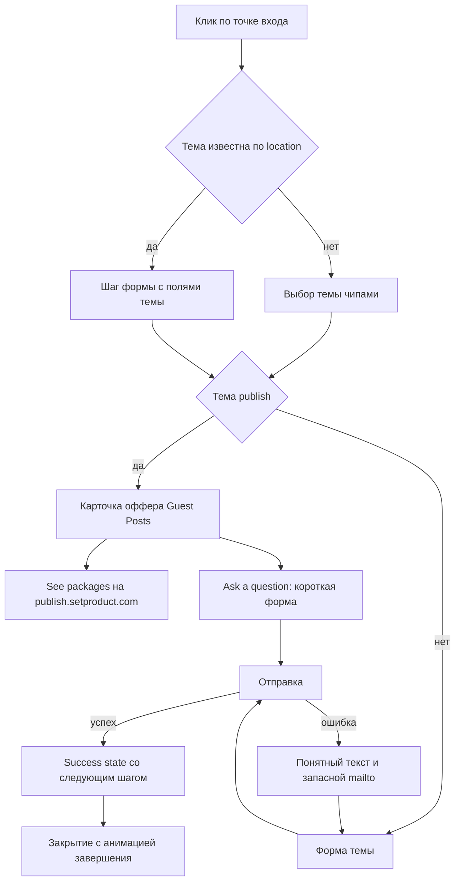
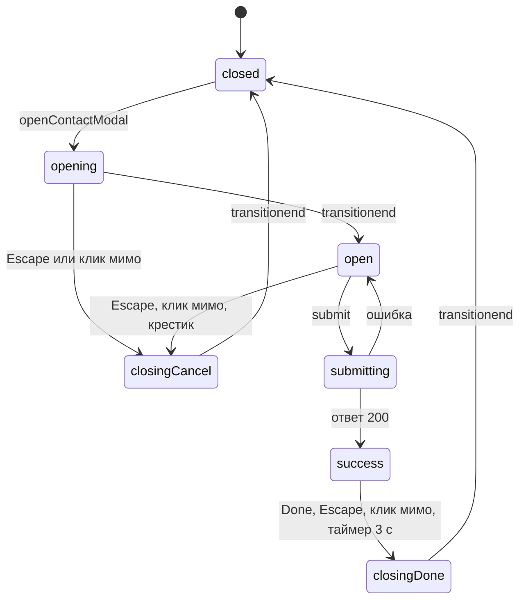

# Contact modal: лиды, паблишинг и motion (план, 17.11.2026)

Статус: черновик на согласование. Код не менялся.

Цель: превратить контактную форму из «ящика для писем» в маршрутизатор намерений, который (1) ведёт интерес к платным публикациям на publish.setproduct.com, (2) собирает больше данных о лиде без лишнего трения, (3) выглядит и двигается как часть дизайн-системы Setproduct.

---

## 1. Главный вывод

Сейчас модалка одинаковая для десяти точек входа и четырёх разных намерений (реклама, заказной дизайн, вопрос по киту, скидка). Она спрашивает только email и текст, не упоминает publish.setproduct.com, появляется и исчезает мгновенно, а после отправки показывает тупик из одной строки.

Три самых дорогих пробела:

1. **Паблишинг не продаётся.** Человек нажал `Contact us` в панели Advertise и получил пустое поле `Message`. Оффер (17,000 читателей, DR 42, 24 часа, от $288) остался за спиной.
2. **Лид приходит без контекста.** В письме нет страницы, точки входа, темы, имени. Нет `replyTo`, поэтому ответ по кнопке «Ответить» уходит на `contact@setproduct.com`, а не человеку.
3. **Форма теряет людей технически.** Токен CSRF живёт 5 минут с момента открытия: кто писал дольше, получает `Form expired`. Закрытие стирает текст. С клавиатуры модалку не закрыть.

---

## 2. Как устроено сейчас

| Слой | Файл | Что делает |
|---|---|---|
| Окно | [`ContactModal`](components/modals/ContactModal.tsx:16) | Два поля (`Email`, `Message`), inline-оверлей `rgba(0,0,0,0.5)`, `if (!isOpen) return null`, анимаций нет |
| Вызов | [`openContactModal()`](components/modals/ContactModalContext.tsx:32) | Принимает только `location`, шлёт `contact_cta_click` |
| События | [`ContactLocation`](lib/contact.ts:21) | `contact_cta_click`, `contact_form_start`, `contact_form_submit`, `contact_form_error` |
| Сервер | [`handler()`](pages/api/contact.ts:20) | Origin, rate limit, honeypot, CSRF, письмо на hello@setproduct.com |
| Письмо | [`ContactEmail`](emails/ContactEmail.tsx:8) | Только `email` и `message` |
| Стили | [`.modal-wr`](public/css/setproduct.webflow.shared.css:4972) | Карточка 768em, padding 40em 64em, на мобильном `margin-top: 50em` |

Точки входа: панель Advertise (десктоп и мобильная), [`TemplateCtaHire`](components/sections/TemplateCtaHire.tsx:10), [`DashboardTemplatePage`](components/pages/DashboardTemplatePage.tsx:59), [`TestimonialsPage`](components/pages/TestimonialsPage.tsx:179), [`SearchPage`](components/pages/SearchPage.tsx:945), [`FaqSection`](components/sections/FaqSection.tsx:38) (ссылки `data-contact`), страница возвратов, [`SiteFooter`](components/layout/SiteFooter.tsx:265). Страница [`TermsOfPaidPostsPage`](components/pages/TermsOfPaidPostsPage.tsx:231) до сих пор ведёт на `mailto:`.

---

## 3. Найденные проблемы

| № | Группа | Проблема | Чем грозит |
|---|---|---|---|
| P1 | Бизнес | В модалке нет ни слова про Setproduct Guest Posts | Тёплый рекламодатель пишет письмо вместо покупки |
| P2 | Бизнес | Одна форма на четыре намерения | Нельзя задать уместные вопросы, лид не квалифицирован |
| P3 | Бизнес | FAQ шлёт найм и скидку под одним `location: faq` | В отчёте два сценария неразличимы |
| P4 | Данные | В письме нет `location`, страницы, темы, имени | Каждый ответ начинается с уточнений |
| P5 | Данные | Нет `replyTo` | Ответ уходит не лиду |
| P6 | Данные | Лиды живут только в почтовом ящике | Нет списка, нет скорости реакции |
| P7 | Надёжность | CSRF истекает через 5 минут после открытия ([`verifyToken()`](lib/csrf.ts:15)) | Длинные вдумчивые письма (лучшие лиды) падают с ошибкой |
| P8 | Надёжность | Закрытие стирает текст, черновика нет | Случайный клик мимо = потерянный лид |
| P9 | Надёжность | Ошибка показывает сырой текст сервера, запасного пути нет | Человек уходит |
| P10 | Надёжность | Сервер не проверяет формат email и длину | Мусорные письма |
| P11 | Надёжность | Rate limit в памяти ([`rateLimit()`](lib/rateLimit.ts:10)): на Vercel не общий между инстансами, а 3 в день по IP режет офисы за одним NAT | И не защищает, и мешает |
| P12 | Доступность | Нет `role="dialog"`, `aria-modal`, Escape, ловушки фокуса, возврата фокуса; подписи сделаны `
` | С клавиатуры и скринридера форма почти недоступна |
| P13 | Вёрстка | `overflow: hidden` без компенсации скроллбара; сброс в `""` конфликтует с мобильным меню в [`SiteHeader`](components/layout/SiteHeader.tsx:106) | Страница дёргается, скролл может «залипнуть» |
| P14 | Вёрстка | На мобильном нет лимита высоты и внутреннего скролла | Клавиатура закрывает кнопку отправки |
| P15 | Вёрстка | Старые поля (`w-input`, без `is-l`) | Расходится с новой системой полей |
| P16 | Тексты | `inquires`, `Whats your e-mail`, `Send your Message` | Опечатки и Title Case на самом важном экране |
| P17 | Motion | Появление, закрытие и успех без анимации | Окно «выстреливает», нет связи с кнопкой-триггером |
| P18 | Успех | `Thank you! Your submission has been received!` и всё | Нет срока ответа, нет следующего шага |
| P19 | Аналитика | Нет события закрытия, темы, клика на паблишинг из модалки | Не видно, где и почему уходят |

---

## 4. Новый флоу

### 4.1. Схема

### 4.2. Темы и предвыбор

Четыре темы (решение автора 18.11.2026: всё про киты убрано, их выводят из продажи). Выбор чипами (`button-x-small is-text`, активный `is-active` + `aria-pressed`). Список и подписи живут в [`lib/contactTopics.ts`](lib/contactTopics.ts:1), общем для окна, API и письма.

| Тема (`topic`) | Подпись чипа | Предвыбрана для `location` |
|---|---|---|
| `publish` | `Guest post or ad` | `advertise_panel_desktop`, `advertise_panel_mobile`, `terms_page`, `template_hire`, `dashboard_cta`, `testimonials_page` (сразу форма вопроса) |
| `partnership` | `Partnership` | нет; обзоры, интеграции, совместные материалы |
| `work` | `Design or dev work` | нет |
| `other` | `Something else` | нет |

Подписи без глагола: это ответы на вопрос `How can we help?`, а не кнопки действия.

Тема неизвестна (футер, FAQ, поиск, возвраты): ни один чип не нажат, сразу видна общая форма. Выбирать тему не обязательно. Чипы всегда над формой, смена темы плавно меняет поля, введённый текст сохраняется.

API: `openContactModal(location, { topic, ask })`. Если `options` не переданы, тема берётся из `LOCATION_DEFAULTS` в [`lib/contact.ts`](lib/contact.ts:1), поэтому точки входа править не пришлось.

### 4.3. Ветка паблишинга (главная)

Решение автора от 09.11: открытая цена, никаких `Request a quote` и форм заявки перед оплатой. Поэтому модалка **не собирает заявку**, а показывает оффер и ведёт на портал.

Экран темы `publish`:

- заголовок `Setproduct Guest Posts`;
- четыре факта из [`PUBLISH_OFFER`](lib/publish.ts:1): `17,000 readers a month`, `DR 42`, `Live in 24 hours`, `From $288`;
- primary `See packages` через [`getPublishLinkProps()`](lib/publish.ts:84) с новым значением `contact_modal` в [`PublishLocation`](lib/publish.ts:41);
- secondary `Ask a question` (`button-small outlined`): раскрывает короткую форму ниже.

Форма вопроса: `Email`, `Website` (необязательное), `Message` с подсказкой `What would you like to know before ordering?`. Над полями полоса `From $288, live in 24 hours.` со ссылкой `See packages`, чтобы цена оставалась в одном клике. Цена в форме не обсуждается, это вопрос перед покупкой, а не запрос цены.

### 4.4. Поля по темам

Правило: обязательны только `Email` и `Message`. Остальное необязательно и по возможности заполняется одним кликом.

| Тема | Дополнительное поле (optional) | Placeholder `Message` |
|---|---|---|
| `publish` | `Website` | `What would you like to know before ordering?` |
| `partnership` | `Company or product` | `What do you have in mind? A review, an integration, a joint piece…` |
| `work` | `Company or project` | `What are you building and what do you need? A rough timeline and budget help us reply faster.` |
| `other` и без темы | `Name` | `Type your message` |

Сервер принимает только ссылки `http` / `https`, адрес без схемы дополняет `https://`. В тему письма уходит метка: `[Guest post]`, `[Partnership]`, `[Design or dev work]`, `[Other]`, `[Contact]`.

Автоматически, без участия человека, в письмо уходят: `topic`, `location`, `page_path`, `referrer`, первая страница визита.

Мотиваторы заполнения:

- строка доверия под заголовком: `We'll reply within 24 hours` (ответ Q2);
- подписи необязательных полей с пометкой `optional`;
- строка под кнопкой `We use your email only to reply. Privacy policy` со ссылкой на `/legal/privacy-policy` (ответ Q8).

### 4.5. Success state со следующим шагом

| Тема | Заголовок | Текст | Следующий шаг |
|---|---|---|---|
| `publish`, `partnership` | `Message sent` | `We'll reply to {email} within 24 hours.` | `See packages` (`contact_success`) |
| `work` | `Message sent` | то же | `Read case studies` → `/blog?category=Case Studies` |
| `other` и без темы | `Message sent` | то же | мягкая строка `Promoting a product? Guest posts start at $288. See packages` |

Вторая кнопка везде `Done`. Решение автора (Q6): окно закрывается само через 3 секунды, либо по `Done`, либо кликом мимо окна. Чтобы таймер не съедал следующий шаг, он ставится на паузу, пока курсор над окном или фокус на кнопке следующего шага. Под текстом тонкая полоса показывает, сколько осталось (при `prefers-reduced-motion` полоса не анимируется, таймер тот же).

### 4.6. Черновик текстов (sentence case)

| Место | Сейчас | Станет |
|---|---|---|
| Заголовок | `Contact us` | `How can we help?` |
| Подзаголовок | `Send your questions, ideas, and collaboration inquires` | `Pick a topic and we'll ask only what matters.` |
| Placeholder email | `Whats your e-mail` | `you@company.com` |
| Кнопка | `Send your Message` | `Send message` |
| Загрузка | `Sending...` | спиннер, ширина кнопки не меняется |
| Успех | `Thank you! Your submission has been received!` | см. 4.5 |
| Ошибка лимита | сырой текст | `You've just sent a message. Try again in a minute or write to hello@setproduct.com.` |
| Ошибка сети | сырой текст | `Couldn't send. Your text is saved. Try again or email us.` |

---

## 5. Спецификация motion

### 5.1. Идея: «перевод фокуса»

Фирменные приёмы уже есть: push-кнопка с кромкой, поле, которое в фокусе поднимается на 2px, и растворение в блюре ([`read-next-bar-dissolve`](styles/globals.css:3083)). Диалог собирается из них же, чтобы его нельзя было спутать с чужим.

Образ: оператор переводит фокус камеры. Страница уходит в расфокус, карточка одновременно выходит из расфокуса в резкость и встаёт на кромку, как поле в фокусе. Блюр фона и блюр карточки движутся навстречу друг другу. Это и есть «разблюр».

Правила Material motion, которые соблюдаем:

- вход замедляется (decelerate), выход ускоряется (accelerate);
- выход короче входа;
- элемент уходит туда, откуда пришёл, если действие отменено;
- завершённое действие уходит иначе, чем отменённое;
- на выходе никаких украшений: стаггера и пружин нет.

### 5.2. Токены

| Токен | Значение | Откуда |
|---|---|---|
| `--modal-in` | 360ms | новый |
| `--modal-out` | 220ms | новый |
| `--modal-done-out` | 420ms | новый |
| `--modal-ease-in` | `cubic-bezier(0.22, 1, 0.36, 1)` | равен `--input-ease` |
| `--modal-ease-out` | `cubic-bezier(0.3, 0, 0.8, 0.15)` | Material emphasized accelerate |
| `--modal-blur` | 8px, на мобильном 4px | новый |
| `--modal-scrim` | `#19181b` 32% | вместо чёрного 50%: с блюром нужен более лёгкий тон |
| нажатие | 60ms | равен `--btn-press-in` |

### 5.3. Появление (360ms)

| Слой | Что происходит | Время |
|---|---|---|
| Фон (scrim) | Слой с постоянным `backdrop-filter: blur(8px)` проявляется по `opacity` 0 → 1. Анимируется прозрачность, а не радиус блюра: так дешевле для Safari | 0–320ms |
| Карточка | `transform-origin` в центре кнопки-триггера. `scale` 0.92 → 1, `translateY` 16 → 0, собственный `blur` 8px → 0, `opacity` 0 → 1 за первые 120ms | 0–360ms |
| Кромка | В конце карточка «встаёт» на кромку: подъём 4px и нижняя тень 0 → 4px, как у поля в фокусе | 240–360ms |
| Содержимое | Заголовок, чипы, поля, кнопка: `translateY` 8 → 0 и `opacity`, шаг 24ms, не больше пяти групп | 80–420ms |
| Фокус | Ставится в первое поле сразу, анимацию не ждёт | 0ms |

Точка триггера: провайдер запоминает последний `pointerdown` (Safari на macOS не фокусирует кнопку по клику, поэтому `document.activeElement` недостаточно). Нет точки: центр экрана.

Отвергнуто: уменьшать саму страницу за окном. `transform` на корне ломает `position: fixed` у шапки и sticky-блоков.

### 5.4. Закрытие-отмена (60 + 180ms)

Человек передумал. Окно возвращается в кнопку, из которой вышло.

| Фаза | Что происходит | Время |
|---|---|---|
| Нажатие | Карточка опускается на свою кромку: `translateY` +4px, тень 4px → 0. Тот же жест, что у push-кнопки | 60ms |
| Уход | `scale` 1 → 0.96, `translateY` → 12px, `opacity` 1 → 0, origin в триггере. Блюра на карточке нет: отмена это «убрать на место», а не «раствориться» | 180ms, `--modal-ease-out` |
| Фон | `opacity` 1 → 0 параллельно | 220ms |
| Фокус | Возвращается на кнопку-триггер | в конце |

Если в полях есть текст, он сохраняется в `sessionStorage`. Окно закрывается без вопроса «вы уверены?»: Material не блокирует выход, защита работает через черновик. При повторном открытии показывается строка `Draft restored`.

Прерывание: Escape во время появления разворачивает движение с текущей точки. Поэтому карточка и фон сделаны на CSS-transition по атрибуту `data-state`, а keyframes используются только для галочки и стаггера.

### 5.5. Успех

| Шаг | Что происходит | Время |
|---|---|---|
| 1. Отправка | Подпись кнопки сменяется спиннером, ширина фиксирована, поля `disabled` | до ответа сервера |
| 2. Смена содержимого | Форма уходит вверх (`translateY` −8, `opacity` → 0). Высота карточки плавно переезжает к высоте экрана успеха. Это Material shared axis по вертикали | 160ms выход, 320ms высота |
| 3. Знак | Круг `--primary` 64em: `scale` 0.6 → 1 с лёгким перелётом. Галочка рисуется обводкой. Одно кольцо `--light-primary` расходится и гаснет, как ripple кнопки | 320ms круг, 280ms галочка с задержкой 120ms, 728ms кольцо |
| 4. Текст | Заголовок, текст, кнопки входят снизу со стаггером 24ms | 200ms каждая группа |
| 5. Доступность | Фокус на заголовок успеха, область `aria-live="polite"` | сразу |

Конфетти и повторяющихся анимаций нет.

### 5.6. Закрытие после успеха (420ms)

Дело сделано, письмо «улетело». Движение другое, чем у отмены, чтобы человек кожей чувствовал разницу.

| Слой | Что происходит | Время |
|---|---|---|
| Карточка | `translateY` 0 → −24px, `blur` 0 → 12px, `opacity` 1 → 0. Фирменное растворение, но с движением вверх | 420ms, `--modal-ease-in` |
| Фон | `opacity` 1 → 0 | 300ms |
| Страница | Кликабельна сразу: у оверлея `pointer-events: none` с первого кадра выхода | 0ms |

### 5.7. Мобильный (≤479px)

Карточка становится нижним листом: прижата к низу, верхние углы `radius-24`, высота не больше `100dvh` минус отступ, внутри скролл, кнопка отправки прилипает к низу.

- Появление: снизу, `translateY` 100% → 0, 360ms.
- Отмена: вниз, 220ms.
- Успех и закрытие после него: как на десктопе (вверх с растворением).
- Блюр фона 4px.

### 5.8. Reduced motion и слабые устройства

- `prefers-reduced-motion: reduce`: только `opacity` за 120ms, без масштаба, сдвига и блюра. Галочка показывается готовой. Высота меняется мгновенно.
- `@supports not (backdrop-filter: blur(1px))`: фон без блюра, тон плотнее (48%).
- Размонтирование по `transitionend` с запасным таймером (длительность + 50ms): в скрытой вкладке событие может не прийти.

### 5.9. Машина состояний

Состояние пишется в `data-state` на корне окна. Вся анимация живёт в CSS, React только переключает атрибут.

### 5.10. Прототип до выкатки

По образцу [`pages/inputs-proto.tsx`](pages/inputs-proto.tsx) и [`pages/push-buttons-proto.tsx`](pages/push-buttons-proto.tsx): страница `/contact-modal-proto` (noindex) с кнопками в разных углах экрана и переключателями «успех», «ошибка», «медленная сеть». Тайминги и кромка утверждаются глазами автора на прототипе, потом переносятся в прод.

---

## 6. Каркас окна и доступность

| Что | Решение |
|---|---|
| Основа | Нативный `<dialog>` и `showModal()`: ловушка фокуса, `inert` фона, Escape и верхний слой (top layer) даёт браузер. Новых зависимостей нет. Верхний слой снимает вопрос z-index с шапкой и оверлеем Gumroad |
| Закрытие | Событие `cancel` перехватывается, сначала играет анимация, потом `dialog.close()` |
| Имя окна | `aria-labelledby` на заголовок; заголовок становится `<h2>` |
| Поля | `<label>` вместо `
`, классы `text-input is-l` и `textarea-input is-l`, без `w-input`; `autocomplete="email"`, `name`, `organization`, `url`; `enterkeyhint="send"` |
| Ошибки полей | `aria-invalid`, текст ошибки связан через `aria-describedby` |
| Крестик | `<button type="button" aria-label="Close">`, зона нажатия не меньше 44px |
| Скролл | Общий счётчик блокировок в новом `lib/scrollLock.ts` с компенсацией ширины скроллбара. Им же пользуется мобильное меню, конфликт P13 уходит |
| Кромка в фокусе | Проверить, что у предков поля нет `overflow: hidden` (риск R4 из плана полей): внутренний скролл ставится на обёртку с запасом padding 8em |
| Стили `<dialog>` | Сбросить браузерные `padding`, `border`, `max-width`, `max-height`, `color` |
| Блюр фона | Задаётся в `px`, а не в `em`: `::backdrop` в старых браузерах не наследует переменные |

---

## 7. Сервер и письма

| № | Изменение | Файл |
|---|---|---|
| S1 | `replyTo: email` | [`pages/api/contact.ts`](pages/api/contact.ts:20) |
| S2 | Принимать `topic`, `name`, `url`, `budget`, `timeline`, `product`, `location`, `pagePath`, `referrer`, `landing`. Неизвестные поля отбрасывать | там же |
| S3 | Проверка: формат и длина email (до 254), `message` от 10 до 5000, `topic` из белого списка, URL нормализуется | там же |
| S4 | Тема письма по шаблону `[Publish] question from email, advertise_panel_desktop` | там же |
| S5 | Письмо с таблицей всех полей и контекста | [`ContactEmail`](emails/ContactEmail.tsx:8) |
| S6 | Токен CSRF запрашивается в момент отправки, а не при открытии. Дополнительно клиент шлёт время от открытия до отправки, сервер отсекает отправки быстрее 2 секунд | [`ContactModal`](components/modals/ContactModal.tsx:16), [`lib/csrf.ts`](lib/csrf.ts:15) |
| S7 | Словарь понятных текстов ошибок, запасная ссылка `mailto:` с уже подставленным текстом | [`ContactModal`](components/modals/ContactModal.tsx:16) |
| S8 | ~~Автоответ отправителю~~ Отменён автором (Q10) | — |
| S9 | Проверить, что секрет CSRF задан в окружении Vercel: в коде есть запасная строка-заглушка | [`lib/csrf.ts`](lib/csrf.ts:6) |
| S10 | Лимит: смягчить дневной порог (3 в день по IP режет офисы). Надёжный общий лимит требует внешнего хранилища, отложено (раздел 15) | [`lib/rateLimit.ts`](lib/rateLimit.ts:10) |

---

## 8. Аналитика

Новые события (все через хелперы в [`lib/contact.ts`](lib/contact.ts:38), без строк `gtag` в компонентах):

| Событие | Когда | Параметры |
|---|---|---|
| `contact_topic_select` | Выбор или смена темы | `location`, `topic`, `preselected` |
| `contact_modal_close` | Любое закрытие до отправки | `location`, `topic`, `step`, `had_input`, `method` (`escape`, `backdrop`, `button`, `back`) |
| `contact_draft_restore` | Открытие с восстановленным черновиком | `location`, `topic` |
| `contact_success_cta_click` | Клик по следующему шагу на экране успеха | `location`, `topic`, `target` |

Изменения в существующих:

- `contact_form_submit` получает `topic` и `fields_filled` (число заполненных необязательных полей).
- Клики на портал из модалки идут через существующее `publish_cta_click` с новыми значениями `contact_modal` и `contact_success`. Отдельное событие не заводим, чтобы отчёт по паблишингу оставался в одном месте.

Руками в GA4: кастомные измерения `topic`, `step`, `had_input`, `method`, `fields_filled`, `preselected`.

Базовая линия: события `contact_*` работают с 08.11, старых данных по ним в выгрузках нет. Перед выкаткой фазы 2 записать за доступный период: открытия, долю начавших, долю отправивших, разбивку по `location`.

---

## 9. Порядок работ

Каждый пункт: отдельный коммит, локально, без push. Перед каждым коммитом `npm run lint`, перед концом фазы `npm run build` и проверка на 1440 / 1024 / 768 / 390.

### Фаза 0. Решения и база (без кода)

- Ответы автора на вопросы из раздела 12.
- Снимок базовой линии `contact_*` в GA4.
- Кастомные измерения в GA4.

### Фаза 1. Невидимый фундамент

| Коммит | Содержание |
|---|---|
| `fix: correct contact modal copy and sentence case` | P16 |
| `feat: send reply-to and page context with contact form` | S1, S2 (контекст), S4, S5 |
| `feat: validate contact payload on the server` | S3 |
| `fix: request csrf token on submit` | S6 |
| `fix: show readable contact form errors with mailto fallback` | S7 |

Эта фаза уже улучшает лиды и ничего не меняет внешне. Её можно выкатить сразу.

### Фаза 2. Каркас окна

| Коммит | Содержание |
|---|---|
| `feat: add shared scroll lock helper` | `lib/scrollLock.ts`, подключение в мобильном меню |
| `refactor: rebuild contact modal on native dialog` | Раздел 6, машина состояний без анимаций |
| `style: move contact modal fields to new input system` | `is-l`, `<label>`, зазоры |
| `style: add mobile sheet layout for contact modal` | 5.7 без движения |

### Фаза 3. Motion

| Коммит | Содержание |
|---|---|
| `feat: add contact modal motion prototype page` | 5.10, согласование с автором |
| `feat: add contact modal enter and dismiss motion` | 5.3, 5.4, 5.8 |
| `feat: add contact modal success state and done exit` | 5.5, 5.6 |

### Фаза 4. Темы и паблишинг

Сделана заново 18.11.2026, см. раздел «Фаза 4 сделана заново» в конце файла.

### Фаза 5. Удержание

| Коммит | Содержание |
|---|---|
| `feat: keep contact draft in session storage` | P8 |
| `feat: open contact modal from url parameter` | `?contact=publish` для писем, статей и портала |
| `feat: close contact modal with browser back on mobile` | Запись в history при открытии |
| `chore: remove unused modal styles` | `.modal_form-column`, `.modal_info-wr` и прочее, после проверки поиском |

### Фаза 6. Замер

Сравнение периодов до и после. Точка отсчёта: дата деплоя фазы 4. Первые 2–3 дня не учитываются. Контрольные точки через 2 и 4 недели.

---

## 10. Что могло быть забыто

| № | Что | Где закрыто |
|---|---|---|
| 1 | `replyTo` (автоответ отменён, Q10) | S1 |
| 2 | Контекст лида в письме | S2, S5 |
| 3 | Истечение токена через 5 минут | S6 |
| 4 | Потеря текста при закрытии | Фаза 5 |
| 5 | Клавиатура, скринридер, возврат фокуса | Раздел 6 |
| 6 | Дёрганье страницы из-за скроллбара, конфликт с мобильным меню | Раздел 6 |
| 7 | Клавиатура телефона закрывает кнопку | 5.7 |
| 8 | Кнопка «назад» на телефоне уводит со страницы вместо закрытия окна | Фаза 5 |
| 9 | Прямая ссылка, открывающая форму с нужной темой | Фаза 5 |
| 10 | Страница условий платных постов ведёт на `mailto:` в обход формы и аналитики | Фаза 4 |
| 11 | Два сценария FAQ под одним ярлыком | Фаза 4 |
| 12 | Экран успеха как тупик | 4.5 |
| 13 | Понятные ошибки и запасной путь | S7 |
| 14 | Двойная отправка, отправка без сети | Кнопка `disabled` на время запроса, текст ошибки сети |
| 15 | Слабые устройства и `prefers-reduced-motion` | 5.8 |
| 16 | Кастомные измерения в GA4 руками | Фаза 0 |
| 17 | Событие закрытия (без него не видно, где уходят) | Раздел 8 |
| 18 | Хранение лидов и скорость реакции | Q5 |
| 19 | Обещание срока ответа должно быть правдой | Q2 |
| 20 | **Страницы политики конфиденциальности в проекте нет.** Форма начнёт собирать имя, компанию и бюджет, строка `We use your email only to reply` должна на что-то ссылаться | Q8 |
| 21 | Спам: honeypot и проверка времени заполнения, Turnstile как резерв | S6, Q5 |
| 22 | Проверка писем в Gmail и Apple Mail после смены шаблона | Фаза 1, ручная проверка |
| 23 | Единое название оффера внутри окна: `Setproduct Guest Posts`, кнопка `See packages` | 4.3 |
| 24 | Платные посты нельзя показывать как кейсы | В окне нет примеров постов, только факты оффера |

---

## 11. Метрики успеха

| Метрика | Как считается |
|---|---|
| Доля начавших | `contact_form_start` / `contact_cta_click` |
| Доля отправивших | `contact_form_submit` / `contact_form_start` |
| Переходы на портал из окна | `publish_cta_click` с `contact_modal` и `contact_success` |
| Качество лида | Медиана `message_length`, среднее `fields_filled` |
| Потери | `contact_modal_close` с `had_input: true` |
| Ошибки | `contact_form_error` по `reason` (ожидание: `Form expired` исчезает) |

Прогноза в процентах не даю: трафик окна по новым событиям ещё не измерен. Ориентир по старым событиям Webflow за 12.07–09.10: 890 кликов по контактной ссылке, 724 начала формы, 428 отправок (последнее число может включать подписку). Объём небольшой, поэтому сравниваем периоды, а не запускаем A/B.

---

## 12. Вопросы к автору (ответы 17.11.2026)

| № | Вопрос | Ответ автора |
|---|---|---|
| Q1 | Оставляем форму `Ask a question` в ветке паблишинга? | Да |
| Q2 | Какой срок ответа обещать? | 24 часа: `We'll reply within 24 hours` |
| Q3 | Заказной дизайн ещё продаётся? | Нет. Тема `project` и чипы бюджета убраны |
| Q4 | Купон 30% действует? | Нет. Сценарий скидки убран |
| Q5 | Где хранить лиды? | Только почта. Остальное в раздел 15 как задел |
| Q6 | Как закрывается экран успеха? | Автозакрытие через 3 с, кнопка `Done` или клик мимо окна |
| Q7 | Мобильный вид | Нижний лист |
| Q8 | Политика конфиденциальности | Сделать как принято: страница `/legal/privacy-policy`, ссылки в форме и футере, sitemap |
| Q9 | Подписи тем | Решает агент (см. 4.2) |
| Q10 | Автоответ отправителю | Не нужен, S8 отменён |

---

## 13. Что не проверено

- Секрет CSRF читается из `CSRF_SECRET`. Этой переменной нет в `.env.example`. Если её нет и в Vercel, работает строка-заглушка из кода (S9).
- Не проверял z-index шапки и оверлея Gumroad в браузере: расчёт на верхний слой `<dialog>`.
- Не проверял поведение `backdrop-filter` на `::backdrop` в Safari 16 и старше: при проблемах фон переносится на обычный `div` внутри окна.
- Не открывал портал publish.setproduct.com: параметр `?contact=` и новые UTM с ним не согласованы.
- Диапазоны бюджета, срок ответа и статус купона в плане условные до ответов автора.

---

## 14. Ход работ

### Фаза 1 сделана (17.11.2026)

| Коммит | Что поменялось |
|---|---|
| `f6dab62` fix: correct contact modal copy and sentence case | Исправлены опечатки `inquires` и `Whats your e-mail`. Кнопка `Send message`, placeholder `you@company.com`, новый текст успеха |
| `842014f` feat: send reply-to and page context with contact form | `replyTo` на адрес человека. В письмо уходят точка входа, страница, первая страница визита с UTM, referrer. Точка входа видна в теме письма |
| `8e76e8f` feat: validate contact payload on the server | Проверка формата email, сообщение от 10 до 5000 символов. API отдаёт стабильные коды ошибок (`code`). Лимит частоты проверяется последним, поэтому опечатка в email не сжигает попытку |
| `399e6f8` fix: request csrf token on submit | Токен берётся перед отправкой. Ошибка `Form expired` при долгом наборе текста ушла |
| `d158a97` fix: show readable contact form errors with mailto fallback | Понятные тексты на каждый код и ссылка `mailto:` с уже вставленным текстом. В GA4 `reason` теперь равен коду (`email_invalid`, `rate_minute`, `network`…) |
| `08047c1` fix: report resend failures instead of showing success | **Найдено по ходу работ.** SDK Resend не выбрасывает исключение при отказе API (неверный ключ, квота, домен), а возвращает `{ error }`. Код этого не проверял: человек видел «спасибо», а письмо терялось. Исправлено в контакте и подписке, теперь ответ 502 |

Проверено локально запросами к API: неверный email → 400 `email_invalid`, короткое сообщение → 400 `message_short`, чужой токен → 403 `token_invalid`, просроченный → 403 `token_expired`, honeypot → 400 `spam`, повтор в течение минуты → 429 `rate_minute`, отказ Resend → 502 `send_failed`. `npm run lint` и `npm run build` чистые.

Что изменилось для отчётов GA4: параметр `reason` у `contact_form_error` раньше содержал английский текст ошибки, теперь короткий код. Сравнивать ошибки до и после 17.11 надо по смыслу, а не по строке.

---

## 15. Отложено и требует решения

### 15.1. Лиды: что оптимизировать в будущем (ответ Q5)

Сейчас лид живёт только в почте hello@setproduct.com. Риски: письмо в спаме, потерялось в ящике, нет истории и статистики. По порядку пользы:

1. Уведомление в Telegram-бот параллельно с письмом (две переменные окружения, без новых пакетов). Скорость реакции.
2. Хранилище лидов (Vercel KV, Upstash Redis или таблица): история, дубликаты, отчёт по темам.
3. Общий rate limit в том же хранилище: текущий лимит в памяти сбрасывается на каждом холодном старте функции и не общий между инстансами.
4. Cloudflare Turnstile, если honeypot и CSRF перестанут справляться со спамом.

### 15.2. Контент, который противоречит ответам Q3 и Q4

Решение автора 17.11.2026: переписать под паблишинг. Сделано:

| Коммит | Что поменялось |
|---|---|
| `7258744` content: replace hire and coupon FAQ with publishing and bundle answers | 35 вопросов `Can I hire you?` → `Can I promote my product on Setproduct?` с фактами оффера и ссылкой на портал (`data-publish-location="faq"`). 36 вопросов про купон 30% → `Do you offer discounts?` с бандлом и сезонными распродажами. На главной вопрос про найм заменён на `How do I contact the team?` (паблишинг там уже есть третьим вопросом) |
| `fd8f0a7` feat: replace hire CTA bands with publishing CTA | Новый [`PublishCta`](components/sections/PublishCta.tsx): заголовок `Put your product in front of 17,000 readers`, primary `Publish a post` на портал, secondary `Ask a question` открывает окно. Стоит на страницах шаблонов, дашбордов и `/testimonials`. `TemplateCtaHire` удалён, `ctaHire` в claylo удалён. Новые `PublishLocation`: `template_cta`, `dashboard_cta`, `testimonials_page` |
| `d2eed85` docs: rewrite privacy policy in a shorter, location-free voice | Тон «распределённая команда без офиса», раздел `What we never collect`, права распространены на всех, юридические блоки (GDPR, обработчики, передачи, сроки, Калифорния) сохранены |

Поля `ctaTitleHtml` / `ctaBodyHtml` в `data/dashboard-templates.ts` больше не рендерятся, оставлены в данных: удалить при следующей чистке.

### Фаза 2 сделана (17.11.2026)

| Коммит | Что поменялось |
|---|---|
| `8260fd5` docs: record author answers for contact modal plan | Ответы Q1–Q10, тема `project` и сценарий скидки убраны, S8 отменён, автозакрытие через 3 с, раздел 15 |
| `830ab56` feat: add shared scroll lock helper | `lib/scrollLock.ts`: счётчик блокировок и компенсация ширины скроллбара. Мобильное меню переведено на него |
| `fd98add` refactor: rebuild contact modal on native dialog | `<dialog>` и `showModal()`: верхний слой, ловушка фокуса, `inert` страницы. `data-state` (`open` / `submitting` / `success`), `aria-labelledby` и `aria-describedby`, заголовок `<h2>`, Escape через `cancel`, клик мимо окна (с защитой от выделения текста, ушедшего за край), крестик `<button aria-label="Close">` 44px, возврат фокуса на кнопку-триггер, на тач-экранах фокус на карточку, а не в поле. Ошибки полей рядом с полем через `aria-invalid` и `aria-describedby`. Экран успеха с кнопкой `Done` и сроком 24 часа. Ответ сервера после закрытия окна не трогает следующую сессию |
| `3be52de` style: move contact modal fields to new input system | `.field` и `<label>`, `text-input is-l` и `textarea-input is-l` без `w-input`, `autocomplete="email"`, `enterkeyhint` |
| `9f2b657` style: add mobile sheet layout for contact modal | Нижний лист до 479px: прижат к низу, верхние углы 24, ручка, внутренний скролл, кнопка отправки прилипает к низу и учитывает safe area, блюр 4px |
| `f3e0800` feat: add privacy policy page | `/legal/privacy-policy`: данные форм и контекст, GA4 и cookies, обработчики (Vercel, Resend, Google, Gumroad), передача в США, сроки хранения, права по GDPR, уведомление для Калифорнии, дети, изменения, контакт. PAGE_META, крошки, sitemap, ссылка в футере |
| `646c34f` feat: link privacy policy from contact form | Строка `We use your email only to reply. Privacy policy` под формой |

Старые классы `.modal-wr`, `.modal_close-btn` и соседние в shared CSS больше не используются окном. Удаляются в фазе 5 после проверки поиском.

Не проверено глазами: в окружении нет браузера для скриншотов. Нужна ручная проверка автора на 1440 / 1024 / 768 / 390 и в Safari (`::backdrop` с блюром).

Юридическая оговорка по политике: текст составлен по фактическому коду сайта. Владелец назван «Setproduct, the team behind setproduct.com» (подтверждено автором), юрисдикция и адрес не указываются намеренно. Сроки хранения писем (24 месяца) и GA4 (14 месяцев) нужно сверить с настройками в Google Workspace и GA4.

### Фаза 3 сделана, второй проход (17.11.2026)

Первый проход (`082f84d`, `fc8acd3`, `a236d32`) откатан коммитом `95b13af`: в нём мерцала анимация. Motion переписан заново в `9f681c9` с другими техническими решениями.

| Причина мерцания в первом проходе | Как сделано теперь |
|---|---|
| `filter: blur` на большой карточке перерисовывался каждый кадр, в Safari текст «плыл» | На карточке двигаются только `transform` и `opacity`. Блюр есть только у фона, и он постоянный |
| `::backdrop` анимировался через keyframes, в Safari фон вспыхивал в первом кадре | Свой слой `.contact-dialog_scrim` внутри окна с постоянным `backdrop-filter` и transition по `opacity`. `::backdrop` прозрачный |
| `preopen` → `open` через два `requestAnimationFrame`: иногда проскакивал кадр с окном в полный размер | Фаза пишется в `data-phase` прямо в DOM, до `showModal()`. Стартовый кадр фиксируется принудительным reflow (`offsetWidth`), и в той же задаче включается конечный. Лишнего кадра нет |
| Точка роста в процентах экрана: карточка «уезжала» вбок при кнопке в углу | Точка в px внутри карточки, ограничена её размерами |
| Форма пересоздавалась при открытии и меняла содержимое посреди входа | Форма сбрасывается после закрытия, пока окно скрыто |
| Тень анимировалась вместе с карточкой | Тень статичная и едет вместе со слоем карточки |

Что работает:

- Появление 360ms: фон проявляется, карточка растёт из нажатой кнопки (0.92 → 1, сдвиг 16px), содержимое входит пятью группами с шагом 24ms.
- Отмена 220ms: карточка уходит обратно в кнопку с ускорением. Escape во время входа разворачивает движение с текущей точки, потому что это transition, а не keyframes.
- Отправка: форма уходит вверх за 140ms, высота карточки переезжает к экрану успеха за 320ms, круг с галочкой, одно кольцо, текст входит со стаггером.
- Автозакрытие через 3 с. Таймер — это сама анимация полосы прогресса, поэтому наведение на карточку и фокус на кнопке Done ставят его на паузу без JS, а в скрытой вкладке он стоит.
- Закрытие после успеха 420ms: карточка поднимается и растворяется. С первого кадра выхода окно не ловит клики.
- Мобильный (≤479): лист выезжает снизу целиком, без масштаба и прозрачности, отмена уводит его вниз. Блюр фона 4px.
- Reduced motion: только `opacity` 120ms, галочка сразу нарисована, высота меняется мгновенно.
- Окно закрывается таймером на длительность выхода + 40ms, а не по `transitionend`. Любое закрытие (включая принудительное по второму Escape в Chrome) проходит через событие `close`: снимается scroll lock, фокус возвращается на кнопку.

Прототип `/contact-modal-proto` не возвращал: проверять удобнее на живом окне (кнопка Contact в футере, Ask a question в блоке паблишинга). Для медленного просмотра: DevTools → More tools → Animations → скорость 10% или 25%.

Не проверено глазами: в окружении нет браузера. Обязательно Safari на macOS и iOS (слой с `backdrop-filter` под карточкой) и Chrome на Android (нижний лист).

### Фаза 4 сделана заново (18.11.2026)

Первый проход (`c6747af`, `6acb237`, `d8d7268`) откатан коммитом `ee0b4e3`. Новый проход: `feb5a3b` (темы на сервере и в письме), `e629cde` (окно), `4bcc89e` (страница условий).

Что в окне:

- Чипы `Guest post or ad`, `Partnership`, `Design or dev work`, `Something else`. Без темы ни один не нажат, видна общая форма.
- `Guest post or ad` без вопроса показывает карточку оффера: четыре факта из `PUBLISH_OFFER`, `See packages` и `Ask a question`. Из точек паблишинга окно открывается сразу на форме вопроса.
- Одно необязательное поле по теме (4.4), пометка `optional`. Поля controlled, текст переживает смену темы. Кто уже написал сообщение, того на карточку оффера не возвращаем.
- Смена панели: высота карточки переезжает за 320ms тем же механизмом, что и переход к успеху, новая панель поднимается за 280ms. При открытии эта анимация не играет, вход покрывает стаггер.
- Нижняя строка формы: политика слева, `Send message` справа. На телефоне строка разбирается (`display: contents`), кнопка остаётся липкой внизу листа.
- Отправка: подпись остаётся в потоке (ширина кнопки не прыгает), поверх спиннер, для скринридера `Sending`.
- Успех: адрес, на который ответим, и следующий шаг по теме (4.5).

События (раздел 8): `contact_cta_click` с `topic`, `contact_topic_select` (`topic`, `previous`), `contact_modal_close` (`topic`, `step`, `had_input`, `method`), `contact_success_cta_click` (`target`), в `contact_form_submit` добавлены `topic` и `fields_filled`. Значения `PublishLocation`: `contact_modal`, `contact_success`.

### Фаза 5 сделана (18.11.2026)

| Коммит | Что |
|---|---|
| `ab27067 chore: drop unused dashboard cta copy` | Удалены `ctaTitleHtml` / `ctaBodyHtml` из `data/dashboard-templates.ts`: после замены на `PublishCta` их никто не читал |
| `260974b chore: remove unused legacy modal styles` | Из Webflow CSS удалены `.remodal`, `.modal-wr`, `.modal_*` (16 правил, 90 строк). Поиск по `components`, `pages`, `lib`, `data`, `content`, `public` не нашёл ни одного использования |
| `b62723c feat: keep contact draft and close the sheet with browser back` | Черновик и кнопка «назад» |
| `9293b34 feat: open contact modal from url parameter` | `?contact=` |

Черновик:

- Пока окно открыто, текст всех полей и тема пишутся в `sessionStorage` (`sp_contact_draft`). Живёт до закрытия вкладки.
- При следующем открытии поля заполнены, над ними строка `Draft restored` с кнопкой `Clear`. Событие `contact_draft_restore` (`location`, `topic`).
- Тема точки входа важнее темы из черновика. Если в черновике есть сообщение, карточка оффера пропускается.
- После успешной отправки черновик стирается, даже если окно закрыли, пока шёл запрос.

Кнопка «назад» на телефоне (≤479px, нижний лист):

- При открытии добавляется запись в history без смены URL. Системный жест «назад» закрывает лист (`contact_modal_close` с `method: back`), страница остаётся.
- Закрыли иначе (крестик, фон, Escape, Done): запись снимается своим `history.back()`, следующий «назад» уводит со страницы, как человек и ждёт.
- Переход по ссылке из окна оставляет запись, она безвредна.

Параметр в адресе:

- `?contact=publish` (`partnership`, `work`, `other`) открывает окно без темы.
- `location` в событиях: `url_param`. Параметр сразу убирается из адреса (shallow, без перезагрузки), поэтому обновление страницы окно не открывает.
- Пример для письма: `https://www.setproduct.com/?contact=publish&utm_source=newsletter`. UTM доходят до письма через первую страницу визита.

Проверить руками: «назад» на iOS Safari и Android Chrome, восстановление черновика после клика мимо окна, `/?contact=partnership` на 1440 и 390.
