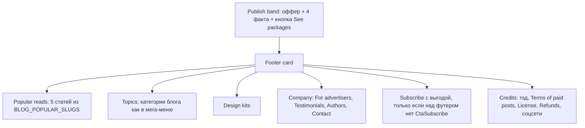

# Футер: глубина просмотра и лиды на платный паблишинг

Дата аудита: 2026-11-08. Файл футера: `components/layout/SiteFooter.tsx`, стили `.footer*` в `public/css/setproduct.webflow.shared.css` (около строк 3854–3970 и мобильный блок около 6152).

## 1. Как футер устроен сейчас

Структура (одна секция `section-padding bottom-80`, без верхнего отступа):

1. Лиловая карточка `.footer-card` (`#ebe0ff`, radius 24px).
   - Три колонки ссылок: Tutorials (7 категорий блога), Design kits (7 разделов), Information (Write for us, Testimonials, License, Refund policy, Contact us).
   - Справа логотип и форма подписки «Subscribe to Setproduct».
2. Строка под карточкой: «© All rights reserved. Setproduct.com» и 6 иконок соцсетей.

На мобильном карточка разворачивается `column-reverse`: сначала форма подписки, потом все 19 ссылок одной колонкой.

## 2. Что мешает метрикам (находки)

### Глубина просмотра и время на сайте

- **В футере нет ни одной статьи.** Читатель, дочитавший пост до низа, видит только категории и разделы магазина. Сильнейший повод кликнуть дальше (конкретный популярный пост) отсутствует, хотя список популярных уже есть: `lib/blog/popular.ts` (`BLOG_POPULAR_SLUGS`, по данным GA4).
- **Две подписки подряд.** На страницах `CategoryPage`, `BundlePage`, `DashboardsPage`, `BlogListingPage`, `FreebiesListingPage`, `FreebieDetailPage`, `TemplateDetailPage` и на статьях не из «паблишинг»-категорий над футером стоит `CtaSubscribe`, а внутри футера ещё одна такая же форма. Второе одинаковое предложение воспринимается как шум и съедает место, где могла быть навигация.
- **Категории в футере расходятся с меню.** В футере есть «Inspiration» и «Tools», но нет «SEO» и «Design & code», которые есть в мега-меню (`NAV_BLOG_CATEGORIES`). SEO при этом одна из трёх категорий, чьи читатели являются покупателями паблишинга.
- **Ссылки футера сделаны через `<a>`, а не `next/link`.** Каждый клик перезагружает страницу целиком: медленнее переход, выше шанс, что человек закроет вкладку.
- **Ссылки на категории ведут на `/blog?category=...`.** Для поисковика это одна страница с параметром, а не отдельные тематические хабы, поэтому категории почти не получают собственного органического трафика.
- **На мобильном 19 ссылок одной колонкой без группировки.** CSS уже содержит иконку-стрелку `.footer-link-dropdown-icon` под аккордеон, но она скрыта, а аккордеона нет. Получается длинная простыня, которую пролистывают не читая.
- **Нет ссылок на авторов** (`/authors/[slug]`), поиск (`/search`) и Resources как раздел знаний.

### Лиды на publish.setproduct.com

- **В футере оффер спрятан** третьей колонкой, одной строкой «Write for us». Эта формулировка читается как «ищем авторов бесплатно» или «вакансия», а не как платное размещение продукта.
- **Пять разных названий одного оффера** по сайту: «Get featured» (шапка), «Advertise with us» и «Publish on our blog» (меню Company), «Publish with us» (главная), «See packages» (статья), «Write for us» (футер). Человек не понимает, что это одна и та же услуга.
- **Сильные факты не показаны в футере**, хотя они уже собраны в одном месте (`PUBLISH_OFFER` в `lib/publish.ts`): 17,000 читателей в месяц, DR 42, публикация за 24 часа, от $288.
- **Нет социального доказательства**: ни одного примера уже опубликованных платных статей и ни одного логотипа бренда-клиента.
- **Ссылки на условия** (`/legal/terms-of-paid-posts`) в футере нет, хотя для покупателя это аргумент доверия.

### Мелкие проблемы качества

- «Contact us» сделан как `<a href="#">` с `onClick`: по правилам проекта это должна быть `<button type="button">`.
- В копирайте нет года, иконка Twitter старая (сейчас X).
- Заголовок формы «Subscribe to Setproduct» не говорит, что человек получит взамен email. В `CtaSubscribe` выгода уже сформулирована («Once per week… new releases, free resources and blog posts»).

## 3. Предлагаемая новая структура футера

### 3.1. Publish band (новый верхний ярус футера)

Узкая полоса над карточкой ссылок, на белом фоне с тонкой рамкой (чтобы не сливаться ни с карточкой футера, ни с секцией выше):

- Eyebrow: `For founders and marketers`
- Заголовок: `Tell 17,000 readers about your product`
- Четыре факта-«чипа» из `PUBLISH_OFFER`: `Live in 24 hours`, `Dofollow link, DR 42`, `17,000 readers a month`, `From $288`
- Кнопка L primary `See packages` со стрелкой, `getPublishLinkProps("footer")`
- Вторичная текстовая ссылка `Read the terms` на `/legal/terms-of-paid-posts`

Полоса не показывается на страницах, где над футером уже стоит `BlogInlineCta` с паблишинг-оффером, чтобы не было двух одинаковых призывов подряд. Механика: проп `hidePublish` у `SiteFooter`.

### 3.2. Колонка «Popular reads»

Пять статей из `BLOG_POPULAR_SLUGS` (заголовок и время чтения, без картинок, чтобы футер не потяжелел). Данные берутся при сборке, так же как `navData` для мега-меню. Внизу ссылка `All articles` на `/blog`.

### 3.3. Колонка «Topics»

Тот же список, что в `NAV_BLOG_CATEGORIES`: UI design, Startups & SaaS, Growth hacking, SEO, Design & code, Technology, Research. Один источник правды вместо двух расходящихся списков.

### 3.4. Колонка «Company»

`For advertisers` (ведёт на publish.setproduct.com, заменяет «Write for us»), `Testimonials`, `Authors`, `Search`, `Contact us` (кнопка, а не `<a href="#">`).

### 3.5. Подписка

- Заголовок с выгодой: `Weekly design and growth notes`, подпись `New posts, free resources and releases. One email a week.`
- Не рендерится, если на странице над футером уже стоит `CtaSubscribe` (проп `hideSubscribe`). Освободившееся место отдаётся колонке Popular reads.

### 3.6. Credits

`© 2026 Setproduct` (год вычисляется), ссылки `License`, `Refund policy`, `Terms of paid posts`, обновлённые иконки соцсетей (X вместо Twitter).

### 3.7. Мобильная версия

Колонки ссылок становятся аккордеоном (используется уже существующая в CSS стрелка `.footer-link-dropdown-icon`), Publish band и Popular reads всегда раскрыты и стоят первыми.

## 4. Единое название оффера по всему сайту

Предлагаемая пара формулировок, которая повторяется везде:

| Место | Сейчас | Предлагаю |
|---|---|---|
| Кнопка в шапке | Get featured | Publish your product |
| Меню Company, заголовок карточки | Publish on our blog | Publish your product |
| Меню Company, кнопка | Advertise with us | See packages |
| Главная, hero | Publish with us | Publish your product |
| Сайдбар статьи | See packages | See packages (без изменений) |
| Нижний CTA статьи | See packages | See packages (без изменений) |
| Футер | Write for us | For advertisers + Publish band с кнопкой See packages |

Логика: «Publish your product» отвечает на вопрос «что это», «See packages» отвечает на вопрос «что дальше». Финальные формулировки нужно согласовать с автором (см. вопросы ниже).

## 5. Измерение

- Добавить в `PublishLocation` новое значение `footer_band`, чтобы клики с новой полосы не смешивались со старой ссылкой `footer`.
- Новое GA4-событие `footer_click` с параметрами `group` (popular, topics, kits, company) и `href`, по аналогии с `lib/nav/analytics.ts`.
- Метрики для сравнения до и после: views per user, average engagement time, `publish_cta_click` с `location = footer_band`, доля сессий с переходом из футера.

## 6. Что сознательно не входит в этот этап

- Перевод `/blog?category=` на статические хабы `/blog/category/[slug]`. Это отдельная SEO-задача с редиректами и sitemap.
- Блок логотипов клиентов паблишинга: нужны реальные логотипы и разрешение брендов.
- Изменения на стороне publish.setproduct.com.
