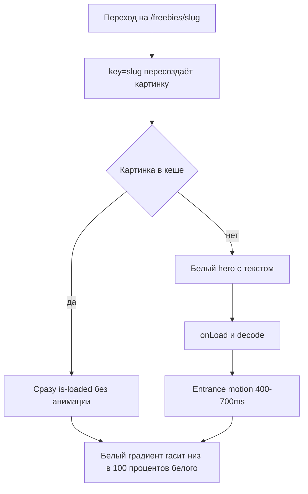

# Hero страниц /freebies/[slug]: светлая тема и плавное появление обложки

## Что сейчас

- Разметка hero: [`FreebieDetailPage`](../components/pages/FreebieDetailPage.tsx:61). Секция `section is-height-100vh`, поверх неё фон `section-bg-image-wr` с `` и `section-bg-gradient`.
- Градиент: [`.section-bg-gradient`](../public/css/setproduct.webflow.shared.css:5270) = `linear-gradient(#2223, #2229 75%)`, тёмная вуаль от 20% до 60%.
- Белый текст задаёт [`.template_hero-sect`](../public/css/setproduct.webflow.shared.css:5276) через `color: var(--white)`.
- Кнопка `button secondary`, она рассчитана на тёмный фон.

**Важно.** Эти же классы используют страницы шаблонов: [`TemplateDetailPage`](../components/pages/TemplateDetailPage.tsx:53), [`GenericTemplatePage`](../components/pages/templates/GenericTemplatePage.tsx:124), [`ChartsTemplatePage`](../components/pages/templates/ChartsTemplatePage.tsx:58), [`TemplateHero`](../components/sections/TemplateHero.tsx:23). Поэтому общие классы не трогаем. Светлую тему вводим модификатором `is-light`, который ставится только на /freebies.

**Причина «перескоков» при переходах.** Next.js при переходе `/freebies/a` → `/freebies/b` не пересоздаёт компонент страницы, он только меняет пропсы. У того же `` меняется `src`, и браузер держит на экране старую картинку, пока не загрузится новая. Получается, что заголовок уже новый, а обложка ещё от прошлого ресурса, и потом она резко меняется. Лечится это `key={item.slug}`: картинка создаётся заново, и мы управляем её появлением.

---

## Шаг 1. Светлая тема: четыре варианта градиента

Общее для всех вариантов: текст `var(--black)`, описание чуть приглушено (`#19181bb3`). Главная кнопка становится primary (`button` без модификатора, фиолетовая), потому что на белом это самый заметный и брендовый элемент. Низ hero обязательно заканчивается чистым `#fff`, тогда граница с белой страницей ниже пропадает.

Градиенты пишутся с 5–7 промежуточными точками («easing gradient»). Обычный двухточечный `linear-gradient` к белому даёт заметную полосу (banding) и «грязно-серую» середину.

### Вариант A. «Туман снизу» (рекомендую)
Сверху картинка видна почти полностью, к низу плавно растворяется в белом. Текст стоит на уже белом участке.
```css
.section-bg-gradient.is-light {
  background-image: linear-gradient(180deg,
    #fff0 0%, #ffffff14 25%, #ffffff59 45%,
    #ffffffb3 60%, #ffffffeb 75%, #fff 88%);
}
```
Плюсы: обложка остаётся героем первого экрана, переход к контенту бесшовный. Минусы: на высоких обложках с мелким текстом верх может спорить с хедером, это проверяем на 3–4 ресурсах.

### Вариант B. «Вуаль + туман»
Вся картинка под ровной белой вуалью 40–50%, снизу дополнительно уходит в 100% белый. Обложка читается как фактура, а не как иллюстрация.
```css
.section-bg-gradient.is-light {
  background-image:
    linear-gradient(180deg, #fff0 40%, #ffffffcc 70%, #fff 90%),
    linear-gradient(#ffffff80, #ffffff80);
}
```
Плюсы: самый спокойный, текст читается на любой обложке. Минусы: картинка выглядит «выцветшей», продукт продаёт хуже.

### Вариант C. «Туман слева»
Текст слева на белом, обложка открыта справа. Горизонтальный градиент складывается с вертикальным, чтобы низ всё равно уходил в белый.
```css
.section-bg-gradient.is-light {
  background-image:
    linear-gradient(90deg, #fff 0%, #ffffffe6 30%, #fff0 65%),
    linear-gradient(180deg, #fff0 60%, #fff 95%);
}
```
На ≤991px переключается на вариант A, потому что текст там занимает всю ширину. Плюсы: обложка видна лучше всего. Минусы: правая часть многих обложек может оказаться пустой, нужно смотреть по ресурсам.

### Вариант D. «Фирменный оттенок»
Как A, но середина градиента идёт через `--light-purple` (`#fbfaff`) и только к самому низу становится `#fff`. Даёт едва заметный фиолетовый подтон и связывает hero с брендом.
```css
.section-bg-gradient.is-light {
  background-image: linear-gradient(180deg,
    #fbfaff00 0%, #fbfaff59 40%, #fbfaffd9 65%, #fff 88%);
}
```

### Что меняется в разметке (для любого варианта)
- `section is-height-100vh` → добавить модификатор `is-light-hero` (или `is-light` на `template_hero-sect` и `section-bg-gradient`).
- CSS-правила добавить рядом с [`.section-bg-gradient`](../public/css/setproduct.webflow.shared.css:5270), не меняя исходные.
- Кнопка `button secondary` → `button`.
- Проверить хлебные кр��шки сразу под hero: на белом они должны стоять без «ступеньки».

---

## Шаг 2. Entrance motion для обложки: четыре варианта

Общее для всех вариантов:
1. Новый маленький компонент `FreebieHeroImage` (клиентский, `useState` + `onLoad`). Держит `isLoaded` и ставит класс `is-loaded` на ``.
2. `key={item.slug}` на компоненте. Картинка пересоздаётся при каждом переходе, старая обложка не висит под новым заголовком.
3. **Картинка из кеша не анимируется.** Если `img.complete` уже `true` при монтировании, класс `is-loaded` ставится сразу, без перехода. Иначе при возврате назад пользователь каждый раз смотрел бы на повторную анимацию.
4. Перед показом вызывается `img.decode()`: картинка проявляется уже раскодированной, без «прорисовки полосами».
5. Текст hero (H1, описание, кнопка) **не анимируется** и виден сразу. Ждать обложку ради чтения заголовка нельзя.
6. `prefers-reduced-motion: reduce` → только короткая смена прозрачности (150ms), без масштаба и размытия.
7. Без JS (SSR-HTML до гидрации): картинка должна быть видна. Скрытие `opacity: 0` включается только когда на `<html>` есть класс `js`, либо через `<noscript>`-стиль.
8. Фон под картинкой во время ожидания `#fff`. С вариантами шага 1 это даёт «пустой белый hero», а не чёрную дыру.
9. Hero-картинка является LCP (крупнейший элемент первого экрана). Анимация не должна начинаться с задержкой, только сразу после `onLoad`. После выкатки сверить LCP в PageSpeed до и после.

### Вариант 1. Простое проявление
`opacity: 0 → 1`, 400ms, `ease-out`. Минимум риска и кода.

### Вариант 2. «Оседание» (рекомендую)
`opacity: 0 → 1` + `transform: scale(1.04) → scale(1)`, 700ms, `cubic-bezier(.22,1,.36,1)` (та же кривая, что в `hover-lift`). Обложка будто опускается на место. Дорогое ощущение, при этом анимируются только `opacity` и `transform`, видеокарта справляется без рывков.

### Вариант 3. Blur-up
Сначала размытое крошечное превью (из `thumbImage`/сгенерированного 32px webp), поверх него проявляется полная картинка с `filter: blur(12px) → 0`. Пользователь сразу видит цветовое пятно обложки. Минусы: нужно генерировать превью для всех ресурсов, `filter: blur` на полноэкранной картинке тяжелее для слабых устройств.

### Вариант 4. «Картинка выходит из тумана»
Развитие идеи светлого градиента. Пока обложка грузится, белый градиент закрывает hero на 100%. После загрузки граница тумана «отъезжает» вниз до своего штатного положения, открывая картинку сверху вниз. Реализуется через `mask-image` на картинке с анимируемой CSS-переменной (`@property --reveal`) или через сдвиг `background-position` у слоя градиента увеличенного размера. Самый «авторский» вариант, логично связан с шагом 1. Минусы: сложнее, чем 1–2; `@property` нет в старых Safari (там будет вариант 1 как фолбэк).

---

## Как это связано



## Проверка
- Ширины 1440 / 1024 / 768 / 390.
- 4–5 ресурсов с разными обложками: светлая, тёмная, пёстрая, с текстом в верхней части.
- Быстрые переходы по карточкам из [`FreebiesShowcase`](../components/sections/FreebiesShowcase.tsx) и кнопка «назад»: старая обложка не должна мелькать.
- DevTools → Network → Slow 4G: hero белый с текстом, затем мягкое появление.
- `prefers-reduced-motion` в DevTools → Rendering.
- `npm run lint`.
- Страницы шаблонов (`/templates/*`) не изменились.
