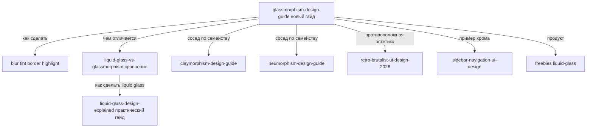

# Бриф: отдельный гайд по glassmorphism (24.11.2026)

**Кому:** агенту в режиме Code. Ниже всё, что нужно, чтобы выполнить задачу без дополнительных вопросов автору.
**Статус:** бриф на согласование. Ничего не написано, файлы не созданы.
**Связанный план:** продолжает работу по разделу UI guides (коммиты `c5553fb7`, `0d205669`).

---

## 1. Задача в одном абзаце

Написать большую статью-гайд по glassmorphism как самостоятельный материал, потому что сейчас метка «Glassmorphism» в индексе гайдов ведёт на сравнительный пост [`liquid-glass-vs-glassmorphism`](../content/blog/liquid-glass-vs-glassmorphism.mdx), а отдельного гайда нет. После публикации поставить перекрёстные ссылки на новый гайд во всех постах и данных проекта, где тема glassmorphism обсуждается по существу, и переименовать метку сравнительного поста в индексе.

Данные Search Console за три месяца добавляют к задаче второе требование, без которого первый пункт теряет смысл. Слово `glassmorphism` приносит странице 52% показов и 4.9% кликов, а сравнение приносит 9.2% показов и 64.3% кликов. Поэтому новый гайд пишется не «в дополнение к сравнению», а как **целевая страница под head-термин**: заголовок держит слово впереди, в структуре есть раздел про типы, в FAQ стоят четыре вопроса под самые крупные непокрытые интенты. Подробные цифры в разделе 2.2а.

---

## 2. Что уже есть, факты на которых стоит бриф

### 2.1. Кластер глубинных стилей

| Slug | Заголовок | Дата | Роль в кластере |
|---|---|---|---|
| `liquid-glass-design-explained-a-practical-guide` | Liquid glass design explained, a practical guide | 2026-01-14 | Практический гайд по Apple-материалу, 345 строк |
| `liquid-glass-vs-glassmorphism` | Glassmorphism, neumorphism, liquid glass, what to use in 2026 | 2026-06-09 | Карта пяти стилей, 253 строки, лучший CTR категории |
| `claymorphism-design-guide` | Claymorphism UI design with a copy-paste CSS recipe | 2026-06-25 | Практический гайд с CSS-рецептом, 356 строк |
| `neumorphism-design-guide` | How neumorphism UI design works and where it quietly fails | 2026-06-26 | Практический гайд с CSS-рецептом, 368 строк |
| `retro-brutalist-ui-design-2026` | Retro, brutalist and Y2K UI design trends that work in 2026 | 2026-06-05 | Обзор трёх эстетик |

Ключевой вывод: у neumorphism и claymorphism есть свои практические гайды с CSS-рецептом, а у glassmorphism нет. Новый пост закрывает ровно эту дыру и ставит glassmorphism в один ряд с ними, что удобно и читателю, и поисковику.

### 2.2. Метрики, которые надо перебить

Цифры ниже взяты из [`.ai/seo-benchmarks.md`](../.ai/seo-benchmarks.md) и относятся к окну, закрытому 2026-10-06. Они не противоречат свежей выгрузке в разделе 2.2а, но она полнее: там разбор по запросам, устройствам, странам и месяцам. Опираться при работе на 2.2а, 2.2 держать как планку категории.

| Метрика | Значение | Источник |
|---|---|---|
| Лучший CTR в категории Design Trends | 1.81% | `liquid-glass-vs-glassmorphism`, окно 3 мес к 2026-10-06 |
| Второй CTR | 1.63% | `claymorphism-design-guide` |
| Просмотры в GA4 | 2 373 | `liquid-glass-vs-glassmorphism`, 3 мес к 2026-10-09 |
| Цель новой статьи | 1.8%+ | планка категории |

### 2.2а. Свежая выгрузка GSC за 3 месяца (24.11.2026)

Источник: [`plans/gsc-november/`](gsc-november) — три архива, распакованы в `plans/gsc-november/extracted/`. Выгрузка `c` — единственная страница [`liquid-glass-vs-glassmorphism`](../content/blog/liquid-glass-vs-glassmorphism.mdx) с фильтром `+glass`, 387 строк запросов. Выгрузка `a` — весь сайт (1000 страниц, 1002 запроса). `a` и `b` идентичны. Окно **23.08.2026 — 21.11.2026**.

**Общая картина по странице (выгрузка `c`), она и есть весь кластер:**

| Метрика | Значение |
|---|---|
| Клики | 143 |
| Показы | 21 335 |
| CTR | 0.67% |
| Средняя позиция | 5.71 |

**Главное открытие: показами владеет одно слово, кликами — сравнение.**

Все 391 строка выгрузки, сверено awk по файлу `queries.csv`, группы не пересекаются:

| Группа запросов | Строк | Показы | Клики | CTR | Доля показов | Доля кликов |
|---|---|---|---|---|---|---|
| `glassmorphism` (ровно одно слово) | 1 | **11 057** | 7 | 0.06% | **51.8%** | 4.9% |
| `glassmorphism ui…` | 15 | 2 127 | 5 | 0.24% | 10.0% | 3.5% |
| vs-запросы | 20 | 1 896 | **88** | **4.64%** | 8.9% | **61.5%** |
| написание через пробел (`glass morphism…`) | 14 | 1 682 | 3 | 0.18% | 7.9% | 2.1% |
| `glassmorphism design…` | 6 | 58 | 1 | 1.72% | 0.3% | 0.7% |
| всё остальное | 335 | 4 506 | 39 | 0.87% | 21.1% | 27.3% |

Расшифровка первой строки: запрос `glassmorphism` в одиночку даёт 11 057 показов при позиции 6.23 и **7 кликов, CTR 0.06%**. Позиция 6 это вторая страница выдачи. Страница уже стоит там по главному слову темы и не получает кликов, потому что title отвечает на вопрос «что выбрать», а человек ввёл «glassmorphism» и хочет узнать, что это и как это сделать.

Сравнение работает отлично: `glassmorphism vs liquid glass` — 38 кликов при CTR 10.61% и позиции 1.44 (первая строка выдачи). `liquid glass vs glassmorphism` — 24 клика, 8.39%, позиция 1.57. `glassmorphism vs neumorphism` — 13 кликов, 3.88%.

**Третья находка, важнее первых двух.** Запрос `glassmorphism 2026` даёт 44 показа и **7 кликов при CTR 15.91% и позиции 1.43**. Это лучший CTR во всей выгрузке, в 265 раз выше CTR по головному слову. Читатель с годом в запросе готов кликать, ему нужно только увидеть год в сниппете. Отсюда условие 2 в разделе 4.1: год в title обязателен.

**Вывод, который меняет бриф.** Проблема не «нет контента», а «контент отвечает не на тот вопрос, который даёт 52% показов». Новый гайд нужен не как дополнение к сравнению, а как **целевая страница под head-термин**, а сравнение остаётся целевой страницей под vs-запросы.

**Интентные группы, которые почти не покрыты (сверено awk, группы пересекаются, цифры не суммируются):**

| Интент | Строк | Показы | Клики | Лучший пример |
|---|---|---|---|---|
| types / kinds / variations / different | 10 | 131 | 0 | `types of glassmorphism`, 47 показов, позиция 5.17 |
| what is / meaning / definition | 9 | 52 | 0 | ноль кликов на всю группу |
| ios / apple / vision / iphone | 19 | 128 | 0 | ноль кликов на всю группу |
| alternative / instead / similar | 5 | 62 | 0 | `glassmorphism alternative`, позиция **2.45** |
| subtle / minimal | 3 | 51 | 0 | `subtle glassmorphism`, 43 показа, позиция 3.98 |
| css / how to / tutorial / figma | 5 | 5 | 0 | интент есть, объёма нет |
| `is … outdated` | 1 | 24 | 0 | позиция 5.17 |

Отдельно про год: группа `outdated / 2026` даёт 83 показа и **7 кликов**, но клики приходят только от запросов с годом. Запрос `is glassmorphism outdated` (24 показа, позиция 5.17) не дал ни одного клика. То есть людей останавливает не ответ, а отсутствие года в сниппете.

**Динамика внутри окна, важна для срочности:**

| Месяц | Клики | Показы | CTR |
|---|---|---|---|
| август 2026 (неполный) | 21 | 485 | 4.33% |
| сентябрь 2026 | 59 | 2 041 | 2.89% |
| октябрь 2026 | 41 | 4 225 | 0.97% |
| ноябрь 2026 (до 21-го) | 22 | 14 584 | 0.15% |

Показы выросли в 30 раз с августа по ноябрь, клики не выросли вообще. Это классический сигнал «сниппет не убеждает».

Но ежедневная кривая из `diagram.csv` показывает, что рост не равен улучшению, и это важнее самой таблицы. До 25 октября страница держалась на 80-100 показах в день при позиции 4.4-5.0. С 26 октября показа начали удваиваться каждые несколько дней: 26.10 — 253, 05.11 — 840, 10.11 — 941, 11.11 — 1 047, 17.11 — 978. Одновременно позиция ушла с 4.5 на **6.6-7.5** к середине ноября.

Читается так: страница стала попадать в выдачу по гораздо более широкому набору запросов, но на худших позициях. То есть Google расширил семантику, а не поднял страницу. Отсюда практический вывод для брифа: надеяться, что новый пост сразу встанет на 3-4 позицию, нельзя. В разделе 9 (фаза 8) поэтому и стоит порог «провал при позиции 8 и ниже», а не «сразу первая страница».

**Устройства и страны:**

| Устройство | Клики | Показы | CTR |
|---|---|---|---|
| ПК | 117 | 18 973 | 0.62% |
| Мобильный | 24 | 2 313 | 1.04% |
| Планшет | 2 | 49 | 4.08% |

Мобильных всего 10.8% показов, но CTR у них выше в 1.7 раза при худшей позиции (6.34 против 5.64). Это довод за то, чтобы первый экран и рецепт читались на телефоне.

Страны, с точными цифрами из `countries.csv`:

| Страна | Клики | Показы | CTR | Позиция |
|---|---|---|---|---|
| Индия | 18 | 2 609 | 0.69% | 5.31 |
| США | 19 | 1 900 | 1.00% | 5.87 |
| Германия | 9 | 1 107 | 0.81% | 5.59 |
| Индонезия | 7 | 1 167 | 0.60% | 6.02 |
| Великобритания | 4 | 616 | 0.65% | 5.55 |
| Канада | 7 | 513 | 1.36% | 5.20 |
| Иран | 6 | 312 | 1.92% | 4.84 |
| Малайзия | 5 | 275 | 1.82% | 5.33 |

Аудитория глобальная и англоязычная, но индийская и юго-восточная доля по показам больше, чем американская. Это довод за раздел про производительность на слабых устройствах: Индия, Индонезия и Малайзия вместе дают 4 051 показ, больше чем США и Канада вместе взятые.

**SERP-фичи:** в разделе «Вид в поиске» единственная строка — «Переведенные результаты поиска», 15 показов. Изображений и расширенных сниппетов нет. Значит картинки и FAQ-разметка пока не работают на эту страницу, и новый пост может занять эту нишу.

**Кластер целиком, весь сайт за 3 месяца (выгрузка `a`, 15 148 кликов и 1 659 754 показа, CTR 0.91%):**

| Страница | Клики | Показы | CTR | Позиция |
|---|---|---|---|---|
| `liquid-glass-vs-glassmorphism` | 554 | 50 551 | 1.10% | 5.18 |
| `claymorphism-design-guide` | 455 | 33 480 | 1.36% | **3.59** |
| `neumorphism-design-guide` | 322 | 24 873 | 1.29% | 6.04 |
| `freebies/liquid-glass` | 200 | 3 182 | **6.29%** | 6.88 |
| `liquid-glass-design-explained-a-practical-guide` | 194 | 20 732 | 0.94% | 6.24 |
| `retro-brutalist-ui-design-2026` | 169 | 9 960 | **1.70%** | 5.68 |

Два эталона, на которые надо целиться, и они разные:

**`claymorphism-design-guide`** — лучшая позиция кластера (3.59) при 455 кликах. Практический гайд с CSS-рецептом, построенный ровно по модели «отдельный пост под head-термин», уже стоит выше всех. Это подтверждает выбор формы для нового поста. Разобран подробно в 2.2б.

**`retro-brutalist-ui-design-2026`** — лучший CTR кластера (1.70%) при худшей позиции (5.68). У него в title стоит год, и он обгоняет по кликабельности и сравнительный пост, и оба morphism-гайда. Это второе доказательство того, что год в title решает, и он же объясняет находку про `glassmorphism 2026` с CTR 15.91%.

`freebies/liquid-glass` с CTR 6.29% в расчёт не берём: это страница бесплатной библиотеки, другой интент, другая длина и другая выдача.

### 2.2б. Разбор эталона `claymorphism` изнутри (выгрузка `d`, 24.11.2026)

Отдельная выгрузка только по [`claymorphism-design-guide`](../content/blog/claymorphism-design-guide.mdx), 604 строки запросов, с колонками сравнения периодов. Это ключевые данные всего брифа, потому что эталон разобран не снаружи, а по запросам.

**Заголовок страницы обманывает.** Общий CTR 1.36% выглядит прилично, но разложен он неравномерно:

| Группа запросов на страницу `claymorphism-design-guide` | Показы | Клики | CTR |
|---|---|---|---|
| головное слово (`claymorphism`, `clay morphism`) | 14 278 | 99 | **0.69%** |
| голова + `ui` / `ux` | 3 872 | 86 | **2.22%** |
| всё остальное (примеры, сайты, дашборды, `what is`, vs) | 2 690 | 39 | 1.45% |
| итого по странице в этой выгрузке | 20 840 | 224 | 1.07% |

Позиция головного слова 2.72, то есть **первая страница выдачи**, и всё равно CTR 0.69%. Причина в том, что запрос `claymorphism` человек вводит, когда ищет галерею примеров, а не объяснение. Сниппет с описанием техники его не цепляет. А `claymorphism ui` (2 440 показов, 52 клика) и `claymorphism ui design` (772 показа, 20 кликов) цепляет отлично, там CTR 2.13% и 2.59%.

**Что из этого следует для нового гайда, четыре вывода:**

1. **Позиция 2-3 по головному слову не даёт CTR выше 1%.** Значит нельзя планировать «выйдем на первое место и соберём клики». У эталона первое место уже есть, и кликов всё равно 99 на 14 278 показов.
2. **Слово `ui` в title обязательно.** Группа с `ui` даёт CTR в 3 раза выше при худшей позиции. В моём title (`Glassmorphism UI design in 2026, types and the CSS that holds up`) оно есть, и это не случайность, а вывод из данных эталона.
3. **Интент примеров сильнее интента объяснения.** У `claymorphism` группа `examples` даёт 19 кликов на 819 показов (2.32%), а `what is` — 3 клика на 1 466 показов (0.20%). Для glassmorphism то же самое: группа `examples` в кластере даёт 19 кликов при CTR 2.32%. Значит в структуре нужен блок с примерами, а не только теория.
4. **`ui kit` и `figma` конвертят рекордно.** `claymorphism ui kit` — 4 клика на 29 показов, CTR 13.8%. `neumorphism ui kit` — 1 клик на 6 показов. Объёма мало, но конверсия в 20 раз выше средней. Это довод за продуктовый CTA в разделе про токены.

**Сравнение периодов по всей странице:** 455 кликов сейчас против 346 раньше, 33 480 показов против 21 588, позиция 3.59 против 5.67. То есть страница выросла по всем трём метрикам одновременно, а CTR при этом упал с 1.60% до 1.36%. Механика та же, что у сравнения: рост показов идёт за счёт более широких запросов на худших позициях, и средний CTR размывается.

### 2.2в. Что показало сравнение периодов по всему кластеру (выгрузка `e`)

69 страниц, 1 394 запроса, две колонки периодов. Главное в таблице:

| Страница | Клики сейчас / раньше | Показы сейчас / раньше | Позиция сейчас / раньше |
|---|---|---|---|
| `liquid-glass-vs-glassmorphism` | 554 / 371 | 50 551 / 32 457 | **5.18 / 9.52** |
| `claymorphism-design-guide` | 455 / 346 | 33 480 / 21 588 | **3.59 / 5.67** |
| `neumorphism-design-guide` | 322 / 143 | 24 873 / 10 678 | **6.04 / 8.84** |
| `liquid-glass-design-explained-a-practical-guide` | 194 / 280 | 20 732 / 13 767 | **6.24 / 10.1** |
| `freebies/liquid-glass` | 200 / 0 | 3 182 / 0 | 6.88 / 0 |

Весь кластер поднялся по позициям на 2-4 пункта за три месяца. Это происходит на фоне общей перестройки выдачи, а не только наших правок. Практический смысл: пороги в фазе замера (раздел 9) надо ставить относительно этой динамики, а не абсолютом.

Одна страница выпадает: у `liquid-glass-design-explained-a-practical-guide` клики **упали** с 280 до 194, хотя позиция улучшилась с 10.1 до 6.24. Это тревожный сигнал, но он про другой пост, не про glassmorphism. В брифе помечено как наблюдение, задача не ставится.

**Мобильные по кластеру:** 26 732 показа, 126 кликов, CTR 0.47% при позиции 5.59; ПК — 66 233 показа, 465 кликов, CTR 0.70% при позиции 5.38. В прошлом периоде мобильный CTR был 0.88%. То есть мобильный CTR падает быстрее десктопного, и это ещё один довод за то, чтобы первый экран нового поста читался на телефоне без горизонтального скролла.

**SERP-фичи по кластеру:** только «Переведенные результаты поиска», 1 893 показа и 38 кликов (CTR 2.01%). Ни изображений, ни FAQ, ни рейтингов. Ниша пустая.

### 2.2г. Четыре мёртвых URL получают показы в кластере

Проверил существование каждой `/blog/` страницы из выгрузки `e` по файловой системе. Четыре URL **не существуют** как посты, но получают показы:

| URL | Клики | Показы | Позиция |
|---|---|---|---|
| `/blog/glassmorphism-vs-neumorphism-vs-liquid-glass` | 0 | 2 | **1** |
| `/blog/glassmorphism-vs-neumorphism-vs-liquid-glass-2026` | 0 | 2 | **1** |
| `/blog/liquid-glass-vs-liquid-glass-vs-glassmorphism` | 0 | 1 | **1** |
| `/blog/liquid-glass-designed-explained-a-practical-guide` | 0 | 1 | 3 |

Объёма почти нет, но позиции показательны: Google держит эти адреса с первой позиции, а отдают они 404. Два из них выглядят как варианты названия будущего поста про сравнение трёх стилей.

Что это значит для задачи. Если новый гайд назвать `glassmorphism-vs-neumorphism-vs-liquid-glass`, он унаследует позицию 1 по этим запросам. Но это **сравнение**, а не гайд, и такой slug противоречит разграничению из 5.1. Правильное решение: не использовать эти имена под новый пост, а завести на них 301-редиректы на `liquid-glass-vs-glassmorphism` в [`next.config.js`](../next.config.js). Это отдельная мелкая правка, вынесена в 13.3.

### 2.2д. `glassmorphism types` уже на первой позиции и не кликается

Самое неудобное открытие этой выгрузки:

| Запрос | Показы | Клики | Позиция |
|---|---|---|---|
| `glassmorphism types` | 7 | 0 | **1** |
| `types of morphism` | 2 | 0 | **1** |
| `types of ui morphism` | 4 | 0 | 1.75 |
| `types` | 2 | 0 | 5 |
| `types of glassmorphism` | 54 | 0 | 5.8 |
| `liquid glass types` | 49 | 0 | 3.82 |

По `glassmorphism types` сайт **уже первый в выдаче** и получает ноль кликов на 7 показах. На 54 показах по `types of glassmorphism` — тоже ноль при позиции 5.8.

Это меняет трактовку. Раньше я писал «ниша свободна» про типы. Точнее так: ниша не свободна, страница уже там, но её сниппет не обещает типы. Человек видит заголовок про сравнение стилей и не кликает, потому что искал разбор видов glassmorphism.

Отсюда слово `types` в title не «приятное дополнение», а исправление конкретного провала: единственный запрос, где мы уже первые, и он не конвертирует из-за несоответствия заголовка. Объём маленький (7 показов), но принцип тот же, что с годом: сниппет должен совпадать с формулировкой запроса.

**Вторая находка, не про новый пост, но важная.** В выгрузке `a` 347 строк с якорем `#`: суммарно 177 330 показов и **2 клика**. По кластеру в выгрузке `e` 41 строка с хешем: 36 583 показа сейчас и 9 470 раньше, кликов ноль в обоих периодах. Хуже всего `#a-13-year-detour-from-skeuomorphism-to-liquid-glass` (3 633 показа) и `#claymorphismmd-for-ai-agents` (3 598). Это совпадает с наблюдением из [`.ai/seo-benchmarks.md`](../.ai/seo-benchmarks.md). Разобрано в 13.1.

### 2.3. Текущая перелинковка кластера glass

Ссылки на сравнительный пост стоят в восьми постах блога и в трёх файлах данных. Посты: `bento-grid-layout-design-guide`, `retro-brutalist-ui-design-2026`, `claymorphism-design-guide`, `how-to-design-a-ui-kit-foundation`, `slider-ui-design`, `depth-in-ios-design`, `liquid-glass-design-explained-a-practical-guide`, `how-to-get-better-at-ui-design-by-studying-ai-generated-examples`. Данные: `data/ui-guides.ts`, `data/freebies-listing.ts`, `data/publish-showcase.ts`. Четвёртый файл `data/inspiration.ts` слово glassmorphism содержит, но это заголовки карточек из галереи, а не ссылки, его не трогаем. Это и есть карта для фазы перелинковки, см. раздел 7.

### 2.4. Ограничения проекта, которые нельзя нарушать

Из [`AGENTS.md`](../AGENTS.md) и трёх скиллов (`.roo/skills/`):

- sentence case везде, включая H1, H2, H3, alt, frontmatter;
- двоеточие в `title` и `metaTitle` запрещено, в H2/H3 не использовать;
- em-dash (—) максимум 2 на файл целиком, включая frontmatter и FAQ;
- трихолоны максимум 2 на файл;
- запрещены конструкции «Not X, but Y», «It's not just X, it's Y», «Whether you're X or Y», «From X to Y» как шаблон;
- банклише из скилла блога удалять по факту обнаружения;
- blockquote (`>`) внутри статьи запрещён, CSS ломает вёрстку, вместо этого inline-код или обычный абзац;
- стрелочные списки `→` разделять пустой строкой, иначе MDX склеит строки в один абзац;
- сырой `<script type="application/ld+json">` в теле MDX запрещён, FAQ-схема берётся из поля `faq`;
- узкие таблицы на 2-3 колонки оборачивать в `<div class="blog-fit-table">` с пустыми строками до и после;
- любая замена картинки — это новое имя файла, перезапись по тому же пути запрещена;
- файлы в `content/blog/` длиннее 500 строк правятся только через `apply_diff`, не через полную перезапись.

---

## 3. Целевая аудитория и обещание

**Точка А.** Продакт-дизайнер видел сотни скриншотов со стеклянными карточками, скопировал `backdrop-filter: blur(20px)` из статьи, поставил на светлый фон, получил нечитаемый текст и решил, что «glassmorphism сломан».

**Точка Б.** Он понимает, из каких пяти слоёв состоит стеклянная поверхность, знает пределы blur и прозрачности для светлой и тёмной темы, умеет проверить контраст на трёх типах фона до вёрстки, имеет готовый CSS-рецепт и список из восьми ошибок, которые ломают читаемость.

**Обещание в одном предложении для hero, атомарное, годное для цитирования AI:** «Glassmorphism is a frosted surface built from four layers: a blurred backdrop, a translucent tint, a thin light border, and an inner highlight that fakes thickness.»

Формулировку можно менять, но требование сохраняется: одно самодостаточное предложение-определение в первом абзаце. Причина — аудит [`.ai/ai-citation-audit.md`](../.ai/ai-citation-audit.md): страницы с атомарным определением в hero цитируются AI-ассистентами, а сравнительный пост там помечен как слабый.

---

## 4. Техническая карточка статьи

| Поле | Значение | Обоснование |
|---|---|---|
| slug | `glassmorphism-design-guide` | дополняет пару `neumorphism-design-guide` и `claymorphism-design-guide`, коллизий нет |
| файл | `content/blog/glassmorphism-design-guide.mdx` | имя файла = slug |
| category | `Design Trends` | значение есть в [`data/blog-categories.ts`](../data/blog-categories.ts), совпадает с кластером |
| author | `Roman Kamushken` | резолвится в `roman-kamushken` через [`lib/blog/authors.ts`](../lib/blog/authors.ts) |
| date | дата публикации, формат `YYYY-MM-DD` | |
| coverImage | `/blog/covers/glassmorphism-design-guide.webp` | новое имя, не перезаписывать существующие |
| thumbImage | `/blog/covers/thumbs/glassmorphism-design-guide.webp` | генерируется `npm run thumbs:blog` |
| readingTimeText | `~24 min read` | заявлять честно, уточнить по факту |
| relatedSlugs | `liquid-glass-vs-glassmorphism`, `claymorphism-design-guide`, `sidebar-navigation-ui-design` | сравнение, сосед по кластеру, прикладной пример стеклянного хрома |
| lastUpdated | не ставить | ставится только при реальном обновлении |

### 4.1. Варианты title, длина проверена посимвольно

Все три без двоеточия, sentence case, в пределах 60-65. Четыре обязательных условия, все выведены из выгрузок 2.2а и 2.2б, а не из вкуса:

**Условие 1, слово `glassmorphism` стоит первым.** Именно оно даёт 11 057 показов и 7 кликов при CTR 0.06%. Если поставить его после запятой, прямой сигнал соответствия ослабнет.

**Условие 2, год в title обязателен.** Запрос `glassmorphism 2026` даёт 44 показа и **7 кликов при CTR 15.91% и позиции 1.43**. Это лучший CTR во всей выгрузке по странице, в 265 раз выше CTR по головному слову. Подтверждение изнутри эталона: у `retro-brutalist-ui-design-2026` с годом в title лучший CTR кластера (1.70%) при худшей позиции (5.68).

**Условие 3, слово `types` обязательно, и это не про объём.** По `glassmorphism types` сайт **уже стоит на позиции 1** и получает 0 кликов на 7 показах. По `types of glassmorphism` — 0 кликов на 54 показах при позиции 5.8. То есть поисковик нас уже считает релевантными, а сниппет не обещает то, что человек ищет. Слово в title исправляет конкретный провал, а не добавляет охват.

**Условие 4, слово `UI` обязательно.** Вывод из эталона 2.2б: у `claymorphism-design-guide` группа запросов с `ui` даёт CTR 2.22% против 0.69% у головного слова, то есть в 3 раза выше при худшей позиции. Без `UI` в title мы теряем самую кликабельную группу.

| Вариант | Длина | Что обещает | Какой интент закрывает |
|---|---|---|---|
| `Glassmorphism UI design in 2026, types and the CSS that holds up` | 64 | главный: слово впереди, год, `types`, `UI design`, CSS | `glassmorphism`, `glassmorphism 2026` (CTR 15.91%), `glassmorphism ui`, `types of glassmorphism` |
| `Glassmorphism, its types and the CSS that stays readable in 2026` | 64 | год в конце, сильнее акцент на читаемости | то же плюс `what is glassmorphism` (52 показа, 0 кликов) |
| `Glassmorphism in 2026, its types and CSS that stay readable` | 59 | самый короткий, год сразу после слова | `glassmorphism 2026`, остальное слабее |

Рекомендация: первый вариант. Он единственный совмещает четыре обязательных сигнала: головное слово впереди, год, `types` и `UI design`. Длина 64 символа, в лимит 65 укладывается с запасом в один, при правке добавлять ничего нельзя, только менять слова.

Что осознанно **не** попало в title и почему: слово `examples`. Интент примеров самый кликабельный (2.32% у эталона, 19 кликов в кластере), но в 64 символа вместе с четырьмя обязательными сигналами оно не влезает. Поэтому примеры закрываются не title, а структурой: раздел `Component recipes` и картинка `glass-component-recipes.webp` дают визуальные примеры на первом экране прокрутки.

Что в тайтл не влезло и уходит в тело, три вещи:

1. Написание через пробел. `glass morphism` и `glass morphism ui` вместе дают 2 320 показов и 1 клик, это 10.9% показов страницы при CTR 0.04%. В title это не поставить, поэтому в первом абзаце обязательна фраза вида `Glassmorphism, also written glass morphism, ...`.
2. `what it is`. Запросы с `what is`, `meaning`, `definition` дают 52 показа и 0 кликов, но в 64 символа это не влезает вместе с годом. Уходит в первый абзац и в FAQ.
3. `subtle` и `minimal`. `subtle glassmorphism` даёт 43 показа при позиции 3.98 и 0 кликов. Это не отдельная тема, а признак, значит он идёт в раздел про типы.

Все три пункта проверяются глазами при приёмке, а не grep-ом.

### 4.2. Варианты description, длина проверена посимвольно

| Вариант | Длина | Пары с title |
|---|---|---|
| `Glassmorphism explained, its types, blur values, contrast limits, a copy-paste CSS recipe and the mistakes that break readability in 2026.` | 138 | к любому из трёх |
| `Glassmorphism, what it is, its types, blur values, a copy-paste CSS recipe and the contrast rules that keep glass readable in 2026.` | 131 | лучше всего к title 2 |
| `Glassmorphism UI design explained, with its types, blur values, contrast limits, a copy-paste CSS recipe and the fallbacks that keep it readable.` | 145 | к title 1 и 3, где уже стоит `UI design` |

Рекомендация: первый вариант в паре с первым title. Description даёт предмет, перечисляет артефакты (типы, значения blur, пределы контраста, рецепт, ошибки) и заканчивается годом, что и требует скилл seo. Слово `types` есть во всех трёх, потому что оно закрывает самый крупный непокрытый интент.

Внимание по бюджету трихолонов: бюджет 2 на файл целиком и считается вместе с frontmatter. Все три title из 4.1 и все три description из 4.2 трихолонов не содержат. Проверено поштучно: `types and the CSS that holds up` это два члена, `its types, blur values, contrast limits, a copy-paste CSS recipe and the mistakes` это перечисление пяти разных артефактов, а не три синонима ради ритма. Значит в теле остаётся полный бюджет 2. Тратить его не обязательно, при самопроверке считать по смыслу и писать в отчёте «уместных перечислений N, реальных трихолонов M».

Отдельно про год: он стоит в title, а не в description. Причина в данных, не в стиле. Год в description занимает 6 символов и почти не влияет на клик, а в title напрямую совпадает с запросом `glassmorphism 2026`, у которого CTR 15.91%.

---

## 5. Структура статьи

Объём: 3 500-4 500 слов тела. Ориентир для сверки: `liquid-glass-design-explained-a-practical-guide` — 345 строк на 9 минут, `chart-ui-design-guide` — 26 минут чтения. Статья должна быть тяжёлой по существу, а не по воде.

Заголовки ниже уже в sentence case и без двоеточий. Менять формулировки можно, правила нет.

### Часть 1. Определение и контекст

1. `## What glassmorphism actually is` — атомарное определение, четыре слоя поверхности, чем не является. В первом абзаце обязательна оговорка про написание через пробел: `also written glass morphism`.
2. `## The types of glassmorphism that actually differ` — рабочая классификация по признаку, который читатель видит глазами: полное прозрачное стекло, тонированное, матовое, стекло с микрошумом, стекло поверх градиента. Четыре-пять типов, у каждого признак и типовой случай применения. Раздел закрывает запрос `types of glassmorphism` (47 показов, позиция 5.17, ноль кликов) и всю группу `types / kinds / variations` (143 показа, 0 кликов).
3. `## Why frosted glass keeps coming back` — история от Aero до visionOS и iOS, почему стиль переживает тренды, ссылка на сравнительный пост как на карту семейства. Здесь же отдельный абзац про Apple, iOS и visionOS: запросы с `ios`, `apple`, `vision` дают 132 показа и 0 кликов.
4. `## Five glass aesthetics, one family` — таблица различий glassmorphism, frosted UI, liquid glass, neumorphism, claymorphism. Только признаки, без повторения сравнительного поста.

### Часть 2. Анатомия

5. `## The anatomy of a glass surface` — слои, порядок наложения, что даёт толщину.
6. `### Backdrop blur and how much is too much` — шкала 4 / 8 / 16 / 24 / 40 px, что происходит с текстом на каждом шаге.
7. `### Tint and saturation` — почему прозрачность 8-12% работает, а 40% превращает стекло в молоко.
8. `### The border that saves readability` — 1px светлая кромка, направление света.
9. `### The inner highlight that fakes thickness` — inset-тень, микрошум, зачем без них поверхность выглядит наклейкой.

### Часть 3. Реализация

10. `## A copy-paste CSS recipe` — полный код, комментарии в коде, без магии.
11. `### Light theme and dark theme` — два набора значений, разница в tint и opacity.
12. `### Fallback for browsers without backdrop-filter` — `@supports`, сплошная заливка как первый класс, а не костыль.
13. `## Contrast math you can check before shipping` — расчёт итогового цвета фона под текстом, почему WCAG 2.2 сам по себе не спасает.
14. `### A three-background stress test` — светлый градиент, тёмное фото, пёстрый паттерн; критерии прохождения.
15. `## States on a glass component` — default, hover, focus, active, disabled, error, loading; правило: состояние меняет структуру, а не только оттенок.

### Часть 4. Применение

16. `## Where glass belongs and where it breaks` — хром навигации против контента, плотные данные против hero.
17. `## Component recipes` — карточка, модалка, навбар, тост, поле ввода, дропдаун. Короткие блоки, каждый с набором значений. Раздел несёт двойную нагрузку: это и практика, и визуальные примеры, а интент примеров по данным эталона конвертит в 10 раз лучше, чем интент объяснения (2.32% против 0.20%). Под каждый компонент даётся короткая картинка-макет, а не только код.
18. `## Glassmorphism on mobile` — производительность, `prefers-reduced-transparency`, тач-таргеты, поведение на слабых GPU. Раздел важнее обычного: 10.8% показов страницы с мобильных и стран с дешёвыми устройствами заметная доля (Индия 2 609 показов, Индонезия 1 167, Филиппины 564).
19. `## Design tokens for a glass system` — переменные в Figma, соответствие CSS-переменным, как не разъехаться между компонентами.
20. `## Eight anti-patterns that make glass unreadable` — конкретика, каждый пункт с примером «плохо/хорошо» на inline-коде, без blockquote.

### Часть 5. Закрытие

21. `## Before you ship` — чек-лист из 10-12 пунктов.
22. `## Frequently asked questions` — 6-7 вопросов, текст в поле `faq` frontmatter, из тела убрать дубли.

Итого 22 заголовка H2/H3 на 4 000 слов: примерно один заголовок на 180 слов, что соответствует требованию сканируемости.

**Состав FAQ обязателен, четыре вопроса закрывают непокрытые интенты из 2.2а:**

| Вопрос | Зачем | Данные |
|---|---|---|
| `What are the types of glassmorphism?` | прямой дубль раздела 2 в FAQ-формате | 47 показов, позиция 5.17, 0 кликов |
| `Is glass morphism the same as glassmorphism?` | закрывает написание через пробел, которое не влезло в title | 1 942 показа, 8 кликов, CTR 0.41% |
| `Is glassmorphism outdated in 2026?` | самый частый вопрос-возражение | 24 показа, 0 кликов |
| `What can I use instead of glassmorphism?` | страница уже на позиции 2.45 и не получает кликов | 22 показа, позиция 2.45, 0 кликов |

Остальные два-три вопроса: контраст и читаемость, производительность на мобильных, реализация в Figma.

Ответы держать в 40-55 слов, без списков внутри ответа: сейчас у страницы в разделе «Вид в поиске» нет ни одного расширения, кроме строки «Переведенные результаты поиска» (15 показов). Короткий прямой ответ это единственный шанс занять место в выдаче, где сейчас пусто.

### 5.1. Разграничение с сравнительным постом

Обязательное условие, иначе два материала начнут конкурировать (Принцип 6 из [`.ai/content-strategy.md`](../.ai/content-strategy.md)).

| Вопрос читателя | Куда ведём |
|---|---|
| «Что такое glassmorphism и как его сделать» | новый гайд |
| «Какие бывают виды glassmorphism» | новый гайд, раздел `The types of glassmorphism that actually differ` |
| «Чем glassmorphism отличается от liquid glass и neumorphism» | `liquid-glass-vs-glassmorphism` |
| «Как устроен liquid glass как материал» | `liquid-glass-design-explained-a-practical-guide` |
| «Как сделать claymorphism» | `claymorphism-design-guide` |

В новом посте раздел `Five glass aesthetics, one family` даёт только признаки различия, а за полным сравнением отправляет по ссылке. В сравнительном посте добавить в начале абзац-указатель: кто хочет именно glassmorphism, идёт в новый гайд.

Второй слой разграничения, важный из-за данных. Сравнительный пост сейчас получает 554 клика и 50 551 показ по кластеру целиком, то есть работает как главная страница темы. Новый гайд не должен отбирать у него vs-запросы: там CTR 4.68% и 64.3% всех кликов кластера. Поэтому в новом посте слово `versus` и формулировка «compared» встречаются один раз, в разделе 4, и только со ссылкой наружу. Заголовок нового поста не содержит названий других стилей.

---

## 6. Картинки

Папка: `public/blog/assets/glassmorphism-design-guide/`. Обложка: `public/blog/covers/glassmorphism-design-guide.webp`, 1600×900, WebP.

Имена файлов семантические, как в `liquid-glass-vs-glassmorphism`, а не `img-N`, чтобы alt и URL работали на поиск:

| № | Файл | Что на картинке | Alt |
|---|---|---|---|
| 1 | `glass-layers-exploded.webp` | разнесённые слои стеклянной карточки, подписи blur, tint, border, highlight | Four layers of a glass surface separated in an exploded view |
| 2 | `blur-scale-comparison.webp` | одна карточка при 4, 8, 16, 24 и 40 px blur | The same glass card at five blur strengths side by side |
| 3 | `contrast-stress-test.webp` | одна карточка на трёх фонах, текст читается только на двух | Glass card tested on gradient, photo and pattern backgrounds |
| 4 | `glass-states.webp` | семь состояний компонента в ряд | Glass button in default, hover, focus, active, disabled, error and loading states |
| 5 | `glass-component-recipes.webp` | карточка, модалка, навбар, тост в одной сетке | Four glass component recipes on a neutral canvas |
| 6 | `glass-light-dark.webp` | один макет в светлой и тёмной теме | The same glass layout in light and dark themes |
| 7 | `glass-chrome-vs-content.webp` | слева стеклянный хром поверх контента, справа стекло на таблице данных | Glass used on navigation chrome versus on dense content |
| 8 | `glass-mistakes.webp` | четыре типовые ошибки в сетке два на два | Four common glassmorphism mistakes compared |
| 9 | `glass-types-comparison.webp` | пять типов стекла в одном ряду, подписи типа под каждым | Five glassmorphism types compared side by side |

Картинка 9 обязательна и должна стоять в разделе `The types of glassmorphism that actually differ`. Причина в данных: по `glassmorphism types` сайт уже на позиции 1 с нулём кликов (см. 2.2д), и картинка в этом разделе это единственный шанс попасть в блок изображений, которого у страницы сейчас нет вообще. В «Вид в поиске» по всей странице только строка «Переведенные результаты поиска» с 15 показами.

Картинка 5 (`glass-component-recipes.webp`) получает повышенный приоритет по данным эталона: группа запросов `examples` конвертит в 10 раз лучше, чем `what is` (2.32% против 0.20%, см. 2.2б). Она должна стоять высоко, в разделе 17 `Component recipes`, и показывать не схему, а готовые компоненты в сетке.

Для каждой картинки в брифе реализации подготовить промпт в формате скилла: описание, стиль, композиция, `Aspect ratio`, alt, имя файла. Промпты пишет агент, генерирует автор.

Alt-тексты выше уже в sentence case с заглавной только в первом слове. При правке не переводить их в Title Case.

После добавления файлов предупредить автора о необходимости запустить `check_images.js` и `npm run thumbs:blog`.

---

## 7. Перелинковка, карта правок

Принцип: ссылка ставится только там, где текст уже говорит про стекло по существу. Анкор описательный, не «click here». Не более одной новой ссылки на пост, кроме постов кластера.

### 7.1. Посты кластера, обязательные правки

| Файл | Строка | Что сделать |
|---|---|---|
| [`liquid-glass-vs-glassmorphism.mdx`](../content/blog/liquid-glass-vs-glassmorphism.mdx) | 53 | в абзац «If you want the hands-on version of just one of these» добавить вторую ссылку на новый гайд |
| [`liquid-glass-vs-glassmorphism.mdx`](../content/blog/liquid-glass-vs-glassmorphism.mdx) | 108 | под заголовком «Glassmorphism, when blur became a language» дать ссылку на практическую часть |
| [`liquid-glass-design-explained-a-practical-guide.mdx`](../content/blog/liquid-glass-design-explained-a-practical-guide.mdx) | 40 | в абзац про размежевание добавить ссылку на гайд по glassmorphism |
| [`claymorphism-design-guide.mdx`](../content/blog/claymorphism-design-guide.mdx) | 59, 331 | расширить существующие упоминания ссылкой на новый гайд |
| [`neumorphism-design-guide.mdx`](../content/blog/neumorphism-design-guide.mdx) | 343 | в абзац про соседей по семейству добавить ссылку |
| [`retro-brutalist-ui-design-2026.mdx`](../content/blog/retro-brutalist-ui-design-2026.mdx) | 82, 203 | в противопоставление brutalism и стекла добавить ссылку на практическую часть |

### 7.2. Посты, где стекло упоминается как приём

| Файл | Строка | Что сделать |
|---|---|---|
| [`sidebar-navigation-ui-design.mdx`](../content/blog/sidebar-navigation-ui-design.mdx) | 372 | в строке таблицы `Glass` дать ссылку на гайд |
| [`how-to-design-a-ui-kit-foundation.mdx`](../content/blog/how-to-design-a-ui-kit-foundation.mdx) | 830 | заменить общее упоминание на ссылку на практику |
| [`slider-ui-design.mdx`](../content/blog/slider-ui-design.mdx) | 351 | ссылка уже есть на сравнение, добавить вторую не нужно, проверить и оставить |
| [`data-table-ui-design.mdx`](../content/blog/data-table-ui-design.mdx) | 583 | аналогично, оценить уместность, при сомнении не трогать |
| [`getgradients-review.mdx`](../content/blog/getgradients-review.mdx) | 88 | `frosted layers` уже ведёт в liquid glass, оценить замену на новый гайд |
| [`why-every-ai-startup-looks-the-same.mdx`](../content/blog/why-every-ai-startup-looks-the-same.mdx) | 59, 272 | в пункт про стеклянные панели добавить ссылку на практику |
| [`how-to-get-better-at-ui-design-by-studying-ai-generated-examples.mdx`](../content/blog/how-to-get-better-at-ui-design-by-studying-ai-generated-examples.mdx) | 204 | ссылка на сравнение уже стоит, вторую не добавлять |
| [`open-source-tools-digest-2026-10.mdx`](../content/blog/open-source-tools-digest-2026-10.mdx) | 141 | ссылка на liquid glass логична, не менять |
| [`three-js-art-direction-anti-slop.mdx`](../content/blog/three-js-art-direction-anti-slop.mdx) | 205 | ссылка на liquid glass логична, не менять |

Правило для спорных мест: если абзац про liquid glass как материал, ссылка остаётся на liquid glass. Если про blur, прозрачность и читаемость, ссылка ведёт на новый гайд.

### 7.3. Данные и индексы

| Файл | Что сделать |
|---|---|
| [`data/ui-guides.ts`](../data/ui-guides.ts) | добавить строку `{ slug: "glassmorphism-design-guide", label: "Glassmorphism", group: "visual-styles" }` перед `Liquid glass`, по алфавиту |
| [`data/ui-guides.ts`](../data/ui-guides.ts) | переименовать метку сравнительного поста: `Glassmorphism` → `Glass styles`, строка встанет между `Claymorphism` и `Liquid glass` |
| [`data/ui-guides.ts`](../data/ui-guides.ts) | в `UI_GUIDES_BY_READS` новый slug не добавлять: данных нет, он сам уйдёт в конец. Пересмотреть при следующем квартальном обновлении |
| [`data/freebies-listing.ts`](../data/freebies-listing.ts) | в карточке `liquid-glass` (строки 251-254) добавить новый slug в `relatedPosts` |
| [`lib/blog/popular.ts`](../lib/blog/popular.ts) | не трогать, список по входам GA4 |
| [`pages/sitemap.xml.ts`](../pages/sitemap.xml.ts) | не трогать, пост попадёт автоматически |
| [`lib/blog/schema.ts`](../lib/blog/schema.ts:83) | поправить устаревшее число в комментарии: «the same 42 links» → 45 (44 сейчас плюс новый гайд) |
| [`lib/ui-guides/load.ts`](../lib/ui-guides/load.ts:23) | поправить устаревшее число в комментарии: «a hub page with 41 guides» → 45 |

### 7.4. Продуктовые CTA

Внутри тела, органично, 2-3 упоминания по правилам скилла блога:

- бесплатная библиотека [Liquid Glass for React](../data/freebies-listing.ts) — `/freebies/liquid-glass` в разделе про реализацию;
- Liquid Glass UI Playbook на Gumroad — в `inlineCta`, с честной рамкой «материал и системные правила», без обещания, что это про glassmorphism;
- ссылка на `/templates/react-ui-kit` уместна в разделе про токены и компоненты, если не выглядит вставкой.

Не ставить три продуктовых CTA в один абзац.

---

## 8. Схема связи материалов



---

## 9. Порядок работы

Фаза 1. Подготовка. Прочитать AGENTS.md и три скилла, выписать лимиты в пять строк, прочитать 2-3 поста кластера для калибровки голоса. Согласовать title, description, outline.

Фаза 2. Текст. Писать по частям, после каждой части показывать автору. Промпты картинок выдавать по ходу.

Фаза 3. Frontmatter и FAQ. Заполнить полный набор полей, FAQ в поле `faq`, тело без дублей FAQ.

Фаза 4. Самопроверка. Прогнать блок команд из раздела 10, числа привести в отчёте.

Фаза 5. Индексы. Правки `data/ui-guides.ts`, комментариев с числами в `lib/blog/schema.ts` и `lib/ui-guides/load.ts`, `relatedPosts`.

Фаза 6. Перелинковка. Правки по карте из раздела 7, отдельным коммитом.

Фаза 7. Проверка на живом сервере. `npm run dev`, проверить страницу поста, хаб, чипы на главной, панель в навбаре, sitemap.

Фаза 8. Замер через 6 недель, не раньше. GSC, фильтр по странице `/blog/glassmorphism-design-guide`.

Пороги откалиброваны по эталону из 2.2б, а не выставлены на глаз. Ключевой ориентир: у `claymorphism-design-guide` при позиции 2.72 CTR головного слова 0.69%, а с модификатором `ui` 2.22%. Значит планка «CTR 1.8% по головному слову» недостижима в принципе, её никто в кластере не берёт.

| Показатель | Ориентир по кластеру | Провал | Норма | Хорошо |
|---|---|---|---|---|
| Позиция по `glassmorphism` | сравнение 6.23, эталон 2.72 | 8 и ниже | 4-6 | 3 и выше |
| CTR по головному `glassmorphism` | эталон 0.69% при позиции 2.72 | ниже 0.3% | 0.5-0.9% | выше 1% |
| CTR по `glassmorphism ui` | эталон 2.22% | ниже 1% | 1.5-2.5% | выше 2.5% |
| CTR по `glassmorphism types` | сейчас 0% при позиции 1 | 0 кликов | 1-2 клика | 3+ клика |
| CTR по `glassmorphism 2026` | сейчас 15.91% | ниже 8% | 10-15% | выше 15% |
| CTR сравнения по vs-запросам | 4.68% сейчас | ниже 3.5% | стабилен | вырос |

Что делать при отклонении, по каждому показателю:

1. Позиция ушла за 8. Переписать первый экран и title, не всю статью. Остальной текст не трогать, пока не проверены заголовок и лид.
2. Низкий CTR по головному слову. Это нормально, не паниковать: эталон на позиции 2.72 имеет те же 0.69%. Смотреть не на него, а на группу `ui`.
3. Низкий CTR по `glassmorphism ui`. Значит слово `UI` в title стоит, но лид не продолжает обещание. Править подзаголовок и первый абзац.
4. Ноль кликов по `glassmorphism types` при позиции 1. Значит раздел про типы не читается из заголовка H2 или стоит слишком глубоко. Поднять раздел выше и переписать его H2 ближе к формулировке запроса.
5. CTR сравнения по vs-запросам просел ниже 3.5%. Разграничение из 5.1 не сработало: убрать из нового поста слово `versus` и лишние названия стилей, оставить одну ссылку в разделе 4.

---

## 10. Блок самопроверки, обязателен перед сдачей

```
F=content/blog/glassmorphism-design-guide.mdx
echo "BODY WORDS:"; awk 'BEGIN{c=0} /^---$/{c++; next} c>=2' $F | wc -w
echo "EM-DASH TOTAL:"; grep -o '—' $F | wc -l
echo "HEADING COLONS:"; grep -cE '^#{2,3} .*:' $F
echo "TITLE LEN:"; grep -E '^title:' $F | awk -F'"' '{print length($2)}'
echo "DESC LEN:"; grep -E '^description:' $F | awk -F'"' '{print length($2)}'
echo "TRICOLONS:"; grep -noE '[A-Za-z-]+( [a-z-]+)?, [A-Za-z-]+( [a-z-]+)?,? (and|or) [A-Za-z-]+' $F
echo "NOT-BUT:"; grep -niE "not (just|only)|not [a-z ]+, but|^Not " $F
echo "BLOCKQUOTE:"; grep -cE '^>' $F
npm run lint 2>&1 | tail -1
```

Пороги, при которых файл не сдаётся:

| Проверка | Порог |
|---|---|
| em-dash по всему файлу | не больше 2 |
| двоеточие в H2/H3 | 0 |
| длина title | 60-65 |
| длина description | 130-160 |
| трихолоны | не больше 2, каждое совпадение разобрать вручную |
| «Not X, but Y» и родственные | 0 |
| blockquote в теле | 0 |
| `npm run lint` | чисто |
| слов в теле | 3 500-4 500 |

Трихолоны считать вручную по смыслу: перечисление трёх реальных объектов не нарушение, три синонима ради ритма нарушение. В отчёте писать «уместных перечислений N, реальных трихолонов M».

Дополнительно проверить глазами:

- стрелочные списки `→` разделены пустой строкой, иначе текст склеится;
- узкие таблицы в обёртке `blog-fit-table`;
- 4-8 внутренних ссылок на посты блога, 1-2 на продуктовые страницы, 1-2 внешних авторитетных источника (WCAG, Apple HIG, NN/g, MDN);
- FAQ в `faq` frontmatter, а не только в теле;
- все H1-H3 в sentence case.

---

## 11. Критерии готовности

- [ ] `content/blog/glassmorphism-design-guide.mdx` создан, frontmatter полный
- [ ] длина title 60-65, длина description 130-160, оба без двоеточий
- [ ] тело 3 500-4 500 слов, 20-22 заголовка
- [ ] в первом абзаце стоит оговорка про написание через пробел (`glass morphism`)
- [ ] есть раздел `The types of glassmorphism that actually differ` с 4-5 различимыми типами
- [ ] в FAQ есть вопросы про типы, про написание, про устаревание и про альтернативу
- [ ] em-dash не больше 2, трихолонов не больше 2, запрещённых конструкций 0
- [ ] FAQ 6-7 вопросов в поле `faq`
- [ ] картинки залиты в `public/blog/assets/glassmorphism-design-guide/`, обложка в `/blog/covers/`
- [ ] thumb сгенерирован через `npm run thumbs:blog`
- [ ] `data/ui-guides.ts` обновлён: новая строка плюс переименование метки сравнительного поста
- [ ] перелинковка выполнена по карте раздела 7
- [ ] `npm run lint` чисто
- [ ] `npm run dev` отдаёт 200 на `/blog/glassmorphism-design-guide`, ссылка видна в хабе, чипах главной и панели навбара
- [ ] в HTML хаба метка `Glassmorphism` ведёт на новый гайд, а `Glass styles` на сравнительный
- [ ] коммиты раздельные: `content: add glassmorphism design guide`, затем `feat: link the glassmorphism guide across the glass cluster`, затем `fix: rename glass label in the ui guides index`
- [ ] push не выполняется без явной команды автора
- [ ] в первом экране есть визуальные примеры (картинка `glass-component-recipes.webp`), а не только текст: интент примеров конвертит в 10 раз лучше интента объяснения
- [ ] в отчёте о сдаче названы фактические числа прогона самопроверки: em-dash, трихолоны, слова, длины title и description
- [ ] отдельным коммитом заведены 301-редиректы с четырёх мёртвых URL из 13.2

---

## 12. Риски и как их снять

| Риск | Причина | Что делать |
|---|---|---|
| Каннибализация с сравнительным постом | оба про стекло | разграничение из 5.1, разные вопросы читателя, разные анкоры, один `versus` в новом посте |
| Завышенные ожидания по CTR | в брифе раньше стояла планка 1.8%, а эталон на позиции 2.72 имеет 0.69% | планка переписана в фазе 8: смотреть CTR по группе `ui` (эталон 2.22%), а не по головному слову |
| Новый пост не ранжируется по head-термину | у сравнения позиция 6.23, у эталона 2.72 | первые 6 недель смотреть позицию, при 8+ переписать первый экран, а не весь текст |
| Сниппет не совпадает с формулировкой запроса | `glassmorphism types` уже позиция 1 и 0 кликов, `glassmorphism 2026` даёт CTR 15.91% | четыре сигнала в title: головное слово, год, `types`, `UI`. Проверять совпадение с запросами, а не «красоту» |
| Запрос через пробел `glass morphism` остаётся без ответа | 2 320 показов в двух написаниях, в title не влезает | оговорка в первом абзаце плюс отдельный вопрос в FAQ |
| Выдуманные числа в контрасте | легко придумать «на глаз» | считать реальные значения в разделе про contrast math, формулы показывать |
| Устаревание через год | тема трендовая | год в title (он же даёт CTR 15.91%), обновлять через `lastUpdated` |
| Стиль AI-текста | объём провоцирует воду | калибровка голоса по кластеру, короткие абзацы, конкретные числа |
| Долгая перелинковка | 8 постов плюс 9 постов с упоминаниями плюс 3 файла данных | отдельный коммит, правки через `apply_diff`, без полной перезаписи |
| Показы продолжают утекать мимо статьи | 347 строк с якорем `#` дают 177 330 показов и 2 клика, по кластеру 41 фрагмент и 0 кликов | не решается новым постом, вынесено в 13.1 |
| Мёртвые URL с первой позиции достанутся конкуренту | четыре 404 держат позицию 1 в выдаче | 301-редиректы на сравнение, вынесено в 13.2 |
| Перепутать эталон и цель | у `freebies/liquid-glass` CTR 6.29%, это не статья | в расчётах опираться только на `claymorphism-design-guide` и `retro-brutalist-ui-design-2026` |

---

## 13. Чего бриф не покрывает

- генерация самих картинок, это делает автор в Venice.ai или Figma;
- git push;
- правки `vercel.json`, `package.json`, конфигов;
- новые компоненты в `components/`, пост рендерится существующим [`BlogPostLayout`](../components/blog/BlogPostLayout.tsx);
- редизайн хаба или навбара, только данные индекса.

### 13.1. Отдельная задача, якорные URL высасывают показы

Проверено awk по `pages.csv` выгрузки `a` (весь сайт, 3 месяца):

| Срез | Строк | Показы | Клики |
|---|---|---|---|
| Весь сайт | 347 | 177 330 | **2** |
| Только 4 поста кластера | 39 | 36 572 | **0** |

По кластеру вторая выгрузка (`e`, с периодами) подтверждает то же самое: 41 строка с хешем, 36 583 показа сейчас и 9 470 раньше, кликов ноль в обоих периодах. То есть пул показов у фрагментов вырос почти в 4 раза, а конверсия осталась нулевой.

Это 10.7% всех показов сайта при двух кликах на весь сайт. Пять худших:

| Фрагмент | Показы | Позиция |
|---|---|---|
| `liquid-glass-vs-glassmorphism#a-13-year-detour-from-skeuomorphism-to-liquid-glass` | 3 633 | 4.94 |
| `claymorphism-design-guide#claymorphismmd-for-ai-agents` | 3 598 | 5.96 |
| `claymorphism-design-guide#anatomy-of-the-style` | 3 431 | 5.97 |
| `claymorphism-design-guide#css-recipe-claymorphism-in-30-lines` | 2 682 | 6.26 |
| `liquid-glass-vs-glassmorphism#liquid-glass-apples-2025-reset` | 2 576 | 4.47 |

Позиции у фрагментов 4.5-6.0, то есть лучше, чем у самих страниц (5.18 у сравнения, 3.59 у claymorphism — этот единственный выше). Клика нет потому, что в сниппете фрагмента нет заголовка страницы и описания, а есть только кусок текста посреди статьи.

Причину проверил по коду, гипотеза про внутренние ссылки не подтвердилась:

- ссылок с хешем в постах блога нет, `grep -rn '](/blog/[a-z0-9-]*#' content/blog/` даёт 0 строк;
- оглавление строит относительные ссылки, `href={`#${entry.id}`}` в [`TableOfContents.tsx`](../components/blog/TableOfContents.tsx:174) и [`MobileTableOfContents.tsx`](../components/blog/MobileTableOfContents.tsx:120), они не создают отдельного адреса в разметке;
- `canonical` в [`SeoHead.tsx`](../components/seo/SeoHead.tsx:66) выводится из frontmatter, хеш туда попасть не может.

Значит фрагменты попали в индекс из внешних источников или из прежней версии сайта, и Google держит их как отдельные адреса. Первый шаг диагностики — один `curl` к живому посту и просмотр `<link rel="canonical">`. Пока причина не выяснена, в брифе стоит пометка «требует проверки», а не готовое решение. В тот же коммит с новым постом это не заводить: другой класс правок, другой риск, отдельная проверка результата через 6 недель после правки.

### 13.2. Отдельная задача, четыре мёртвых URL с первой позицией

В выгрузке `e` нашлись четыре адреса `/blog/*`, которых нет в `content/blog/`, но которые получают показы:

| URL | Клики | Показы | Позиция |
|---|---|---|---|
| `/blog/glassmorphism-vs-neumorphism-vs-liquid-glass` | 0 | 2 | **1** |
| `/blog/glassmorphism-vs-neumorphism-vs-liquid-glass-2026` | 0 | 2 | **1** |
| `/blog/liquid-glass-vs-liquid-glass-vs-glassmorphism` | 0 | 1 | **1** |
| `/blog/liquid-glass-designed-explained-a-practical-guide` | 0 | 1 | 3 |

Объёма почти нет, но позиции важны: Google держит эти адреса на первой позиции, а отдают они 404. Два первых выглядят как альтернативные названия поста про сравнение трёх стилей, четвёртый — как опечатка в реальном slug.

Что делать: 301-редиректы в [`next.config.js`](../next.config.js) на [`liquid-glass-vs-glassmorphism`](../content/blog/liquid-glass-vs-glassmorphism.mdx). Не на новый гайд: это интент сравнения, а не гайда. Механика уже есть в `redirects()` в том же файле, рядом с правилом `/:path+.html`.

**Чего делать нельзя:** называть новый пост `glassmorphism-vs-neumorphism-vs-liquid-glass`, чтобы «унаследовать позицию». Это сравнение, оно нарушит разграничение из 5.1 и отберёт vs-запросы у поста, который на них держит CTR 4.68%.

### 13.3. Какие выгрузки ещё пригодятся

Запрошенные ранее две выгрузки получены и разобраны в 2.2б и 2.2в. Осталось то, что понадобится уже после публикации.

| Что нужно | Как выгрузить | Когда |
|---|---|---|
| Запросы по `/blog/glassmorphism-design-guide` | Performance, страница = URL нового поста | через 6 недель после публикации, это фаза 8 из раздела 9 |
| Сравнение периодов по новому посту | «Сравнить», период 1 = 3 месяца до публикации, период 2 = после | вместе с предыдущим |
| Запросы по `neumorphism-design-guide` | Performance, страница = этот URL | если понадобится второй эталон для калибровки |

Что делать НЕ нужно: выгружать `freebies/liquid-glass`. Другая страница, другой интент, CTR 6.29% там не про статью. Не нужны и данные по `app.setproduct.com/tag/*`: это субдомен, к блогу отношения не имеет, все позиции там 20+.
