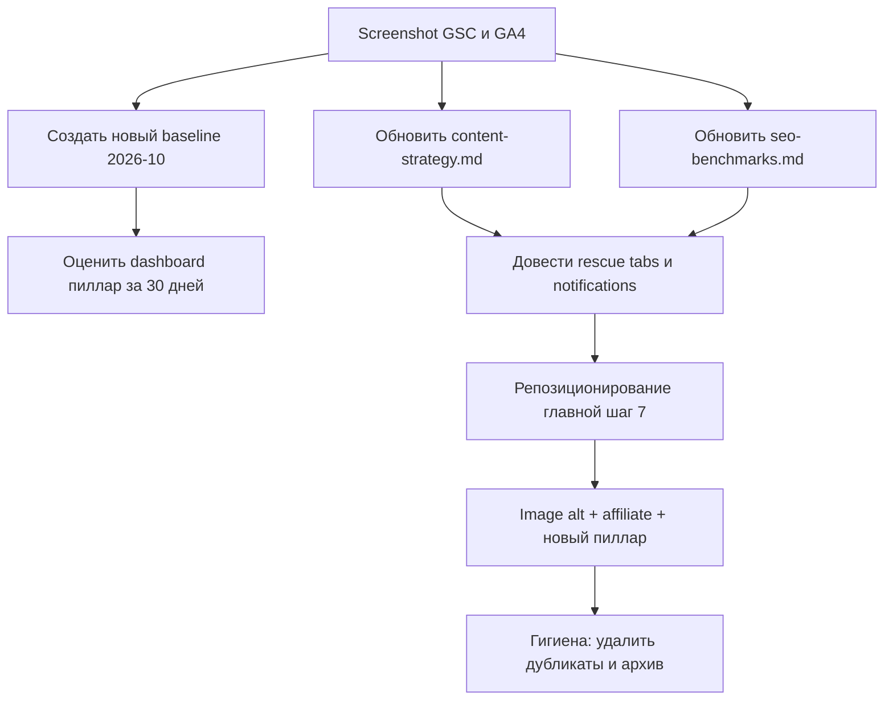

# Аудит локальных md-артефактов: бенчмарки, планы, аналитика

Дата аудита: 2026-10-10
Область: файлы, которые лежат в репозитории и НЕ публикуются на сайт
(папки `.ai/`, `plans/`, `components/jared.md`, `components/seo-benchmark.md`,
`scripts/report.*`).

## 0. Главный вывод одной строкой

Почти вся аналитика в `.ai/` снята в диапазоне май-июль 2026 и заморожена.
Сейчас октябрь 2026, то есть данным от 3 до 5 месяцев. Протокол самих
baseline-файлов запрещает править таблицы задним числом, поэтому устаревшие
снимки надо не переписывать, а закрывать новым снимком. Бенчмарки и стратегия,
наоборот, должны быть переписаны свежими цифрами. Самое ценное, что сейчас
теряется: две статьи-гиганта по показам (tabs 107k показов, notifications 131k
показов) с CTR ниже 1% и нереализованный репозиционированием главной страницы.

---

## 1. Полный инвентарь локальных md-артефактов

### 1.1. Папка `.ai/` — SEO, аналитика, планы контента (21 файл)

| Файл | Дата | Тип | Что внутри |
|---|---|---|---|
| `seo-benchmarks.md` | 28.05.2026 | Бенчмарк | Лучшие перформеры по 14 категориям, много TBD |
| `content-strategy.md` | июнь 2026 | Стратегия | Мастер-документ: baseline, 12 принципов, паттерны A-E, вейв-роадмап |
| `seo-baseline-2026-05-28.md` | 28.05.2026 | Снимок | Старт Wave 1: Top-28 постов, запросы, критерии успеха |
| `seo-baseline-pillar-launch-2026-06-05.md` | 05.06.2026 | Снимок | Чекпойнт запуска dashboard-пиллара, HEAD 8e083a0 |
| `seo-category-audit.md` | 30.05.2026 | Аудит | Разбор 9 постов категории SEO |
| `ai-citation-audit.md` | 01.07.2026 | Аудит | Цитируемость лид-абзацев Top-20 для AI-поиска |
| `image-alt-summary.md` | 19.06.2026 | Аудит | 155 постов, 1293 картинки: 33.8% без alt |
| `image-alt-audit.csv` | 19.06.2026 | Данные | Сырые данные по каждой картинке |
| `image-alt-proposals.csv` | 19.06.2026 | Данные | 739 готовых предложений alt |
| `image-alt-proposals-summary.md` | 19.06.2026 | Сводка | 158 high, 577 medium, 1 low, 3 на ручную проверку |
| `authors-audit.md` | 18.06.2026 | Аудит | 155 постов = 10 авторов, сирот нет |
| `csv-redirect-audit.md` | 08.06.2026 | Аудит | 226 строк редиректов, 1 дубль, 1 битый таргет, конфликт порядка |
| `affiliate-integration-plan.md` | 01.07.2026 | План | 20 постов, партнёры ещё не подтверждены (блокер) |
| `form-controls-pillar-inventory.md` | 19.06.2026 | План | Инвентарь будущего пиллара, ждёт OK на Фазу 2 |
| `guest-posts-rescue-plan.md` | 01.07.2026 | План | Спасение 5 постов-гостевых, вопрос по бенчмарку открыт |
| `notifications-rescue-plan.md` | июль 2026 | план | Спасение notifications-ui-design (131k показов, 0.4% CTR) |
| `tabs-rescue-plan.md` | июль 2026 | План | Спасение tabs-ui-design (107k показов, 0.6% CTR) |
| `pillar-dashboards-plan.md` | 03.06.2026 | План | План dashboard-пиллара, 14 постов, фазы |
| `pillar-dashboards-progress.md` | 05.06.2026 | Отчёт | Пиллар запущен, 11 коммитов, 4 поста удалены |
| `pillar-d-posts-salvage-check.md` | 05.06.2026 | Аудит | Проверка перед удалением 4 D-постов (завершена) |
| `research-300k-designer-skills.md` | окт/ноя 2026 | Research | Заметки под будущий пост про навыки дизайнеров |

### 1.2. Папка `plans/` — 27 файлов

Разделить на три подгруппы.

**Стратегические (ценность надолго):**

| Файл | Статус по файлу | Тип |
|---|---|---|
| `homepage-editorial-pivot.md` | шаги 0-6 закрыты, шаг 7 (реализация) не начат | Репозиционирование главной |
| `buttons-design-system-audit.md` | аудит + 3 варианта миграции | Рефакторинг кнопок |
| `buttons-push-effect.md` | предложение, не реализовано | Дизайн-решение |
| `search-page-ux-audit.md` | варианты A/B/C, политика табов помечена «реализовано» | UX-аудит поиска |

**Одноразовые QA-артефакты (можно закрывать после применения правок):**

| Файл | Что это |
|---|---|
| `why-every-ai-startup-looks-the-same-skill-audit.md` | Прогон self-check по скиллу: 2 нарушения (1 «Whether you're», ~17 триколонов) |
| `why-every-ai-startup-looks-the-same-air.md` | Разбивка длинных абзацев на 3-4 предложения |
| `where-to-launch-startup-2026-hardest-moment-visuals.md` | Визуализация сложного блока со scorecard |
| `why-every-ai-startup-looks-the-same-visuals.md` | Визуальные промпты (3 варианта) |

**Обложки и визуальные брифы (расходники, исчезают после генерации картинки):**
`ai-agent-ui-design-patterns-cover.md`, `bento-grid-layout-design-guide-image-prompts.md`,
`computer-vision-consultancy-engagement-model-cover.md`,
`computer-vision-consultancy-engagement-model-visuals.md`,
`hidden-minutes-slowing-your-business-down-cover.md`,
`hidden-minutes-slowing-your-business-down-third-visual-minutes-a-day.md`,
`hidden-minutes-slowing-your-business-down-visuals.md`,
`saas-subscription-waste-cover.md`, `saas-subscription-waste-visuals.md`,
`solo-founder-tech-stack-2026-breaks-infographics.md`,
`solo-founder-tech-stack-2026-cover.md`,
`solo-founder-tech-stack-2026-hardest-moment-visuals.md`,
`solo-founder-tech-stack-2026-intro-scenes.md`,
`where-to-launch-startup-2026-cover.md`,
`where-to-launch-startup-2026-hardest-moment-visuals.md`,
`why-every-ai-startup-looks-the-same-air.md`,
`why-every-ai-startup-looks-the-same-cover.md`,
`why-every-ai-startup-looks-the-same-linkedin.md`,
`why-every-ai-startup-looks-the-same-visuals-2.md`,
`why-every-ai-startup-looks-the-same-visuals-8-ways.md`,
`why-every-ai-startup-looks-the-same-visuals.md`.

### 1.3. Вне папок — мусор и дубликаты

| Файл | Проблема |
|---|---|
| `components/seo-benchmark.md` | Прямой дубликат `.ai/seo-benchmarks.md` (та же дата 28.05.2026). Ссылается на мёртвый скилл `seo-content-optimization` (текущий скилл называется `seo`). Источник путаницы. |
| `components/jared.md` | 302 строки research-заметок по крипто-посту (jaredfromsubway.eth). Лежит в папке компонентов по ошибке. |
| `scripts/report.md`, `scripts/report.json` | Артефакт прогона `check-site.mjs`, регенерируется заново. 245/245 страниц OK, 354 битых внешних ссылки. |
| `test-next-redirect.js`, `test-redirect.js` | Брошенные черновики (не md, но в ту же свалку). |

---

## 2. Классификация: устарело / обновить / оставить

### 2.1. УСТАРЕЛО и больше не нужно (архив или удаление)

| Файл | Почему | Действие |
|---|---|---|
| `pillar-dashboards-plan.md` | Работа завершена (пиллар запущен 05.06.2026). Файл написан до появления `content-strategy.md` | Архив |
| `pillar-dashboards-progress.md` | Отчёт о завершённой работе | Архив |
| `pillar-d-posts-salvage-check.md` | Проверка перед удалением выполнена | Архив |
| `seo-category-audit.md` | Одноразовый разбор 30.05.2026 | Архив после проверки, применены ли действия |
| `seo-baseline-2026-05-28.md` | Исторический снимок (сам файл запрещает правку) | Оставить как историю, не трогать |
| `seo-baseline-pillar-launch-2026-06-05.md` | Исторический чекпойнт | Оставить как историю |
| `why-every-ai-startup-looks-the-same-skill-audit.md` | QA после применения правок | Удалить |
| `why-every-ai-startup-looks-the-same-air.md` | Разбивка абзацев после применения | Удалить |
| Все обложки/визуальные брифы для уже опубликованных с обложкой постов | Расходник | Удалить или перенести в `plans/archive/` |
| `components/seo-benchmark.md` | Дубликат + мёртвый скилл | Удалить |
| `scripts/report.md`, `scripts/report.json` | Регенерируемый артефакт | Удалить |

### 2.2. ОБНОВИТЬ новыми данными и аналитикой

| Файл | Что обновить | Приоритет |
|---|---|---|
| `content-strategy.md` | Свежий baseline (сейчас цифры июня: 13.8k клика / 3.28M показов / 0.4% CTR / поз. 13.4). Пересобрать 12 принципов, роадмап и 30/60/90 | S |
| `seo-benchmarks.md` | Заполнить TBD-категории, обновить лучшие CTR/показы по свежему GSC. Skill читает файл на каждом запуске | S |
| Новый `.ai/seo-baseline-2026-10-XX.md` | Снимок текущего состояния по протоколу | S |
| `ai-citation-audit.md` | Новые посты и лид-абзацы | B |
| `image-alt-proposals.csv` | Не обновить, а исполнить (739 предложений). Проверить, сколько уже внедрено | B |
| `guest-posts-rescue-plan.md` | Проверить статус, закрыть открытый вопрос по бенчмарку | A |
| `tabs-rescue-plan.md` | Проверить статус внедрения | A |
| `notifications-rescue-plan.md` | Проверить статус внедрения | A |
| `form-controls-pillar-inventory.md` | Решить по Фазе 2 | B |
| `affiliate-integration-plan.md` | Разблокировать после подтверждения партнёров | B |

### 2.3. ОСТАВИТЬ как есть (актуально / вневременное)

- `authors-audit.md` (всегда актуально, аудиты авторов меняются редко)
- `csv-redirect-audit.md` (пока редиректы не применены)
- `research-300k-designer-skills.md` (research под будущий пост, ещё не использован)
- `buttons-design-system-audit.md`, `buttons-push-effect.md`, `search-page-ux-audit.md`
- `bento-grid-layout-design-guide-image-prompts.md` (если картинки ещё не сгенерированы)
- `homepage-editorial-pivot.md` (шаг 7 не начат — актуально)

---

## 3. Аномалии и находки (требуют решения)

1. **Протокол сам блокирует аудит.** `seo-baseline-*.md` явно запрещает править
   таблицы, а `content-strategy.md` требует новый снимок. Значит аудит должен
   создавать НОВЫЕ файлы, а не править старые.

2. **Skill читает дубликат.** `components/seo-benchmark.md` содержит устаревшее
   имя скилла `seo-content-optimization`. Если его не удалить, всегда будет
   непонятно, какой файл источник истины. Эталон — `.ai/seo-benchmarks.md`.

3. **Пиллар-проект не закрыт по метрикам.** `seo-baseline-pillar-launch-2026-06-05.md`
   назначил 30-дневную оценку успеха, но файла с результатами нет. Это дыра в
   самой важной SEO-работе последних месяцев.

4. **Две статьи с огромным потенциалом не спасены.** tabs (107 268 показов) и
   notifications (131k показов) имеют планы спасения, но нет отметки о внедрении.
   Это самый крупный неиспользованный резерв CTR на сайте.

5. **Размещение research-файлов.** `components/jared.md` и, возможно, ещё часть
   research должна жить в `.ai/`, а не в `components/`.

6. **Главная страница.** `homepage-editorial-pivot.md` описывает переход от
   «продаём Figma-киты» к «широкое издание». План готов, но код не изменён.
   Это самый крупный продуктовый сдвиг в бэклоге и он не начат.

---

## 4. Какие скриншоты и выгрузки нужны

Данные, которые закрывают все пробелы выше. Формат: скриншот или CSV-экспорт.

### Google Search Console (Performance)

1. **Search results, последние 3 месяца** + сравнение с предыдущими 3.
   - Вкладка Queries, экспорт CSV (не скриншот) — Top 100+ запросов.
   - Вкладка Pages, экспорт CSV — Top 100+ страниц.
   - Метрики: Clicks, Impressions, CTR, Position. Страна — все.
   - Закрывает: `content-strategy.md`, `seo-benchmarks.md`, новый baseline.

2. **Search results по фильтру страницы** — точечно по спасённым постам:
   tabs-ui-design, notifications-ui-design, 5 постов гостевого кластера,
   dashboard-пиллар и его сателлиты. Период: с даты правок по сегодня.
   - Закрывает: проверку внедрения rescue-планов и 30-дневную оценку пиллара.

3. **Индексирование → Страницы (Indexing → Pages).** Сколько страниц
   проиндексировано, сколько исключено и по какой причине.

4. **Опыт → Core Web Vitals** (мобильный и десктоп).

5. **Экспорт запросов с фильтром по CTR** — запросы с большими показами и
   низким CTR (это список целей для Wave 1).

### Google Analytics 4

6. **Отчёты → Взаимодействие → Страницы и экраны**, последние 3 месяца.
   - Просмотры, время взаимодействия. Закрывает benchmark «лучший пост»
     (сейчас эталон liquid-glass = 8 259 просмотров).

7. **Отчёты → Привлечение → Источник трафика** и **Привлечение трафика**.
   - Проверяет Принцип 1 «большая часть трафика не из Google».

8. **Отчёты → Вовлечение → События.**
   - Ключевые события (подписки, клики). Нужно для бенчмарков конверсии.

9. **Отчёты → Привлечение → Привлечение трафика** с разрезом по AI-инструментам
   (chatgpt.com, perplexity, claude.ai и т.п.) — для правил AI-tool трафика.

10. **Realtime** (если нужно) — для проверки событий `search` и `search_no_results`
    из аудита поиска.

### Дополнительно

11. **Выгрузка Ahrefs/Semrush** (если есть доступ): DR, число ссылающихся домёнов,
    новые/потерянные бэклинки. В плане главной фигурируют DR 42 и 2 700+
    ссылающихся домёнов — их надо подтвердить свежими цифрами.

12. **Список подписчиков / контактов** — сейчас его нет нигде (эндпоинт только
    шлёт письмо). Если рассылка планируется, нужен отдельный трек.

---

## 5. Приоритет файлов по важности для роста проекта

### Уровень S — критично, блокирует остальное

1. [`content-strategy.md`](../.ai/content-strategy.md) — мастер-документ,
   от него зависят все решения.
2. [`seo-benchmarks.md`](../.ai/seo-benchmarks.md) — читается скиллом на
   каждом запуске; TBD-категории = слепые зоны.
3. Новый `seo-baseline-2026-10-XX.md` — точка отсчёта для всего, что дальше.

### Уровень A — высокое влияние на рост, работа активна

4. [`homepage-editorial-pivot.md`](homepage-editorial-pivot.md) — репозиционирование
   издания, не реализовано.
5. [`tabs-rescue-plan.md`](../.ai/tabs-rescue-plan.md) — 107k показов, CTR 0.6%,
   максимальный резерв по кликам.
6. [`notifications-rescue-plan.md`](../.ai/notifications-rescue-plan.md) — 131k показов,
   CTR 0.4%.
7. [`guest-posts-rescue-plan.md`](../.ai/guest-posts-rescue-plan.md) — 5 постов кластера.
8. 30-дневная оценка dashboard-пиллара (по данным `seo-baseline-pillar-launch-*.md`).

### Уровень B — среднее влияние

9. [`image-alt-proposals.csv`](../.ai/image-alt-proposals.csv) — 1293 картинки,
   33.8% без alt (доступность + имидж-SEO).
10. [`affiliate-integration-plan.md`](../.ai/affiliate-integration-plan.md) — монетизация.
11. [`form-controls-pillar-inventory.md`](../.ai/form-controls-pillar-inventory.md) — новый пиллар.
12. [`ai-citation-audit.md`](../.ai/ai-citation-audit.md) — обновление под AI-поиск.
13. [`research-300k-designer-skills.md`](../.ai/research-300k-designer-skills.md) — написать пост.

### Уровень C — низкое влияние, гигиена

14. [`authors-audit.md`](../.ai/authors-audit.md), [`csv-redirect-audit.md`](../.ai/csv-redirect-audit.md).
15. `plans/*-cover.md`, `plans/*-visuals*.md` — расходники.
16. Удаление мусора: `components/seo-benchmark.md`, `scripts/report.*`,
    QA-артефакты в `plans/`.

### Порядок действий (рекомендуемый)

---

## 6. Что нужно от тебя

1. Выгрузки и скриншоты из раздела 4 (хотя бы GSC Search results CSV и
   GA4 «Страницы и экраны»).
2. Подтверждение, какие rescue-планы уже внедрены (tabs, notifications,
   guest-posts), чтобы не считать их дважды.
3. Разблокировка affiliate-плана: подтверждены ли партнёрства.
4. Решение по dashboard-пиллару: делать ли 30-дневную оценку сейчас.
