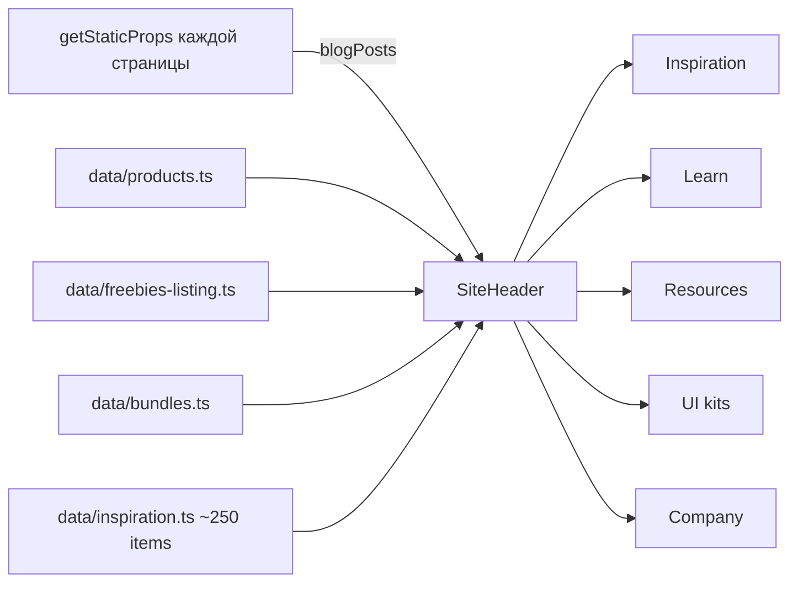
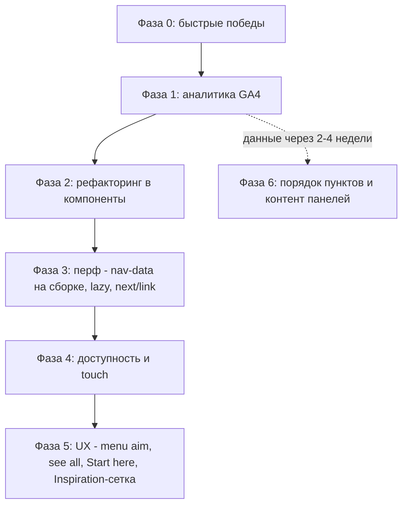

# Мега-меню: аудит и план улучшений (октябрь 2026)

Объект аудита: [`components/layout/SiteHeader.tsx`](../components/layout/SiteHeader.tsx) (1222 строки), стили в [`styles/globals.css`](../styles/globals.css) (строки ~1310–1700 десктоп, ~1770–2000 мобильный drawer), базовые классы Webflow в `public/css/setproduct.webflow.shared.css`.

## 1. Как устроено сейчас

- 5 панелей. Четыре устроены одинаково: слева колонка Categories, справа сетка из 6 карточек 2×3. Наведение на категорию подменяет карточки. Company: список ссылок и два промо-блока.
- Все 5 панелей **всегда смонтированы** в DOM; закрытие — `max-height: 0` + `overflow: hidden` + `inert`.
- Hover-intent: открытие через 120 мс, закрытие через 250 мс, смена подкатегории через 260 мс. Переход между уже открытыми меню мгновенный (`is-switching`).
- Клавиатура: фокус внутри обёртки открывает панель, blur закрывает, Escape закрывает.
- Триггер — это `div` с `onClick` плюс поверх него прозрачная ссылка `nav_dropdown_toggle-link` на раздел (`/blog`, `/all`, `/freebies`, app.setproduct.com).
- Мобильный drawer: те же панели раскрываются аккордеоном, внизу закреплён поиск.

Что уже сделано хорошо: hover-intent с задержками, отсутствие «прыжка» при переключении меню, `inert` на закрытых панелях, `prefers-reduced-motion`, UTM на исходящих ссылках Inspiration, фолбэк если Inspiration пуст, единый паттерн `hover-lift` на карточках.

## 2. Найденные проблемы

### A. Производительность

| # | Проблема | Где | Влияние |
|---|---|---|---|
| A1 | Весь массив `INSPIRATION_ITEMS` (~250 записей с длинными описаниями), а также `PRODUCTS`, `FREEBIE_PRODUCTS`, `BUNDLES` статически импортируются в клиентский компонент, который есть на каждой странице. Всё это попадает в JS-бандл каждой страницы, хотя меню показывает максимум ~60 карточек | [`SiteHeader.tsx:12-16`](../components/layout/SiteHeader.tsx:12) | Лишние десятки–сотни КБ JS на каждой странице, хуже LCP/INP |
| A2 | `blogPosts` передаётся через props каждой страницы. На `/` и `/blog` это **все** 150+ постов, на остальных до 14×6 = 84 поста (все 14 категорий), хотя меню показывает 8 категорий по 6 штук. Лишние поля `image`, `author` | [`get-blog-post-previews.ts`](../lib/blog/get-blog-post-previews.ts:18), `pages/*.tsx` | Раздутый `__NEXT_DATA__` в HTML каждой страницы |
| A3 | Превью постов в Learn — обычный `` **без** `loading="lazy"` внутри всегда смонтированной панели. Браузер, скорее всего, качает 6 обложек на каждой странице, даже если меню не открывали. Атрибут `sizes` без `srcset` ничего не делает | [`SiteHeader.tsx:798`](../components/layout/SiteHeader.tsx:798) | Лишний трафик и конкуренция с LCP-картинкой. Проверить во вкладке Network |
| A4 | Нет предзагрузки: при открытии панели картинки начинают грузиться только в момент показа, отсюда «пустые» карточки на первом hover | — | Ощущение медленного меню |
| A5 | Все внутренние ссылки меню — обычные `<a href>`, не `next/link`. Каждый клик в меню = полная перезагрузка страницы, без префетча Next.js | весь файл | Медленные переходы, перезагрузка CSS/JS |

### B. Доступность и семантика

| # | Проблема | Где |
|---|---|---|
| B1 | Панель открывается **на фокус**. При навигации Tab-ом каждое меню раскрывается, а в Inspiration до следующего пункта ~10 категорий + 12 ссылок карточек. Добраться с клавиатуры до UI kits долго | [`openOnFocus`](../components/layout/SiteHeader.tsx:429) |
| B2 | Один элемент совмещает две роли: ссылка на раздел и кнопка раскрытия (`aria-haspopup`/`aria-expanded` висят на `<a>`). Скринридер объявляет ссылку, которая по Enter уходит на другую страницу, а не раскрывает меню | [`SiteHeader.tsx:642`](../components/layout/SiteHeader.tsx:642), 742, 838, 936 |
| B3 | Company-триггер — `div role="button"` вместо `<button>`. Нет `aria-controls` ни у одного триггера | [`SiteHeader.tsx:1030`](../components/layout/SiteHeader.tsx:1030) |
| B4 | Внутри `<nav>` вложены ещё 5 `<nav>`: 6 landmark-ов «навигация» подряд. Плюс пустые `<form method="get">` вокруг панелей (наследие Webflow) | 652, 656 |
| B5 | Escape закрывает панель, но не возвращает фокус на триггер | [`SiteHeader.tsx:512`](../components/layout/SiteHeader.tsx:512) |
| B6 | Стрелки ↑↓ по категориям и ←→ по пунктам верхнего уровня не работают | — |

### C. Юзабилити

| # | Проблема | Где |
|---|---|---|
| C1 | **Touch-устройства шире 991px (iPad landscape, тач-ноутбуки).** Hover отключён для coarse-pointer, а тап по триггеру попадает в прозрачную ссылку поверх него и уходит на раздел: меню не открыть. Категории тоже переключаются только hover-ом, тап сразу уводит на страницу | 396, 642 |
| C2 | Все категории Resources ведут на `/freebies` без фильтра. Пользователь кликнул «Components» и попал на общий список. `FreebiesListingPage` вообще не читает категорию из URL | [`SiteHeader.tsx:864`](../components/layout/SiteHeader.tsx:864), [`FreebiesListingPage.tsx:25`](../components/pages/FreebiesListingPage.tsx:25) |
| C3 | Нет явного «Смотреть все N →» внизу панели для выбранной категории и нет счётчиков у категорий. Непонятно, что клик по категории ведёт на страницу, и сколько там всего | все панели |
| C4 | Задержка смены подкатегории 260 мс ощущается вязкой (в комментарии написано ~90 мс). Фиксированная задержка решает проблему диагонального движения грубо | [`SiteHeader.tsx:296`](../components/layout/SiteHeader.tsx:296) |
| C5 | Описания карточек Inspiration — это сырые AI-промпты («Tall vertical composition: a mobile notification center screen on dark background (#111113)…»). Для визуальной галереи текст мешает: картинки маленькие, текста много | `data/inspiration.ts` |
| C6 | Shuffle Inspiration после гидрации: сначала рендерятся одни 6 карточек, затем подменяются другими. Если меню открыто быстро, видно подмену | [`SiteHeader.tsx:544`](../components/layout/SiteHeader.tsx:544) |
| C7 | Панель ограничена `max-height: 90vh` с `overflow: hidden`. На ноутбуках с низким экраном (высота 700–800px) нижний ряд карточек может обрезаться без прокрутки | [`globals.css:1329`](../styles/globals.css:1329) |
| C8 | Learn показывает 6 **свежих** постов. Свежие посты не всегда лучшие; пилларные статьи (button, dashboard, tabs) не получают сквозных ссылок из навигации | 548 |
| C9 | В Learn нет категорий Design & Code, SEO, Case Studies, Career и других из `BLOG_CATEGORIES`; при этом в props для них грузятся посты (см. A2) | 50 |
| C10 | Порядок пунктов: первым стоит Inspiration (уводит на другой домен), денежный раздел UI kits четвёртый. Стоит решать по данным GA4 | 630 |

### D. Аналитика

| # | Проблема |
|---|---|
| D1 | По меню нет ни одного GA4-события, хотя [`lib/gtag.ts`](../lib/gtag.ts:17) `event()` уже есть и используется в других компонентах. Неизвестно, какие панели открывают, какие категории смотрят, по каким карточкам кликают и сколько продаж начинается с кнопки «Buy» в меню |

### E. Код и сопровождение

| # | Проблема |
|---|---|
| E1 | Монолит 1222 строки. Четыре панели — копипаста одной разметки (~100 строк каждая) с мелкими отличиями. Любая правка делается 4 раза |
| E2 | `KIT_PREVIEWS` захардкожен в компоненте и дублирует данные из `PRODUCTS` (цены, ссылки Gumroad). При смене цены легко забыть обновить меню |
| E3 | Инлайн-стили бейджа «New» (`INSPIRATION_BADGE_STYLE`) в `em` без шкалы проекта, вместо CSS-класса |

### F. Нарушения правил проекта (sentence case)

- [`SiteHeader.tsx:80`](../components/layout/SiteHeader.tsx:80) `Refund Policy` → `Refund policy`
- [`SiteHeader.tsx:934`](../components/layout/SiteHeader.tsx:934) `UI Kits` → `UI kits`
- [`SiteHeader.tsx:1212`](../components/layout/SiteHeader.tsx:1212) `Write for Us` → `Write for us` (и в `aria-label`)

## 3. Идеи улучшений

### Быстрые победы (низкий риск)
1. Исправить sentence case (F).
2. `loading="lazy"` + `decoding="async"` для превью постов, либо перевести их на `next/image`, как у UI kits и Resources (A3).
3. Фильтр категорий Resources через `?category=` и чтение параметра в `FreebiesListingPage` (C2).
4. Возврат фокуса на триггер по Escape (B5); `overflow-y: auto` для открытой панели на низких экранах (C7).
5. Снизить задержку подкатегории до ~120 мс как временную меру (C4).

### Производительность
6. Модуль `lib/nav/buildNavData.ts`: на этапе сборки готовит **только то, что показывает меню** (по 6 карточек на категорию, обрезанные описания, без лишних полей). SiteHeader получает уже готовый компактный объект. `INSPIRATION_ITEMS`, `PRODUCTS` и остальные исчезают из клиентского бандла (A1, A2, E2).
7. `getBlogPostPreviews` для меню: только 8 нужных категорий × 6, поля `slug/title/description/thumbImage/category`. Полный список оставить только там, где он реально нужен (листинг `/blog`, главная) (A2).
8. Предзагрузка картинок: при hover-intent на триггер (до открытия) и на категорию подгружать её 6 превью (A4).
9. `next/link` для внутренних ссылок + закрытие меню и drawer на `routeChangeStart` (A5).
10. Ленивое монтирование панели: рендерить содержимое только после первого открытия, дальше держать в DOM для анимации.

### Доступность и touch
11. Разделить триггер: текст — ссылка на раздел, шеврон — отдельная `<button aria-expanded aria-controls>`. Либо триггер целиком `<button>`, а ссылка на раздел живёт внутри панели как «Смотреть все» (B2, C1). Второй вариант проще и решает touch.
12. Не открывать по фокусу, открывать по Enter/Space/↓; стрелки внутри панели (B1, B6).
13. Убрать вложенные `<nav>` и пустые `<form>`, оставить один `<nav aria-label="Main">` (B4).
14. На touch-устройствах первый тап по категории переключает превью, второй (или кнопка «Смотреть все») переходит (C1).

### Юзабилити и конверсия
15. «Menu aim» (safe triangle, как у Amazon) вместо фиксированной задержки: подкатегория переключается мгновенно, если курсор идёт вертикально по списку, и ждёт, если курсор движется по диагонали к карточкам (C4).
16. Футер каждой панели: «See all dashboards (24) →» под выбранную категорию + счётчики у категорий (C3).
17. Inspiration: убрать описания, сделать визуальную сетку 3×2 или 4×2 с крупными превью и подписью-названием; описание в `title`-подсказке (C5).
18. Learn: блок «Start here» с 3–4 пилларными статьями сверху или вместо таба «All topics». Это и навигация для новичка, и сквозные внутренние ссылки на SEO-пиллары (C8).
19. UI kits: бейджи «New» / «Bestseller» / цена на карточке, кнопка Buy как primary только у одной карточки (правило «одна primary на секцию»).
20. Shuffle Inspiration на этапе сборки (меняется с каждым деплоем) вместо клиентского (C6).
21. Порядок пунктов верхнего уровня решить по данным: какой пункт чаще открывают и откуда начинаются покупки (C10, зависит от D1).
22. Cmd/Ctrl+K: командная палитра поиска на базе существующего Fuse-индекса (`lib/search/`), индекс грузится лениво по первому фокусу.

### Аналитика
23. GA4-события: `nav_open` (menu), `nav_category_view` (menu, category), `nav_click` (menu, category, position, target_type: card/button/see_all, href), `nav_buy_click`. Без этого остальные решения по контенту меню делаются вслепую (D1).

### Рефакторинг
24. Разбить SiteHeader на `MegaMenu`, `MegaMenuPanel` (общая разметка «категории + сетка карточек»), `MegaMenuCard`, `CompanyPanel`, `MobileDrawer`, хук `useMegaMenuState` (hover-intent, клавиатура, Escape). Описание панелей — массив конфигов (E1).
25. Бейдж «New» вынести в CSS-класс на шкале `radius-*` (E3).

## 4. Рекомендуемый порядок

Аналитика идёт рано, чтобы к фазе 6 накопились данные. Рефакторинг до перф- и a11y-работ, иначе каждую правку придётся делать в четырёх копиях.

## 5. Техзадание: Фаза 0 (без sentence case) и Фаза 1

Решение автора от 22.10: sentence case (пункт F) пока **не трогаем**. Остальная Фаза 0, затем сразу Фаза 1.

Перед началом: `git status`, рабочее дерево должно быть чистым. Каждый пункт ниже идёт отдельным коммитом. Без push.

### 0.1 Ленивая загрузка превью в Learn (A3)

Файл: [`SiteHeader.tsx:798`](../components/layout/SiteHeader.tsx:798).

- В `` превью постов добавить `loading="lazy"` и `decoding="async"`, удалить бесполезный `sizes="158px"` (без `srcset` он ничего не делает).
- Карточки UI kits и Resources уже на `next/image` (lazy по умолчанию), Inspiration уже lazy. Их не трогаем.
- Почему сработает: закрытая панель имеет `max-height: 0; overflow: hidden`, браузер считает картинку невидимой и не грузит её до открытия.
- Проверка: открыть `/testimonials` в DevTools → Network → Img, меню не трогать. Обложки постов из меню грузиться не должны. Навести на Learn, они появляются.
- Коммит: `perf(nav): lazy-load learn preview images`

### 0.2 Escape возвращает фокус на триггер (B5)

Файл: `SiteHeader.tsx`, эффект на строке ~512.

- Завести `triggerRefs = useRef<Record<string, HTMLElement | null>>({})` и повесить `ref` на фокусируемый элемент каждого триггера: `nav_dropdown_toggle-link` для Inspiration, Learn, Resources, UI kits; `div role="button"` для Company.
- В обработчике Escape: если `document.activeElement` находится внутри обёртки открытого меню, после закрытия вызвать `triggerRefs.current[menu]?.focus()`.
- **Ловушка:** фокус на триггере вызывает `onFocus → openOnFocus` и меню тут же откроется снова. Нужен флаг `suppressFocusOpenRef`: ставим `true` перед `.focus()`, в `openOnFocus` проверяем его, сбрасываем и выходим.
- Если триггер невидим (`offsetParent === null`, мобильный drawer, где `toggle-link` скрыт), фокус не переносим.
- Проверка: Tab до Learn → Tab внутрь панели на 2–3 ссылки → Escape. Панель закрыта, фокус-рамка на «Learn», панель не открылась повторно. Следующий Tab идёт к Resources.
- Коммит: `fix(nav): return focus to the trigger on escape`

### 0.3 Панель не обрезается на низких экранах (C7)

Файл: [`styles/globals.css:1328`](../styles/globals.css:1328), блок `@media (min-width: 991px)`.

- В `.navbar .nav_dropdown_list.w-dropdown-list.w--open` заменить `max-height: 90vh` на `max-height: calc(100dvh - var(--mobile-navbar-height, 80px) - 24px)` и добавить `overflow-y: auto; overflow-x: hidden; overscroll-behavior: contain;`.
- Переменная `--mobile-navbar-height` уже выставляется на `.navbar` на всех ширинах в эффекте [`syncNavbarHeight`](../components/layout/SiteHeader.tsx:453), новую переменную не заводим. Для читаемости можно продублировать значение под нейтральным именем `--navbar-height` в том же эффекте.
- Закрытое состояние (`max-height: 0; overflow: hidden`) не трогаем, анимация открытия остаётся.
- Проверка: окно 1280×700 и 1440×760, открыть Inspiration и UI kits. Нижний ряд карточек достижим прокруткой колеса внутри панели, страница под ней при этом не скроллится. На 1440×900 скроллбара нет.
- Коммит: `fix(nav): let tall mega-menu panels scroll on short screens`

### 0.4 Категории Resources открывают отфильтрованный список (C2)

**SiteHeader** ([строка 864](../components/layout/SiteHeader.tsx:864)): `href` у категории = `category ? /freebies?category=${encodeURIComponent(category)} : "/freebies"`. Значения `category` в `NAV_FREEBIE_CATEGORIES` уже совпадают с `FREEBIES_CATEGORIES` из `data/freebies-listing.ts`.

**FreebiesListingPage** ([строка 25](../components/pages/FreebiesListingPage.tsx:25)): повторить паттерн из [`BlogListingPage.tsx:29-55`](../components/pages/BlogListingPage.tsx:29):
- `useRouter()`, эффект на `router.isReady` + `router.query.category`: берём строку (из массива первый элемент), ищем точное совпадение в `FREEBIES_CATEGORIES`, затем без учёта регистра (`mobile templates` → `Mobile Templates`). Нашли → `setActiveCategory` и сброс `visibleCount`. Не нашли или параметра нет → `ALL_TOPICS`.
- `onCategoryChange` дополнительно пишет категорию в URL через `router.replace({ query }, undefined, { shallow: true, scroll: false })`; для `All topics` параметр удаляется. Ссылку на отфильтрованный список можно будет скопировать и отправить.
- Canonical остаётся `/freebies` (берётся из `PAGE_META`), дублей в индексе не появится.
- Проверка: из меню Resources кликнуть «Components» → `/freebies?category=Components`, в селекте выбран Components, сетка отфильтрована. Сменить фильтр на странице → URL обновился без перезагрузки. Открыть `/freebies?category=garbage` → показан весь список, ошибок нет.
- Коммит: `feat(resources): deep-link listing categories via query param`

### 1. GA4-события мега-меню (D1)

Сейчас в GA4 есть только общие события (`click`, `search_form_submit`, `get_started_button_gumroad_on_products_c` и т.д., см. `plans/ga4 События_Название_события.csv`). Меню никак не размечено.

**Новый файл `lib/nav/analytics.ts`:**
- `NAV_MENU_ID`: соответствие внутренних ключей стабильным именам для отчётов: `inspiration → inspiration`, `tutorials → learn`, `freebies → resources`, `designKits → ui_kits`, `information → company`.
- `trackNav(name, params)`: обёртка над [`event()`](../lib/gtag.ts:17), всегда добавляет `transport_type: "beacon"` (событие должно уйти даже при переходе в той же вкладке). Вне production дополнительно пишет `console.debug("[nav]", name, params)`: локально `NEXT_PUBLIC_GA_ID` обычно пуст, и иначе проверить ничего нельзя.

**События:**

| Событие | Когда | Параметры |
|---|---|---|
| `nav_menu_open` | Панель простояла открытой ≥ 500 мс (пробег курсором по шапке не засчитываем). Одно событие на одно открытие | `menu_name`, `input_type`: `hover` / `click` / `keyboard` / `tap` |
| `nav_category_view` | Подкатегория реально переключилась (после текущего debounce или по фокусу). Начальное «All» не шлём | `menu_name`, `category` (label, `all` для «All topics») |
| `nav_click` | Любой клик по ссылке внутри меню или по триггеру | `menu_name`, `category`, `link_type`, `item_title`, `item_position` (1–6 для карточек), `link_url`, `outbound` (bool) |
| `nav_buy_click` | Клик по кнопке «Buy $N» в UI kits (в дополнение к `nav_click`) | `menu_name`, `category`, `item_title`, `value` (число из цены), `currency: "USD"` |
| `nav_drawer_open` | Открытие мобильного бургер-меню | без параметров |

Значения `link_type`: `trigger`, `category`, `card_image`, `card_title`, `card_cta`, `card_secondary`, `company_link`, `promo`.

**Реализация через делегирование** (минимум правок и переживёт рефакторинг из Фазы 2):
- На ссылки внутри меню добавить data-атрибуты: `data-nav-menu`, `data-nav-type`, `data-nav-title`, `data-nav-position`, а для Buy ещё `data-nav-price`.
- Один `onClickCapture` на корневом `<nav className="nav-menu">` находит `event.target.closest("[data-nav-type]")`, собирает параметры, текущую категорию берёт из state и вызывает `trackNav`. Никаких обработчиков на каждой карточке.
- `input_type` для `nav_menu_open`: в `openOnHover` / `toggleMenu` / `openOnFocus` перед открытием записывать источник в `lastOpenSourceRef`. `toggleMenu` на ширине ≤ 991px или при `pointer: coarse` записывает `tap`.
- Таймер 500 мс для `nav_menu_open` живёт в `useEffect` на `openMenu` и очищается при смене или закрытии меню.

**Что сделать руками в GA4 (автор, после деплоя):**
1. Admin → Custom definitions → создать event-scoped dimensions: `menu_name`, `category`, `link_type`, `item_title`, `item_position`, `input_type`. Без этого параметры не появятся в стандартных отчётах, только в DebugView и Explorations.
2. Admin → Events → отметить `nav_buy_click` как key event.
3. Через 2–4 недели собрать Exploration: открытия по `menu_name`, клики по `link_type` и `item_position`, доля `tap` в `input_type` на desktop-устройствах (проверка гипотезы C1 про iPad).

**Проверка:** локально `npm run dev`, консоль браузера: события `[nav]` появляются ровно по сценариям из таблицы, при быстром пробеге курсором по шапке `nav_menu_open` не шлётся. На превью-деплое с GA ID: GA4 → Admin → DebugView (расширение Google Analytics Debugger или `?debug_mode=true`).

- Коммит: `feat(analytics): track mega-menu interactions in GA4`

## 5b. Итоги Фазы 3 (22.10)

Коммиты: `b49f10f perf(nav): ship compact menu data and lazy-load the catalogue`, `11cbfad perf(nav): client-side menu links, close on route change, preload previews on intent`.

| Что | Было | Стало |
|---|---|---|
| Данные Inspiration в общем JS (грузился на 314 из 316 страниц) | ~214 КБ (gzip ~46 КБ) | 0, отдельный чанк 142 КБ (gzip 26 КБ) грузится только при наведении на меню |
| `__NEXT_DATA__` обычной страницы (testimonials) | 36,0 КБ (gzip 9,5 КБ) | 27,6 КБ (gzip 8,5 КБ), из них меню: 40 постов, 6 ресурсов, 18 карточек Inspiration |
| HTML testimonials | 124,9 КБ | 116,2 КБ |
| Главная и `/blog` | полный список постов дважды не дублируется, меню берёт его из страницы | — |

Как устроено:
- `lib/nav/buildNavData.ts` (только сервер): `getNavData()` собирает для `getStaticProps` по 6 свежих постов на каждую категорию Learn (5 полей), «All» ресурсы и случайные 18 Inspiration. Главная и `/blog` вызывают `getNavData({ blog: false })`.
- `components/layout/nav/navPreviews.ts` подгружается через `import()` при первом `pointerenter`/`focus` на меню или открытии drawer. До загрузки UI kits показывают `KIT_PREVIEWS`, Resources — данные из сборки; категории подменяются после загрузки (обычно успевает за 120 мс задержки открытия).
- `NavLink`: внутренни�� ссылки меню через `next/link` (`prefetch={false}`, предзагрузка страницы только при наведении). Внешние, Inspiration и Gumroad остаются обычными `<a>`.
- На `routeChangeStart` закрываются панель и drawer.
- Предзагрузка картинок (`preloadImages.ts`): наведение на триггер или категорию запускает загрузку её 6 превью; для `next/image` строится тот же srcset с `sizes="158px"`.
- Пункт 10 (ленивое монтирование панелей) не делали: SSR-разметка меню нужна поисковикам для внутренних ссылок, а выигрыш после выноса данных небольшой.

## 5c. Итоги Фазы 4 (23.10)

Коммит: `3dce14e feat: make mega-menu triggers accessible disclosure buttons with touch support`.

| Проблема | Что сделано |
|---|---|
| B2, B3 | Каждый пункт верхнего уровня теперь `<button type="button" aria-expanded aria-controls="nav-panel-…">` (`MenuTrigger.tsx`). Прозрачная ссылка поверх триггера удалена. Ссылки на разделы остались там, где были: первый пункт категорий («All topics» → `/blog`, «All topics» → `/freebies`, «All» → `/all`) плюс заголовок пункта меню в Inspiration. Вариант «весь триггер — кнопка, ссылка на раздел внутри панели как See all» из аудита отклонён по факту реализации: «All» уже вёл на тот же URL, кнопка дублировала его и увеличивала высоту панели. Кнопки нет ни в одной панели (`c9ccb86`) |
| B1 | Фокус больше не открывает панель, Tab идёт по пунктам бара. Enter/Space переключают панель, ↓ открывает и переводит фокус на активную категорию |
| B6 | Внутри панели ↑/↓/Home/End двигают по колонке, ←/→ переключают колонки (категории ↔ карточки), ↑ на первом пункте возвращает на триггер. На триггерах ←/→ переходят к соседнему пункту бара. Колонки помечены `data-nav-group` (`interaction.ts`) |
| B4 | В шапке один `<nav aria-label="Main">` (было 6 landmark-ов). Панели стали `
`, пустые Webflow-`<form method="get">` удалены |
| B5 | Escape возвращает фокус на кнопку-триггер (упрощённый селектор, флаг `suppressFocusOpenRef` больше не нужен) |
| C1 | Touch шире 991px: тап по триггеру открывает панель. Первый тап по другой категории только переключает превью (решение принимается на `pointerdown`), второй тап по ней же открывает страницу. Тап вне меню закрывает панель (только десктопная раскладка, drawer не трогаем) |

Дополнительно:
- Клик мышью по триггеру, когда панель только что открылась по hover, её не закрывает. Иначе задержка 120 мс и клик «боролись» бы, и панель мигала.
- GA4: тип `see_all` удалён вместе с кнопкой. Тапы, которые только переключили превью, в `nav_click` не попадают (их покрывает `nav_category_view`). Для триггера `input_type` теперь точный: `click` / `tap` / `keyboard` по `pointerType` и `event.detail`.
- Все ссылки панелей по-прежнему в SSR-HTML: раздел доступен через первый пункт категорий.
- Размер HTML testimonials: 116,2 → 116,1 КБ (минус 4 формы и 4 прозрачные ссылки).
- Визуально для мыши ничего не меняется: это осознанно, фаза про невидимую часть (роли, клавиатура, диктор, тач). Волновая проверка: Tab по меню не раскрывает панели, стрелки работают внутри, VoiceOver читает один landmark.

Риски для ручной проверки:
- На десктопе с мышью клик по слову «Learn» раньше вёл на `/blog`, теперь он открывает и закрепляет панель. Это осознанный выбор по аудиту. Если в GA4 упадут переходы на разделы, вариант с откатом: текст — ссылка, шеврон — отдельная кнопка.
- Кольцо фокуса на триггере (`outline-offset: -14em`) подобрано под Webflow-паддинг `20em` с отрицательным margin. Проверить на 1024 и 1440.

## 6. Как проверять

- `npm run lint` и `npm run build` после каждой фазы.
- Размер бандла: сравнить вывод `next build` (First Load JS) до и после фазы 3.
- Network: на странице без открытия меню не должно грузиться ни одной картинки меню.
- Ручная проверка на 1440 / 1024 / 768 / 390 px, отдельно iPad landscape (touch, 1024).
- Клавиатура: пройти навигацию только Tab/Enter/Esc/стрелками.
- VoiceOver: один landmark навигации, корректные `aria-expanded`.
