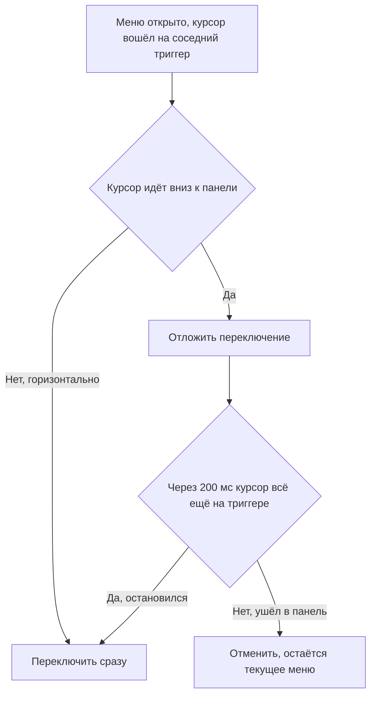
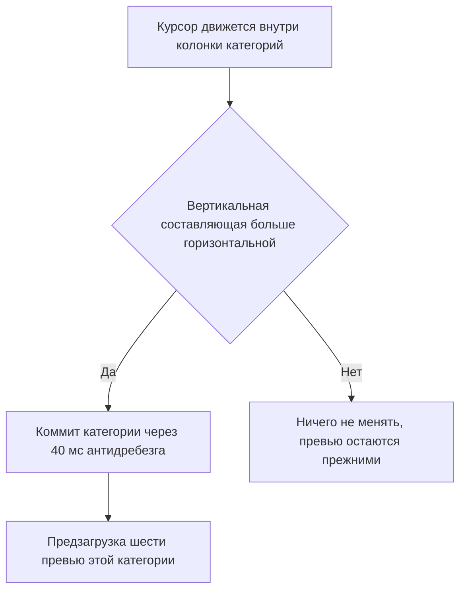

# Мега-меню: Фаза 5 (юзабилити и конверсия)

## Коммит 1b. Menu aim для верхней панели (новое, 23.10) ✅ `7e2cb9a`

Решение автора: задержка при остановке на пункте 300 мс (не 200). Ниже по
тексту «200 мс» читать как 300.

### Проблема

Открыт Learn. Курсор ведут к карточке справа («Free iPhone mockup generator
review»), путь проходит над триггером Resources. Сейчас
[`openOnHover`](components/layout/nav/useMegaMenuState.ts:98) при уже открытом
меню переключает панель **мгновенно** (`openMenuImmediate`), и вместо Learn
появляется Resources. Перехода по ссылке нет, но цель исчезает из-под курсора.

### Решение: тот же «безопасный треугольник», только вниз

Когда меню открыто и курсор входит на соседний триггер:

- курсор движется вдоль панели навигации горизонтально → переключаем сразу,
  как сейчас (намеренный проход по пунктам остаётся быстрым);
- курсор движется вниз-вбок, в сторону открытой панели → не переключаем;
  если курсор остановился на триггере, через 200 мс переключаем всё-таки;
- курсор дошёл до открытой панели → отложенное переключение отменяется
  (вход в обёртку панели уже вызывает `openOnHover` своего меню и снимает
  таймер).

Проверка: треугольник от прошлой точки курсора к верхнему левому и верхнему
правому углу открытой панели. Панель во всю ширину, поэтому на практике это
значит «курсор идёт вниз».

Порог наклона надо брать маленьким. Замер по скриншоту на 1440: триггер Learn
около (850, 65), правая верхняя карточка около (1900, 190). Наклон пути
125 / 1050 ≈ 0,12, то есть около 7°. Порог 1/3 этот случай пропустил бы, и
баг остался бы. Берём порог 1/20 (≈3°) при смещении вниз не меньше 2 px по
истории из трёх точек: горизонтальный проход с дрожанием руки обычно идёт
ровнее, а цена ошибки в сторону «прицеливания» — всего 200 мс задержки
переключения, тогда как ошибка в другую сторону и есть исходный баг.



### Правки

1. `interaction.ts`: экспортировать треугольный тест, добавить
   `isHeadingDownInto(prev, curr, panelRect)` с порогом наклона.
2. `useMegaMenuState.ts`: история курсора (2–3 точки) на `mousemove` по
   `.nav-menu-links-wr`; в `openOnHover` ветка «меню открыто» проверяет
   прицеливание и ставит отложенное переключение в `hoverIntentRef`
   (тот же таймер, поэтому вход в панель и уход с триггера его снимают).
3. `navConfig.ts`: `NAV_MENU_SWITCH_AIM_RECHECK_MS = 200`,
   `NAV_MENU_SWITCH_AIM_SLOPE = 1 / 20`, `NAV_MENU_SWITCH_AIM_MIN_DY_PX = 2`.
4. `SiteHeader.tsx`: `onMouseMove` на `.nav-menu-links-wr`.

Не трогаем: клик, тап, клавиатуру (переключают сразу), открытие из закрытого
состояния (120 мс), грейс закрытия 250 мс. GA4 `nav_menu_open` не меняется:
отменённое переключение просто не создаёт события.

### Проверка (1440 и 1024)

1. Открыть Learn, вести курсор к правой верхней карточке через Resources и
   UI kits → Learn остаётся.
2. Провести курсор горизонтально по пунктам Learn → Resources → UI kits →
   панели переключаются без задержки.
3. Остановиться на Resources при открытом Learn → через ~0,2 с открывается
   Resources.

Продолжение [`plans/mega-menu-audit-2026-10.md`](./mega-menu-audit-2026-10.md).
Фазы 0–4 закрыты. Ниже — только пункты 15, 16, 17, 18, 19а, 20 из раздела
«Юзабилити и конверсия». Пункты 21 и 22 остаются в Фазе 6.

---

## Что трогаем и в каком порядке

| Коммит | Пункт аудита | Файлы |
|---|---|---|
| 1 ✅ `949a312` | Menu aim вместо задержки 260 мс (C4) | interaction.ts, useMenuAim.ts (новый), useMegaMenuState.ts, MegaMenuPanel.tsx, navConfig.ts |
| 2 | Inspiration: визуальная сетка, дедупликация, без shuffle на клиенте (C5, C6) | InspirationCard.tsx, SiteHeader.tsx, buildNavData.ts, MegaMenuPanel.tsx, globals.css |
| 3 | «Start here» в Learn и цена на карточке UI kits (C8, C9а) | navConfig.ts, SiteHeader.tsx, MegaMenuPanel.tsx, MegaMenuCard.tsx, globals.css |

Решение автора от 23.10: счётчики у категорий не делаем. Раздел «Коммит 2.
Счётчики категорий» ниже оставлен для истории и не выполняется.

Реализация menu aim отличается от черновика ниже: вместо сравнения `dx`/`dy`
используется «безопасный треугольник» `isAimingAt()` от прошлой точки курсора
к левому краю сетки превью (±24 px), плюс перепроверка через 280 мс, если
курсор остановился на строке.

Футер «See all (N)» не делаем: он уже отвергнут, вторая ссылка на тот же
раздел дублирует первый пункт колонки. Пункт C3 закрывается счётчиками.

---

## Коммит 1. Menu aim

### Как сейчас

- [`NAV_SUBCATEGORY_HOVER_DELAY_MS`](components/layout/nav/navConfig.ts:34) = 260 мс.
- [`setCategoryOnHover`](components/layout/nav/useMegaMenuState.ts:154) ставит
  таймер, [`clearCategoryHover`](components/layout/nav/useMegaMenuState.ts:230)
  его снимает.
- [`onMouseEnter`](components/layout/nav/MegaMenuPanel.tsx:130) на строке
  категории вызывает и `onIntent` — поэтому диагональный проход заказывает шесть
  превью на каждой промежуточной строке.

### Как будет

Один предикат в [`interaction.ts`](components/layout/nav/interaction.ts:1):

```ts
export type AimSample = {
  dx: number;
  dy: number;
  insideColumn: boolean;
};

// Курсор идёт вниз по списку — переключаем. Курсор идёт вправо, к сетке
// превью — не переключаем, пользователь целится в карточку.
export function isCategoryAim(sample: AimSample): boolean;
```

Правило: `Math.abs(dy) >= Math.abs(dx)` плюс минимальный порог `dy > 2px`,
чтобы дрожание мыши на месте не считалось намерением. Горизонтальный вектор
длиной больше вертикального — намерение уйти в превью, переключение не
происходит.



### Правки

1. `navConfig.ts`: 260 мс → `NAV_SUBCATEGORY_AIM_DEBOUNCE_MS = 40`.
2. `interaction.ts`: `isCategoryAim()` плюс вспомогательная функция, которая
   хранит предыдущую точку в `useRef` и считает `dx`/`dy`.
3. `useMegaMenuState.ts`: `setCategoryOnHover` теряет длинный таймер, остаётся
   короткий антидребезг; добавляется `hasPendingCategoryIntent()` для проверки
   перед коммитом.
4. `MegaMenuPanel.tsx`: на `.nav-links.is-1-column` — `onMouseMove` вместо
   `onMouseEnter`; `onIntent` вызывается только в момент коммита, а не на каждой
   строке. `onMouseEnter` на строке остаётся только для touch-фолбэка через
   `isFinePointer()`.

### Риски

- Тач и `prefers-reduced-motion`: вся ветка под `isFinePointer()`, поведение
  первого тапа из Фазы 4 не меняется.
- Медленный проход по колонке сверху вниз должен по-прежнему переключать;
  быстрый диагональный проход — нет.
- Клавиатура идёт через `setCategoryNow`, её не касаемся.

---

## Коммит 2. Счётчики категорий

### Что показываем

`All topics · 152`, `Dashboards · 12`. Счётчик живёт в той же строке, что и
название, высота панели не растёт. Отдельной ссылки нет.

### Источник цифр

Считается на сборке в [`buildNavData`](lib/nav/buildNavData.ts:44), где уже есть
полный список постов, `PRODUCTS`, `FREEBIE_PRODUCTS`, `BUNDLES` и пул
Inspiration. В клиентский бандл попадают только числа.

`NavData` получает поле:

```ts
/** Ключ: `${menuKey}:${category ?? "all"}`. Значение: сколько записей. */
categoryCounts: Record<string, number>;
```

`MegaMenuCategory` получает опциональное `count?: number`, панель рендерит его
серым в той же строке.

### Правки

1. `navConfig.ts`: тип `MegaMenuCategory` расширяется в `MegaMenuPanel.tsx`,
   не в конфиге.
2. `lib/nav/types.ts`: новое поле `categoryCounts`.
3. `buildNavData.ts`: заполнение по четырём меню.
4. `MegaMenuPanel.tsx`: рендер `<span className="nav_category-count">`.
5. `globals.css`: класс счётчика, приглушённый цвет, `em`-размер.

### Риск

Числа описывают весь раздел, а не выборку из шести карточек. Это ровно то, что
закрывает исходную претензию C3, и подписывать их иначе не надо.

---

## Коммит 3. Inspiration: сетка, дедупликация, без shuffle на клиенте

### Данные

В пуле 277 записей, названия массово повторяются. В `buildNavData` перед
выборкой:

1. уникальность по нормализованному `title`;
2. уникальность по `image`.

Второй шаг добивает случаи, где заголовок переписан, а картинка та же. Оба
шага — чистые функции в `lib/nav/buildNavData.ts`, откатываются одной правкой.

### Разметка

Новый [`components/layout/nav/InspirationCard.tsx`](components/layout/nav/InspirationCard.tsx):

- корень сохраняет классы `nav_tabs-list-item` и `hover-lift` — иначе сломается
  GA4-трекер, который читает `.hover-lift-title` и позицию в
  [`useNavAnalytics`](components/layout/nav/useNavAnalytics.ts:105);
- только картинка в рамке `aspect-ratio: 4 / 3`, дальше одна строка названия;
- описание уходит в `title` атрибут;
- кнопка «View» убирается, вся карточка — одна ссылка на превью;
- `InspirationThumb` переиспользуется как есть, шиммер и fade-in остаются.

### Сетка

`MegaMenuPanel` получает опциональный `listClassName`, панель Inspiration
передаёт `nav_tabs-list--inspiration`. В `globals.css`:

```css
.navbar .nav_tabs-list--inspiration {
  display: grid;
  grid-template-columns: repeat(3, minmax(0, 1fr));
  gap: 16em;
}

.navbar .nav_tabs-list--inspiration .nav_tabs-list-item {
  width: auto;
  margin-right: 0;
}
```

На 1024–1279 — `repeat(2, minmax(0, 1fr))`. Webflow-колонки `w-col-6` не
используем, они дают ровно две.

### Убрать shuffle на клиенте

Удалить [`useEffect`](components/layout/SiteHeader.tsx:149) с
`setShuffledInspiration(shuffle(...))`. Перемешивание остаётся только на сборке.
Состояние остаётся: `loadCatalogue` по-прежнему дописывает полный пул.

Побочный эффект: «All» меняется раз в деплой, а не на каждую перезагрузку.
Это и есть цель пункта 20. Заодно исчезает перерисовка сетки на глазах.

---

## Коммит 4. «Start here» в Learn и цена на карточке UI kits

### Start here

Константа в `navConfig.ts`:

```ts
export const NAV_START_HERE: ReadonlyArray<{ href: string; label: string }> = [
  { href: "/blog/dashboard-ui-design", label: "Dashboard UI design" },
  { href: "/blog/data-table-ui-design", label: "Data table UI design" },
  { href: "/blog/form-controls-reference-2026", label: "Form controls reference" },
];
```

Показывается только при `categories.tutorials === null`, то есть на вкладке
«All topics»; при выбранной категории скрывается.

`MegaMenuPanel` получает опциональный `beforeList?: ReactNode`, который
рендерится в `.nav_dropdown-list-wr` над сеткой. Ссылки — обычные `NavLink`,
остаются в SSR, вес HTML минимальный.

### Цена на карточке

- `KitPreview` получает `price?: string`;
  [`kitPreviewFromProduct`](components/layout/nav/navConfig.ts:215) заполняет
  `$` + `product.price`, [`bundlePreviewFromItem`](components/layout/nav/navConfig.ts:230) — уже готовый `bundle.price`.
- В захардкоженный `KIT_PREVIEWS` цены добавляются вручную, они там уже есть
  внутри `buyLabel`.
- `MegaMenuCardMedia` получает `badge?: ReactNode`, рендерит его поверх
  картинки. Новый класс `.nav_card-price` в `globals.css`, `radius-8`,
  фон `var(--black)`, белый текст, `aria-hidden` — цена уже озвучивается кнопкой
  «Buy $148».
- Бейджи «New» и «Bestseller» не делаем: нужны данные кликов из GA4, иначе
  разметка будет придумана наугад.
- Primary-кнопку у первой карточки не вводим: правило «одна primary на секцию»,
  но шесть карточек читаются как равнозначный список, выделять одну без причины
  не стоит.

---

## Проверка после каждого коммита

1. `npm run lint` — это `tsc --noEmit`.
2. `npm run build` — SSG, MDX и типы.
3. Ручной прогон на 1440, 1024 и 390: открытие меню, проход по колонке,
   диагональ к карточкам, переключение категории, Escape.
4. В GA4 Realtime: `nav_menu_open`, `nav_category_view`, `nav_click` не потеряли
   `item_title` после смены разметки Inspiration.
