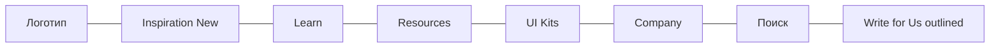
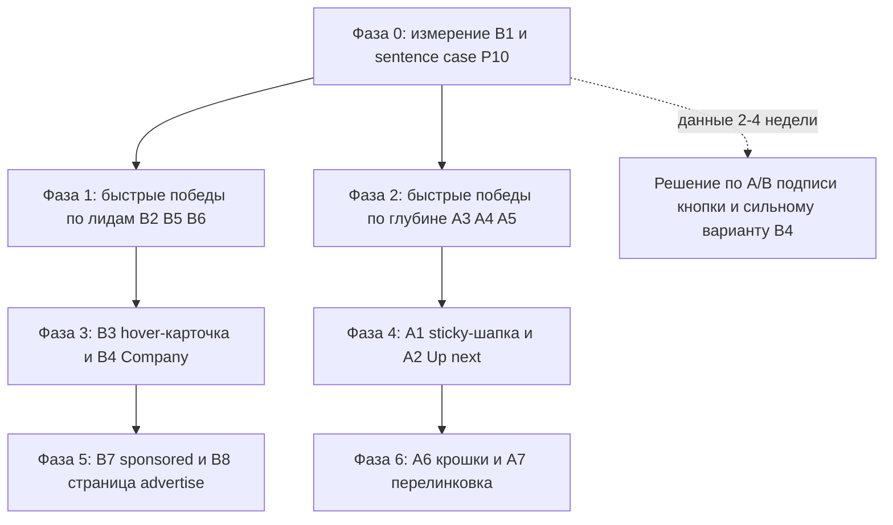

# Навигация: глубина просмотра и лиды на платный паблишинг (ноябрь 2026)

## Решения автора (05.11.2026)

- Цена: $288 за статью с 1 dofollow, $348 за 2 dofollow. Выход за 24 часа.
- Аудитория: 17 000–19 000 читателей в месяц, DR 42.
- Платные посты (автор Connor Patterson) **нельзя** помечать как sponsored.
  B7 в исходном виде отменён; витрину строим без меток на самих постах.
- publish.setproduct.com принимает UTM.
- B4: сильный вариант, отдельный пункт `Advertise` со своей панелью.
- Фаза 0 сделана: `d0a6acd` (UTM и `publish_cta_click`), `8fd49b4` (sentence case).

Продолжение [`mega-menu-audit-2026-10.md`](./mega-menu-audit-2026-10.md) и
[`mega-menu-phase5-2026-10.md`](./mega-menu-phase5-2026-10.md). Техническую
часть меню (перф, a11y, menu aim, аналитика открытий) уже сделали. Этот план
про продуктовые цели:

1. **Глубина:** больше страниц за сессию, больше времени на сайте.
2. **Лиды:** читатель быстро понимает, что на Setproduct можно платно
   рассказать о своём продукте, и уходит на `publish.setproduct.com`.

---

## 1. Что показывают данные (GA4, 12.07–09.10.2026)

| Метрика | Значение | Вывод |
|---|---|---|
| `page_view` / `session_start` | 60 355 / 51 157 ≈ **1,18 стр. за сессию** | Почти все уходят после первой страницы |
| Среднее время взаимодействия на сеанс | ~21–27 с | Статью дочитывают редко |
| `scroll` (90%) | 9 331 на 51 157 сессий ≈ 18% | До конца статьи (где стоят Related и CTA) доходит меньшинство |
| Топ входов | `/`, `/freebies/m3e-canvas`, `/blog/data-table-ui-design`, `/blog/liquid-glass-vs-glassmorphism`, `/blog/tabs-ui-design` | Основной трафик органический, входит **прямо в статью**, а не через главную |
| Входы с «издательским» интентом | `/blog/guest-posting-opportunities` 609, `/blog/submit-a-guest-post` 585 (41 с, одно из лучших значений), плюс `how-much-does-guest-post-cost-2026`, `benefits-of-guest-blogging`, `red-flags-in-guest-post-outreach` | Готовая тёплая аудитория для платного паблишинга, но на этих страницах нет специального CTA |
| События клика по паблишингу | **отсутствуют** | Мы не знаем, сколько людей кликает на `Write for Us` |

Главный вывод: читатель приходит из Google в конкретную статью, читает
верхнюю треть и уходит. Шапку он видит в первые секунды, а потом она
уезжает. Поэтому рычаги такие: шапка (первые секунды) плюс то, что
читатель видит **в момент ухода** (середина и конец статьи).

---

## 2. Как сейчас устроен header

- [`SiteHeader`](../components/layout/SiteHeader.tsx:65) собран из
  [`MegaMenuPanel`](../components/layout/nav/MegaMenuPanel.tsx:52) (категории
  слева, 6 карточек справа) и [`CompanyPanel`](../components/layout/nav/CompanyPanel.tsx:21).
- Платный паблишинг виден в трёх местах:
  - кнопка [`Write for Us`](../components/layout/SiteHeader.tsx:441) справа,
    стиль `button-small outlined`;
  - промо «Publish on our blog» внутри панели Company, вторым из двух
    промо ([`CompanyPanel.tsx:91`](../components/layout/nav/CompanyPanel.tsx:91));
  - ссылки в футере, на главной и в FAQ.
- Шапка не прилипает к верху на статьях (уезжает вместе со страницей).
- Learn показывает 6 **свежих** постов; категорий `SEO`, `Design & Code`,
  `Career` в меню нет ([`NAV_BLOG_CATEGORIES`](../components/layout/nav/navConfig.ts:71)).

### Найденные проблемы

| # | Проблема | Где | Влияние |
|---|---|---|---|
| P1 | Кнопка `Write for Us` стоит **вне** `<nav>`, а GA4-трекинг `handleNavClickCapture` висит на `<nav>`. Клики по главному CTA паблишинга не считаются | [`SiteHeader.tsx:246`](../components/layout/SiteHeader.tsx:246), [`SiteHeader.tsx:438`](../components/layout/SiteHeader.tsx:438) | Нельзя измерить воронку |
| P2 | На ссылках `publish.setproduct.com` нет UTM. Издательский сайт не видит, из какого места пришёл покупатель | все 6 мест | Нельзя понять, какое место продаёт |
| P3 | Подпись `Write for Us` обещает **бесплатное** авторство («пишите для нас»). Человек с продуктом не узнаёт в ней «рекламу моего продукта», автор-фрилансер ожидает бесплатную публикацию и уходит, увидев цену | header, footer | Низкий CTR и нецелевые клики |
| P4 | Ценность не объяснена в момент выбора: нет цены «от $X», аудитории, dofollow, сроков. Человек должен уйти на другой домен, чтобы узнать, интересно ли ему | header | Решение откладывается |
| P5 | В Company промо паблишинга второе, после «Need a custom design?», и сама панель называется Company. Рекламодатель туда не смотрит | [`CompanyPanel.tsx:73`](../components/layout/nav/CompanyPanel.tsx:73) | Слабая видимость |
| P6 | В статьях с издательским интентом (guest posting, link building, SEO) внизу стоит дефолтная подписка, хотя читатель буквально ищет, где опубликоваться | [`BlogPostLayout.tsx:109`](../components/blog/BlogPostLayout.tsx:109) | Упущенные самые тёплые лиды |
| P7 | Платные посты на блоге не помечены. Нет петли «увидел чужой продукт → захотел так же» | MDX | Нет социального доказательства |
| P8 | Шапка уезжает при скролле; на середине статьи нет ни навигации, ни «что читать дальше» | статьи | Уход вместо второго просмотра |
| P9 | Related posts стоят **после** CTA, в самом низу. До них доскролливает ~18% | [`BlogPostLayout.tsx:110`](../components/blog/BlogPostLayout.tsx:110) | Слабая перелинковка |
| P10 | Sentence case: `UI Kits`, `Write for Us`, `Refund Policy` | [`SiteHeader.tsx:365`](../components/layout/SiteHeader.tsx:365), [`SiteHeader.tsx:448`](../components/layout/SiteHeader.tsx:448), [`navConfig.ts:101`](../components/layout/nav/navConfig.ts:101) | Нарушение правил проекта |

---

## 3. Идеи. Блок A: глубина просмотра

### A1. Умная sticky-шапка на статьях
При скролле вниз шапка прячется, при скролле вверх возвращается
компактной (высота ~56px): логотип, название статьи, полоса прогресса
(уже есть [`ReadingProgress`](../components/blog/ReadingProgress.tsx)),
справа кнопка `Next article →`. Скролл вверх — естественный жест «ищу,
куда пойти», и именно в этот момент шапка возвращается.

### A2. Блок «Up next» в момент ухода
Когда прогресс чтения доходит ~70%, снизу справа выезжает маленькая
карточка следующей статьи (обложка, заголовок, время чтения). Одна, без
перекрытия текста, закрывается крестиком, не показывается повторно в
сессии. Источник: первая из `relatedSlugs`.

### A3. Related posts выше CTA и внутри текста
- Поменять порядок: сначала `BlogRelatedPosts`, затем CTA.
- В левом сайдбаре под оглавлением на десктопе вместо формы подписки (или
  над ней) показать «Read next»: 3 строки заголовков из той же
  категории. Сайдбар sticky, поэтому он виден всю статью.

### A4. Learn: «Popular» вместо «All topics»
Пункт 18 аудита (Start here). Первая вкладка Learn показывает 6
самых посещаемых статей (список руками в `navConfig.ts` по данным GA4:
data-table, liquid-glass, tabs, ai-chat, claymorphism, dropdown).
Свежие уходят во вторую вкладку `Latest`. Популярное лучше удерживает
нового читателя, чем случайное свежее.

### A5. Learn: добавить категории `SEO` и `Design & Code`
`SEO` нужна и для глубины, и для воронки паблишинга (там все статьи про
гостевые посты). Убрать слабые по трафику категории, чтобы колонка не
выросла.

### A6. Хлебные крошки на статье
`Blog / UI Design / Tabs UI design` над заголовком в `BlogHero`.
Категория кликабельна, ведёт на `/blog?category=…`. Плюс JSON-LD
`BreadcrumbList` (сниппет в Google).

### A7. Перекрёстные ссылки с топ-входов
`/freebies/m3e-canvas` (2 437 входов) и топ-статьи по компонентам должны
явно вести в соседние разделы: со страницы ресурса на статьи по теме и
наоборот, со статьи про таблицы на UI kit с таблицами. Это контент, а не
шапка, но даёт самый быстрый прирост страниц за сессию.

### A8. Cmd/Ctrl+K поиск (пункт 22 аудита)
Остаётся в бэклоге: польза для глубины ниже, чем у A1–A3.

---

## 4. Идеи. Блок B: лиды на платный паблишинг

### B1. Измерение (делаем первым, без него остальное вслепую)
- Единая функция `getPublishLinkProps(location)` в `lib/publish.ts`:
  ставит `href` с UTM (`utm_source=setproduct.com`,
  `utm_medium=<location>`, `utm_campaign=publish`), `target`, `rel`.
  Все 6+ ссылок переводятся на неё.
- GA4-событие `publish_cta_click` с параметром `location`
  (`header`, `header_panel`, `company_panel`, `footer`, `home`,
  `blog_inline`, `blog_sidebar`, `sponsored_badge`). В GA4 отметить его
  ключевым событием.
- Исправить P1: трекинг для кнопки в `nav-button-wr`.

### B2. Понятная подпись кнопки в шапке
`Write for Us` → вариант, который говорит о продукте и деньгах. Кандидаты
(sentence case, 1–3 слова, глагол первым):

- `Promote your product`
- `Get featured`
- `Publish your story`

Плюс маленький чип цены рядом: `from $X`. Цена сразу отсекает тех, кто
ищет бесплатную публикацию, и успокаивает тех, кто готов платить.
Финальный вариант лучше выбрать A/B-тестом по `publish_cta_click`.

### B3. Hover-карточка у кнопки паблишинга
Наведение (или тап на мобильном) на кнопку открывает маленькую панель,
в том же стиле, что промо Company:

- заголовок: `Feature your product on Setproduct`;
- 3 факта с цифрами: читатели в месяц, DR/авторитет домена, срок
  публикации и тип ссылки;
- 2–3 мини-превью уже вышедших платных постов (социальное доказательство);
- цена «от $X» и кнопка `See packages →` на publish.setproduct.com.

Клик по самой кнопке ведёт сразу на publish, панель только объясняет.

### B4. Перестроить Company → «For brands»
Вариант на выбор:
- **Мягкий:** промо паблишинга поставить первым в Company, второй
  карточкой оставить custom design. Переименовать Company в `Work with us`.
- **Сильный:** отдельный пункт верхнего уровня `Advertise` с собственной
  мега-панелью (структура как в B3, но крупнее), а Company сжать до
  ссылок в футере.

### B5. Контекстный CTA в «издательских» статьях
Статьи категории `SEO` и про guest posting / link building получают
по умолчанию `BlogInlineCta`, ведущий на publish, вместо подписки.
Реализация: дефолт по категории в `BlogPostLayout` (если во frontmatter
нет своего `inlineCta`), без правки 27 MDX-файлов. Плюс одна строка-плашка
после первого H2 в этих статьях, если автор согласен на правку контента.

### B6. Карточка в сайдбаре статьи для `Startups & SaaS` и `Growth Hacking`
Читатели этих категорий — основатели, то есть потенциальные рекламодатели.
Под оглавлением компактная карточка: `Launching a product? Get it in front of
designers and founders` + кнопка. Для `UI Design` оставить подписку
(там аудитория дизайнеров, не рекламодателей).

### B7. Метка платных постов как реклама паблишинга
Поле `sponsored: true` во frontmatter. В `BlogHero` рядом с категорией
бейдж `Featured partner`, а внизу статьи строка
`This story was published via Setproduct publishing. Want yours here?` с
ссылкой. Это и честная маркировка рекламы, и витрина услуги на каждом
платном посте.

### B8. Посадочная страница `/advertise` на setproduct.com
Своя SEO-страница под запросы `write for us design`, `sponsored post
design blog`, `submit guest post UI UX`. Аудитория, цифры, примеры,
цены, FAQ (с FAQPage JSON-LD), кнопка на publish. Ссылки из B2–B7 могут
вести сначала сюда. Нужна, только если publish.setproduct.com сам не
ранжируется по этим запросам.

---

## 5. Порядок работ

### Ход работ

| Фаза | Пункт | Коммит |
|---|---|---|
| 0 | `lib/publish.ts`, UTM на всех ссылках | `40ce528` |
| 0 | GA4 `publish_cta_click` (делегированный слушатель) | `d0a6acd` |
| 0 | Sentence case в шапке, футере, на главной | `8fd49b4` |
| 1.1 | Кнопка `Get featured` с чипом `from $288` | `902f89c` |
| 1.2 | Дефолтный CTA внизу статей SEO, Growth Hacking, Startups & SaaS; UTM `blog_inline` у всех inlineCta | `61b5767` |
| 1.3 | Карточка паблишинга в сайдбаре тех же категорий вместо подписки | `6a30607` |
| 1.1b | Чип цены убран из кнопки (слишком широкая), цена осталась в CTA и карточке | `74e4a0f` |
| 2.1 | Related posts выше нижнего CTA, отступ статьи 112 → 40 | `718067c` |
| 2.2 | Learn открывается на `Popular` (6 топ-входов из GA4), свежие во вкладке `Latest` | `0bdbefa` |
| 2.3 | Learn: добавлены SEO и Design & code, убраны Tools и Inspiration | `d28b306` |
| 2.4 | ~~«Read next» под оглавлением~~ (`0aaee71`): съедал высоту оглавления, откачен в `d9d045b` | `d9d045b` |
| 2.4a | «Read next» занимает место оглавления, когда читатель в последнем разделе; кнопка «Back to contents»; без оглавления показывается сразу. События `blog_read_next_view` и `blog_read_next_click` (location `sidebar`) | `d814473` |
| 2.4b | Карточка «Next article» сразу после текста (работает и на мобильных). Related показывает три следующие статьи без дубля; `getRelatedPosts` добивает ручной `relatedSlugs` постами из той же категории. События с location `after_article` | `76603b7` |
| 2.4c | Фикс гигантской стрелки в карточке (иконка была внутри `text-size-regular`, em умножался); Read next: 5 постов, миниатюры `radius-8` | `567311b`, `c9d8373` |
| 2.4d | Read next включается с 80% прочтения или с предпоследнего H2 и больше не прячется (только «Back to contents»). Событие view с `trigger: progress / section / no_toc` | `3882c1c` |
| 2.4e | Плавающая плашка «Read next» снизу по центру: от конца статьи до появления футера, крестик скрывает до конца визита. События location `floating_bar` и `blog_read_next_dismiss`. Закрывает и большую часть Фазы 4.2 | `2487425` |

### Метрики успеха

| Цель | Метрика GA4 | Сейчас |
|---|---|---|
| Глубина | `page_view` / `session_start` | 1,18 |
| Время | среднее время взаимодействия на сеанс | ~22 с |
| Лиды | `publish_cta_click` на 1 000 сессий, разрез по `location` | не измеряется |
| Продажи | конверсия с `utm_campaign=publish` на publish.setproduct.com | не измеряется |

---

## 6. Открытые вопросы к автору

1. Минимальная цена публикации на publish.setproduct.com (для чипа `from $X`).
2. Цифры для доказательства: читатели в месяц, DR, срок публикации, dofollow.
3. Есть ли уже вышедшие платные посты, которые можно пометить `sponsored`.
4. Ведёт ли publish.setproduct.com свою аналитику (принимает ли UTM).
5. Какой вариант B4: мягкий (Company → Work with us) или сильный (пункт `Advertise`).
