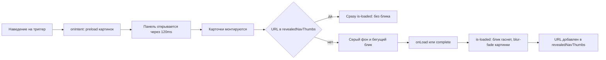

# Единый `NavThumb` для превью в мега-меню

## Проблема

Skeleton с бегущим бликом и плавное blur-появление существуют только в панели Inspiration.
Причина: там картинка обёрнута в собственный компонент `InspirationThumb`, у которого есть
состояние загрузки. Все остальные панели используют `MegaMenuCardMedia` — рамку без состояния:
картинка вставляется браузером как только декодирована, поэтому текст появляется сразу,
а превью «выскакивают» вразнобой по мере прихода файлов.

Дополнительно при смене категории контейнер списка получает новый `key` и монтируется заново.
У Inspiration повторный показ гасится модульным `Set` уже раскрытых URL, у остальных такой
памяти нет — каждый переход по табам проигрывает появление с нуля.

## Целевое поведение

Во всех четырёх панелях — Magazine, UI guides, Resources, Inspiration — превью ведут себя
одинаково:

1. До загрузки картинки видна серая основа `#ececef` с бегущим бликом.
2. По `onLoad` (или сразу, если картинка пришла из кеша) блик гаснет, картинка проявляется
   плавно с лёгким blur.
3. Если этот URL уже показывался в этой сессии, компонент стартует в раскрытом состоянии:
   при переключении категории карточки меняются текстом и картинкой без повторного мигания.
4. Ховер-зум `hover-lift` работает как раньше.

## Файлы

| Файл | Действие |
|---|---|
| [`components/layout/nav/NavThumb.tsx`](components/layout/nav/NavThumb.tsx) | создать |
| [`components/layout/nav/InspirationThumb.tsx`](components/layout/nav/InspirationThumb.tsx) | удалить после переноса логики |
| [`components/layout/nav/MegaMenuCard.tsx`](components/layout/nav/MegaMenuCard.tsx) | удалить `MegaMenuCardMedia`, поправить docstring |
| [`components/layout/SiteHeader.tsx`](components/layout/SiteHeader.tsx) | заменить пять мест использования на `NavThumb` |
| [`styles/globals.css`](styles/globals.css) | переименовать `nav_inspiration-*` в `nav_thumb-*` |

## Шаг 1. Компонент `NavThumb`

Один компонент закрывает оба способа отдачи картинки: обычный `` и `next/image`.
Различие — проп `sizes`: если он передан, значит картинка идёт через оптимизатор Next
с `fill` и этим `sizes`; если нет — рендерится обычный ``.

Пропсы:

- `href` — адрес перехода;
- `image` — `src`;
- `title` — для `alt` вида `${title} preview`;
- `external` — внешняя ссылка, открывается в новой вкладке через `EXTERNAL_LINK_PROPS`;
- `sizes` — включает режим `next/image`;
- `decorative` — по умолчанию `true`: ссылка получает `aria-hidden` и `tabIndex={-1}`,
  потому что рядом в карточке есть ссылка на заголовок с тем же адресом.

Состояние:

```
const revealedNavThumbs = new Set<string>();
```

Модульный Set живёт вне компонента, поэтому переживает ремоунт списка при смене категории.
Ключ — URL исходника (`image`), он одинаков для `` и для `next/image`, так что
воспоминание работает в обоих режимах.

Инициализация: `useState(() => revealedNavThumbs.has(image))`.
На монтировании — если `loaded` ещё false и `imgRef.current?.complete`, вызвать reveal
(кешированная картинка может не прислать `onLoad`). `onError` тоже раскрывает, чтобы
сломанный файл не оставлял вечный блик.

Разметка:

- корень — ссылка с классами `nav_tabs-list-item-img-wr nav_thumb-img-wr hover-lift-media w-inline-block relative`
  плюс `is-loaded` при раскрытии;
- ссылка строится через `NavLink`, чтобы внутренние маршруты шли клиентской навигацией,
  а внешние оставались обычным `<a>`;
- внутри — картинка с классом `image-cover nav_thumb-img`. Для обычного `` сохранить
  инлайновые `position: absolute; inset: 0; width/height: 100%; objectFit: cover`,
  для `next/image` эти размеры даёт `fill`.

## Шаг 2. Перенос и удаление `InspirationThumb`

Логика из [`InspirationThumb`](components/layout/nav/InspirationThumb.tsx:14) переезжает
в `NavThumb` без изменений по смыслу. Имя Set меняется на `revealedNavThumbs`,
комментарий переписывается под общий случай: карточки ремоунтятся на любой смене категории,
а не только на перемешивании Inspiration.

После переноса файл `InspirationThumb.tsx` удаляется, импорт в `SiteHeader` снимается.

## Шаг 3. `MegaMenuCard`

`MegaMenuCardMedia` удаляется целиком: его единственная роль — рамка-ссылка — теперь внутри
`NavThumb`. Проп `media` остаётся, в него передаётся `<NavThumb />`.

В docstring `MegaMenuCardMedia` в типе (`/** Image slot: MegaMenuCardMedia or a custom thumb (InspirationThumb). */`)
заменить на упоминание `NavThumb`. Комментарий над компонентом про
`.nav_tabs-list-item-info-wr .hover-lift-title` не трогать: он про GA4-трекер.

## Шаг 4. `SiteHeader` — пять мест

| Место | Было | Стало |
|---|---|---|
| Полка дизайн-китов, [`SiteHeader.tsx:253`](components/layout/SiteHeader.tsx:253) | `MegaMenuCardMedia` + `next/image` | `NavThumb` с `sizes={CARD_IMAGE_SIZES}` |
| Magazine, [`SiteHeader.tsx:362`](components/layout/SiteHeader.tsx:362) | `MegaMenuCardMedia` + `` | `NavThumb` без `sizes` |
| UI guides, [`SiteHeader.tsx:397`](components/layout/SiteHeader.tsx:397) | `MegaMenuCardMedia` + `` | `NavThumb` без `sizes` |
| Resources, [`SiteHeader.tsx:434`](components/layout/SiteHeader.tsx:434) | `MegaMenuCardMedia` + `next/image` | `NavThumb` с `sizes={CARD_IMAGE_SIZES}` |
| Inspiration, [`SiteHeader.tsx:293`](components/layout/SiteHeader.tsx:293) | `InspirationThumb` | `NavThumb` с `external` |

Импорты: `MegaMenuCardMedia` и `InspirationThumb` убрать, добавить `NavThumb`.
Импорт `Image` из `next/image` удалить, если после правок в файле не останется других
использований. Константа `CARD_IMAGE_SIZES` и `preloadNextImage` / `preloadPlainImage`
остаются без изменений: предзагрузка по наведению намеренно строит тот же srcset,
что и карточка, а `NavThumb` в режиме `sizes` использует ровно этот же `sizes`.

Проверить, что у Inspiration-карточки остается `external`, иначе ссылка откроется в той же
вкладке, а UTM-хвост потеряет смысл перехода на app.setproduct.com.

## Шаг 5. CSS

В [`styles/globals.css`](styles/globals.css:1662) заменить имена:

- `.navbar .nav_inspiration-img-wr` → `.navbar .nav_thumb-img-wr` (блок с фоном и `overflow: hidden`);
- `.navbar .nav_inspiration-img-wr::after` → `.navbar .nav_thumb-img-wr::after` (блик);
- `.navbar .nav_inspiration-img-wr.is-loaded::after` → `.navbar .nav_thumb-img-wr.is-loaded::after`;
- `.navbar .nav_inspiration-img-wr .nav_inspiration-img` → `.navbar .nav_thumb-img-wr .nav_thumb-img`;
- `.navbar .nav_inspiration-img-wr.is-loaded .nav_inspiration-img` → `.navbar .nav_thumb-img-wr.is-loaded .nav_thumb-img`;
- в блоке `prefers-reduced-motion` — `.navbar .nav_inspiration-img-wr::after` и
  `.navbar .nav_inspiration-img` на новые имена.

Комментарий над блоком переписать: шиммер теперь общий для всех панелей, а не только
для перемешанных превью Inspiration. Анимацию списка `nav-cards-slide-in` и тайминги
не менять — они не относятся к появлению картинки.

Проверить, что не осталось вхождений `nav_inspiration` ни в CSS, ни в компонентах.

## Шаг 6. Проверка

- `npm run lint` (`tsc --noEmit`) — чистый.
- Локально 1440 и 1024: открыть каждую из четырёх панелей, убедиться, что блик виден
  до прихода картинки и гаснет при загрузке.
- Переключить по три категории в каждой панели: карточки меняются без повторного
  «мигания» картинок, которые уже показывались.
- Ховер на карточку: подъём рамки и зум картинки такие же, как до правки.
- `prefers-reduced-motion: reduce`: блик не бежит, картинка появляется без движения.
- Клавиатура: `Tab` по карточкам не заходит в ссылку-картинку (`decorative`), но заголовок
  и кнопки карточки доступны.

## Риски и как их снимаем

**`next/image` и `ref`.** Если ref на `img` внутри `Image` окажется недоступен, проверка
`complete` на монтировании просто не сработает, и раскрытие произойдёт по `onLoad`.
Для картинки из кеша браузер `onLoad` тоже присылает при вставке в DOM, поэтому визуально
разницы не будет — только на кадр позже. Отдельный код ради этого не пишем.

**Сетка карточек.** `nav_tabs-list-item-img-wr` задаёт `width: 158em; height: 125em; flex: none`.
Классы остаются на месте, поэтому геометрия не меняется.

**`aria-hidden` на ссылке.** Сейчас у Inspiration ссылка-картинка доступна с клавиатуры,
у остальных — нет. После унификации все становятся `decorative`. Это выравнивание,
а не регресс: рядом в той же карточке есть ссылка на заголовок с тем же адресом,
и дублирующая ссылка только удлиняет обход.

## Диаграмма потока



## Что НЕ делаем

- Не добавляем стаггер по карточкам: сейчас его нет, и в задаче речь про картинку,
  а не про порядок появления карточек.
- Не трогаем `nav-cards-slide-in` и тайминги hover-intent.
- Не меняем `preloadImages.ts` и `CARD_IMAGE_SIZES`: они уже дают нужный srcset.
- Не переводим Magazine и UI guides на `next/image`: их превью уже лежат готовыми
  webp-файлами в `/blog/covers/thumbs/` фиксированного размера, оптимизатор тут лишний.
