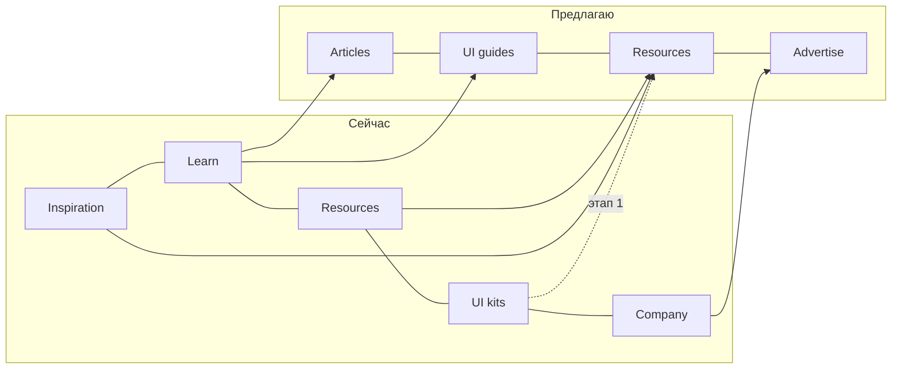

# Верхний навбар: перестройка под издание (план, 16.11.2026)

Статус: выпущено локально 16.11.2026, без push. Итоговые решения автора
расходятся с исходным предложением в двух местах:

1. Первый пункт называется `Magazine` (не `Articles`).
2. `Inspiration` остаётся в баре: после `Resources`, без бейджа `New`.
   В Resources строки `AI UI inspiration ↗` нет.

Итоговый бар: `Magazine` · `UI guides` · `Resources` · `Inspiration` ·
`Advertise` · поиск · `Get featured`. Коммиты: 3990dad, b50e812, 62f79e6,
56fec14, 1754db0, d5e3642, 6b737f7. Ниже текст исходного предложения.

Продолжает
[`nav-depth-and-publish-leads-2026-11.md`](./nav-depth-and-publish-leads-2026-11.md)
(Фаза 3, замена Company на Advertise),
[`publish-showcase-phase5-1.md`](./publish-showcase-phase5-1.md) и Фазу 6 из
[`mega-menu-audit-2026-10.md`](./mega-menu-audit-2026-10.md) (порядок пунктов по данным).

## 1. Короткий ответ

| | Пункты бара |
|---|---|
| Сейчас | `Inspiration (New)` · `Learn` · `Resources` · `UI kits` · `Company` · поиск · `Get featured` |
| Предлагаю | `Articles` · `UI guides` · `Resources` · `Advertise` · поиск · `Get featured` |

Четыре пункта вместо пяти. Киты уходят с верхнего уровня в два этапа, страницы
китов остаются. Inspiration переезжает внутрь Resources. Company заменяется на
Advertise (это уже решено 05.11). Новый пункт `UI guides` даёт сквозной вход в
самую сильную группу страниц сайта.



## 2. На что опираюсь

GA4, 12.07–09.10.2026, [`ga4 Целевая_страница_Целевая_страница.csv`](./ga4%20Целевая_страница_Целевая_страница.csv).
Суммы по группам страниц я складывал вручную по строкам выгрузки, поэтому это
оценки с точностью до пары процентов.

| Факт | Цифра | Что из этого следует для бара |
|---|---|---|
| Страниц за сессию | 1,18 (60 355 / 51 157) | Бар видят в первые секунды на статье. Он должен предлагать следующее чтение, а не магазин |
| Входы на главную | 5 671, около 11% | 89% посетителей не видят новый hero. Что это за сайт, им сообщает только шапка |
| Входы на 31 гайд по компонентам (`*-ui-design`) | около 13 500, около 26% | Самая большая группа входов. В баре у неё нет своего входа, кроме 6 статей во вкладке Popular |
| Входы на гайды по стилям (liquid glass, claymorphism, neumorphism, brutalist, blueprint grid, bento) | около 6 000, около 12% | Вместе с компонентами это около 38% всех входов |
| Входы на `/templates/*` и страницы категорий китов | около 7 000, около 14% | Страницы китов живут за счёт поиска, а не за счёт меню. Убрать пункт из бара не значит потерять этот трафик |
| `buy_button_gumroad_click_on_catalog` | 2 события за 90 дней | Каталог почти не даёт кликов на покупку |
| `get_started_button_gumroad_on_products_c` | 1 041 клик, 837 человек | Со страниц китов на Gumroad уходят. Данных о самих продажах у меня нет, опираюсь на слова автора |
| Входы на страницы из Company | `/testimonials` 37 (1,7 с), `/legal/license` 42, `/legal/refunds-policy` 37 | Три из четырёх ссылок Company обслуживают покупку китов |
| Входы с издательским интентом | `guest-posting-opportunities` 609, `submit-a-guest-post` 585 | Аудитория для платного паблишинга уже приходит |
| Поиск | `search_form_on_categories_submit` 1 444; у входов на `/search` доля сессий с ключевым событием 0,5 | Поиск в баре оставляем на виду |

Чего в выгрузках нет: событий `nav_menu_open`, `nav_click`, `nav_buy_click`
(заведены 22.10) и `publish_cta_click` (05.11). Выгрузки заканчиваются 09.10.
Какой пункт меню реально открывают, я не знаю. См. раздел 8.

## 3. Что не так с текущим баром

| # | Проблема | Где |
|---|---|---|
| N1 | Бар описывает магазин Figma-китов и школу дизайна: `Learn`, `UI kits`, `Inspiration`, подсказки поиска `Search Figma kits…`. Главная при этом называет сайт изданием для фаундеров | [`SiteHeader.tsx:270`](../components/layout/SiteHeader.tsx:270), [`navConfig.ts:198`](../components/layout/nav/navConfig.ts:198) |
| N2 | `UI kits` занимает пункт верхнего уровня, 7 ссылок на категории и 6 карточек с кнопками `Buy` для направления, которое сворачивается | [`SiteHeader.tsx:389`](../components/layout/SiteHeader.tsx:389), [`navConfig.ts:102`](../components/layout/nav/navConfig.ts:102) |
| N3 | Первым стоит `Inspiration` с бейджем `New`: он открывает другой домен в новой вкладке. При глубине 1,18 первый пункт уводит с сайта | [`SiteHeader.tsx:271`](../components/layout/SiteHeader.tsx:271) |
| N4 | `Company`: Testimonials, License, Refund policy относятся к китам. Промо паблишинга стоит вторым после `Need a custom design?` | [`navConfig.ts:119`](../components/layout/nav/navConfig.ts:119), [`CompanyPanel.tsx:76`](../components/layout/nav/CompanyPanel.tsx:76) |
| N5 | Главная монетизация представлена одной кнопкой `Get featured` без цены, срока и объяснения | [`SiteHeader.tsx:474`](../components/layout/SiteHeader.tsx:474) |
| N6 | `Learn` звучит как «обучение». В колонке темы стоят после Popular и Latest, порядок начинается с UI design | [`navConfig.ts:80`](../components/layout/nav/navConfig.ts:80) |
| N7 | Указатель 31 гайда есть только на главной, которую видят 11% | [`data/home.ts:47`](../data/home.ts:47) |

## 4. Три варианта

| Вариант | Бар | Плюсы | Минусы |
|---|---|---|---|
| 1. Минимальный | `Articles` · `Resources` · `Inspiration` · `Advertise` | Меньше всего работы: переименование, перестановка, киты во вкладку Resources | Гайды остаются без входа. Inspiration по-прежнему уводит с сайта |
| 2. Издание с указателем гайдов (рекомендую) | `Articles` · `UI guides` · `Resources` · `Advertise` | Закрывает N1–N7. Переиспользует готовые панели. Четыре пункта свободно помещаются на 1024 | Нужна одна новая панель (указатель). Дизайн занимает второй пункт бара, хотя позиционирование шире дизайна |
| 3. Рубрики прямо в баре | `Startups` · `Growth` · `AI & tech` · `Design` · `Resources` · `Advertise` | Сразу читается как издание. Каждый клик даёт просмотр страницы | Шесть пунктов плюс поиск и кнопка могут не поместиться на 1024. Мега-меню статей выбрасывается. Категории блога не ложатся в четыре рубрики один к одному |

Почему вариант 2: трафик приносят дизайнерские гайды, а деньги приносят
фаундеры и маркетологи. Бар должен обслужить обе группы. `Articles` ведёт в
широкие темы, `UI guides` удерживает тех, кто пришёл из Google на гайд,
`Advertise` и кнопка продают размещение.

## 5. Вариант 2 по пунктам

```
[Logo]   Articles ▾   UI guides ▾   Resources ▾   Advertise ▾        [ Search… ]   [Get featured]
```

### 5.1 `Articles` (бывший `Learn`)

- Та же панель [`MegaMenuPanel`](../components/layout/nav/MegaMenuPanel.tsx): колонка тем слева, 6 карточек справа.
- Новый порядок колонки: `Popular`, `Latest`, `Startups & SaaS`, `Growth hacking`, `SEO`, `Technology`, `UI design`, `Design & code`, `Research`. Темы рекламодателей поднимаются, `UI design` опускается, потому что у гайдов появляется свой пункт.
- Запасные варианты подписи: `Magazine` (так сайт называет себя на главной) или `Topics`.

### 5.2 `UI guides` (новый пункт)

Указатель текстовыми ссылками, без колонки категорий. Картинки только у трёх
закреплённых гайдов слева.

```
┌──────────────────────────────────────────────────────────────────────────────────┐
│ START HERE             COMPONENTS A–Z                            VISUAL STYLES   │
│ [img] Data table       Accordion     Checkbox     Input field    Liquid glass    │
│ [img] Tabs             AI chat       Chip         Notifications  Claymorphism    │
│ [img] Dashboard        App bar       Dashboard    Pagination     Neumorphism     │
│                        Avatar        Data table   Pricing page   Retro brutalist │
│ All UI design posts →  Badge         Date picker  …              Blueprint grid  │
└──────────────────────────────────────────────────────────────────────────────────┘
```

- Источник: `HOME_UI_GUIDES` из [`data/home.ts:47`](../data/home.ts:47). Список переносится в общий файл `data/ui-guides.ts`, чтобы главная и меню читали одно и то же.
- Зачем: читатель гайда по таблицам с наибольшей вероятностью откроет гайд по другому компоненту. Сейчас меню показывает ему 6 статей из 31.
- Побочный эффект для SEO: каждая страница сайта получает ссылку на каждый из 31 гайда (сквозная перелинковка). Рост позиций от этого не обещаю, но направление верное.
- Колонка `Visual styles`: 6–7 статей, которые дают ещё около 12% входов.
- Мобильное меню: аккордеон, ссылки в две колонки, без картинок.

### 5.3 `Resources`

Колонка категорий после правки:

```
Latest
UI components
Icons and animations
Design and AI tools
Desktop utilities
Self-hosted apps
Figma templates
────────────────
Design kits            ← этап 1, позже убирается
AI UI inspiration ↗    ← бывший пункт Inspiration
```

- `Figma templates` опускается вниз. Это согласуется с решением от 16.11 для главной (без Figma, сначала свежие инструменты).
- `Design kits` стоит под разделителем: на главной уже была путаница, когда блок `Resources` показывал платные киты (пункт D6 плана главной). Карточки китов в меню без кнопки `Buy`, только `Learn more`.
- Что сейчас показывает вкладка `All topics`, я не проверял: [`navPreviews.ts`](../components/layout/nav/navPreviews.ts) не читал. Если там не свежие добавления, первую вкладку стоит привязать к `HOME_FREEBIE_SLUGS`.

### 5.4 `Advertise` (вместо `Company`)

Панель уже спроектирована в [`publish-showcase-phase5-1.md`](./publish-showcase-phase5-1.md):
слева факты из [`PUBLISH_OFFER`](../lib/publish.ts:22) и кнопка `See packages`,
справа три наши статьи с бейджем `Page 1 on Google`.

Две поправки к тому мокапу:

1. В нижней строке вместо `About · Testimonials · License · Refunds · Contact` оставить `Read the terms` (условия платных постов) и `Contact us`. Страницы About на сайте нет. Testimonials, License и Refund policy относятся к китам и уже есть в футере ([`SiteFooter.tsx:52`](../components/layout/SiteFooter.tsx:52)).
2. Промо `Need a custom design?` сжать до одной строки со ссылкой на форму контакта или убрать. Зависит от ответа на вопрос 3 в разделе 9.

### 5.5 Кнопка и поиск

- `Get featured` остаётся. Отдельная идея на потом: сделать её основной (залитой) вместо `outlined`. В шапке нет другой основной кнопки, правило «одна primary на секцию» не нарушается. Делать отдельным выпуском, иначе не поймём, что именно повлияло на клики.
- Подсказки поиска в [`navConfig.ts:198`](../components/layout/nav/navConfig.ts:198): `Search articles…`, `Search UI guides…`, `Search free resources…` вместо `Search Figma kits…`.

## 6. Киты: уход по этапам

| Этап | Где киты видны | Условие перехода |
|---|---|---|
| 0, сейчас | Пункт бара, блок на главной, колонка футера | — |
| 1 | Строка `Design kits` внутри Resources, блок на главной, футер | Сразу, вместе с перестройкой бара |
| 2 | Только футер и главная | Клики по строке `Design kits` в `nav_click` близки к нулю за 4 недели |
| 3 | Раздел закрыт | Отдельное решение автора. Нужны 301-редиректы с `/templates/*` на близкие статьи или ресурсы: это правка `next.config.js` и около 7 000 входов за квартал, которые иначе уйдут в 404 |

Если свежая выгрузка покажет, что `nav_buy_click` и клики в панели `ui_kits`
уже около нуля, этап 1 можно пропустить и сразу оставить киты в футере.

Что теряем на этапах 1–2: шесть карточек китов и семь ссылок на категории
перестают повторяться на каждой странице. Ссылки на категории остаются в
футере ([`SiteFooter.tsx:47`](../components/layout/SiteFooter.tsx:47)), поэтому
поисковик страницы не потеряет. Позиции страниц китов могут просесть. Это
согласуется с решением «за позициями по китам не охотимся», но 14% входов
стоит держать в голове.

## 7. Порядок выпуска

Фаза 3 плана навигации ждёт до ~19.11: копятся две недели `publish_cta_click`
по `header` и `company_panel`, чтобы сравнить «до» и «после» замены Company на
Advertise. Если одновременно перестроить весь бар, это сравнение перестанет
показывать эффект именно панели Advertise.

| Выпуск | Что входит | Что измеряем |
|---|---|---|
| A, после ~19.11 | Company → Advertise, больше ничего | `publish_cta_click` по `header`, `advertise_panel` против базы |
| B | Киты во вкладку Resources, Inspiration туда же, `Learn` → `Articles` с новым порядком тем, подсказки поиска | `nav_menu_open` и `nav_click` по пунктам, страниц за сессию |
| C | Панель `UI guides` | `nav_click` из панели, страниц за сессию для входов на гайды |

Альтернатива: один выпуск A+B+C. Быстрее, но эффект Advertise отдельно не
увидеть. Клики на паблишинг и так исчисляются малыми числами, поэтому любое
сравнение здесь даст направление, а не доказательство.

Технические мелочи для реализации:

- [`NAV_MENU_ID`](../lib/nav/analytics.ts:10): добавить `guides` и `advertise`. Клики по китам после переезда пойдут с `menu_name = resources`, это надо учесть при сравнении с прошлым периодом.
- [`PublishLocation`](../lib/publish.ts:41): `advertise_panel`, `advertise_panel_mobile`.
- Подсветка активного пункта: статья из указателя подсвечивает `UI guides`, остальные статьи подсвечивают `Articles`.
- Проверка на 1440 / 1024 / 768 / 390, клавиатура, `npm run lint`, `npm run build`.

## 8. Чего я не проверял

- Сайт в браузере не открывал. Что четыре пункта помещаются на 1024, это ожидание по числу пунктов, а не замер.
- Нет данных `nav_*` и `publish_cta_click`: выгрузки в `plans/` заканчиваются до их появления.
- Нет данных о продажах китов на Gumroad и о заявках на портале паблишинга.
- Не знаю, какую роль играет app.setproduct.com (куда ведёт Inspiration) в планах автора.
- Доля мобильных именно среди тех, кто открывает меню, неизвестна.

Нужна выгрузка GA4 с 22.10 по сегодня:

1. `nav_menu_open` в разрезе `menu_name`.
2. `nav_click` в разрезе `menu_name` и `link_type`.
3. `nav_buy_click`, общее число.
4. `publish_cta_click` в разрезе `location`.

От неё зависят три решения: место Inspiration, нужен ли этап 1 для китов,
работает ли вкладка Popular.

## 9. Решения, которые нужны от автора

1. Вариант бара: 1, 2 или 3.
2. Inspiration: app.setproduct.com остаётся важным продуктом (тогда пункт остаётся в баре, но последним и без бейджа `New`) или его можно убрать внутрь Resources.
3. Заказной дизайн (`Need a custom design?`, `Get a quote`): услуга ещё продаётся?
4. Три выпуска с замером или один общий.
5. Подпись первого пункта: `Articles`, `Magazine` или `Topics`.
6. Киты: через этап 1 (строка в Resources) или сразу в футер.
