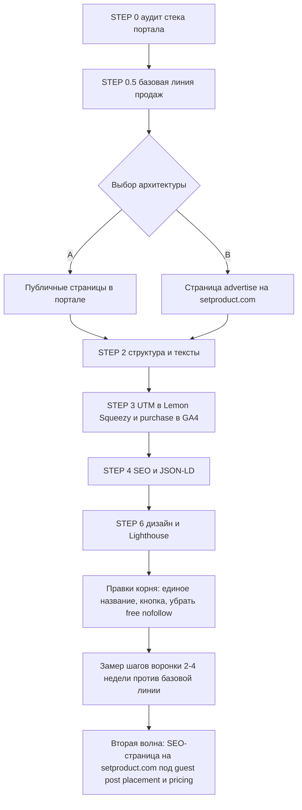

# Промпт для ИИ-агента: превращаем publish.setproduct.com в полноценный ресурс

Дата: 2026-11-09. Автор постановки: Architect-режим.
Связанные планы: [`nav-depth-and-publish-leads-2026-11.md`](./nav-depth-and-publish-leads-2026-11.md),
[`footer-engagement-and-publish-leads.md`](./footer-engagement-and-publish-leads.md),
[`publish-showcase-phase5-1.md`](./publish-showcase-phase5-1.md),
[`guest-posting-cannibalization-diagnosis-2026-10.md`](./guest-posting-cannibalization-diagnosis-2026-10.md),
[`../.ai/guest-posts-rescue-plan.md`](../.ai/guest-posts-rescue-plan.md).

---

## Часть 1. Что известно на сегодня (контекст для агента)

### 1.1. Оффер (единственный источник истины: `lib/publish.ts` → `PUBLISH_OFFER`)

| Факт | Значение | Где подтверждено |
|---|---|---|
| План Accelerate | $288, 1 dofollow, до 3 000 слов, **выход за 24 часа**, размещение в блоге | решение автора 09.11 |
| План Maximize | $348, 2 dofollow, до 5 000 слов, **выход за 4 часа (urgent mode)**, блог + главная, рассылка на 7 000 подписчиков, аналитика | решение автора 09.11 |
| Охват | 17 000 читателей в месяц (по решению автора 17–19 тыс.) | `PUBLISH_OFFER.readersPerMonth` |
| Авторитет | DR 42 | `PUBLISH_OFFER.domainRating` |
| Индексация | гарантия индексации, обычно за 48 часов | terms |
| Срок жизни | пост остаётся навсегда, правки после публикации бесплатно | terms |
| Возвраты | нет, гарантия только срока публик��ции | terms |
| Бесплатный вариант | **убран (решение автора 09.11):** боимся потока мусорных статей. Не упоминать нигде | решение автора |
| Платежи | Lemon Squeezy | автор, 09.11 |
| Sponsored-метка | по умолчанию нет, по запросу клиента | terms, решение автора 05.11 |
| Запрещённые темы | гемблинг, CBD, adult, вещества, hate speech, спам | terms |
| После оплаты | member zone: драфт, анкоры, медиа, превью, статус, саппорт | terms |

✅ **Сроки (решение автора 09.11): Accelerate за 24 часа, Maximize за 4 часа (urgent mode).** Это гарантии, а не «обычно». В полосе фактов пишем «live in 24 hours» (базовый срок), в карточке Maximize отдельный акцент `Live in 4 hours`. `PUBLISH_OFFER.turnaround = "24 hours"` на корне остаётся верным. Формулировки «3 days» и «3 business days» удаляются везде.

Плюс для продаж: раньше Maximize отличался только объёмом и числом ссылок, теперь у доплаты в $60 появилась понятная причина, срочность. Для запуска продукта или новостного повода 4 часа ценнее второй ссылки.

⚠️ Операционный риск: 4 часа означают, что пост надо проверить и выложить в любое время суток, включая ночь по Москве (основные покупатели в США и Индии). Агенту: автору отправлять мгновенное уведомление о заказе Maximize (email или Telegram через вебхук Lemon Squeezy), покупателю в кабинете показывать ожидаемое время выхода. Отсчёт начинается, когда драфт загружен, а не с оплаты. Писать в карточке мелким шрифтом: `4 hours after your draft is in`.

### 1.1a. Решения автора 09.11.2026

| Вопрос | Решение | Что делать |
|---|---|---|
| Сроки | Accelerate 24 часа, Maximize 4 часа | Убрать «3 days» / «3 business days» из карточек и FAQ портала, обновить таблицу и раздел turnaround на корне (часть 6) |
| Название | **Setproduct Guest Posts** | См. часть 2, как не звучать как биржа |
| Репозиторий портала | на GitHub | Как подключить: часть 7 |
| Тариф Starter (free nofollow) | **убрать** | Удалить из FAQ портала вместе с «Foundation Plan». На корне удалить абзацы про бесплатный nofollow в [`TermsOfPaidPostsPage.tsx`](../components/pages/TermsOfPaidPostsPage.tsx:132) (см. часть 6) |
| Платежи | Lemon Squeezy | Учесть в STEP 0 и STEP 3 (см. 1.7) |
| Продажи | 2 за полгода, точных данных нет | См. 1.6, расчёт конверсии |
| Трафик портала | 10–15 визитов в день, почти весь с setproduct.com | Органики на портале фактически нет |

### 1.2. Что уже сделано на setproduct.com (не ломать)

- Все ссылки на портал идут через `getPublishLinkProps(location)`: UTM `utm_source=setproduct.com&utm_medium=<location>&utm_campaign=publish`.
- GA4-событие `publish_cta_click` с `location` (header, company_panel, footer, footer_band, home_hero, faq, blog_inline, blog_sidebar, terms_page, content).
- Кнопка в шапке `Get featured`, CTA в статьях категорий SEO, Growth Hacking, Startups & SaaS.
- `/legal/terms-of-paid-posts` на корневом сайте: человеческое объяснение условий.
- Отложено до ~19.11: пункт `Advertise` вместо `Company` в меню и витрина охвата.

### 1.3. Главная проблема, которую решаем

Человек кликает `Get featured` и попадает на publish.setproduct.com. По данным GSC единственная заметная страница портала в индексе это `publish.setproduct.com/login` (0 кликов). Значит портал сейчас воспринимается как вход в кабинет, а не как витрина услуги. По сайту при этом живёт **пять разных названий** одного оффера: Get featured, Advertise with us, Publish on our blog, Publish with us, Write for us. Посетитель не понимает, что это одна услуга и что именно он покупает.

### 1.4. Спрос по данным GSC (окно 2026-07-07 → 2026-10-06, весь `*.setproduct.com`)

Транзакционные запросы, где люди ищут, **куда заплатить за размещение**:

| Запрос | Показы | Клики | Позиция | Вывод |
|---|---|---|---|---|
| guest post placement | 1 203 | 0 | 13.4 | прямой коммерческий интент, страницы под него нет |
| submit a guest post (+ technology / saas / business / software, все вариации) | ~1 500 суммарно | ~60 | 8–25 | лучший CTR кластера (10–17%), ядро ресурса |
| write for us web development (+ вариации) | ~200 | ~35 | 12–30 | высокий CTR, но «write for us» читается как бесплатное |
| guest post pricing | 309 | 0 | 7.5 | ценовой интент, отвечает прайс-страница |
| paid guest post sites / paid guest posting sites / paid guest posting | ~150 | 4 | 11–13 | ровно наш продукт |
| platform for guest post / guest post network | ~330 | 2 | 10–14 | «площадка», а не одиночный блог |
| accepting guest posts (+ technology / saas) | ~550 | 4 | 13–20 | ищут сайты, принимающие посты |
| saas guest posting sites / saas sites for guest posting | ~30 | 2 | 8–12 | нишевый, конверсионный |
| guest post backlinks / quality guest posts | ~825 | 5 | 12–15 | ссылочный интент |

Информационный кластер (guest posting opportunities, benefits of guest blogging, guest posts vs niche edits) остаётся в блоге setproduct.com и **не переносится** на портал: иначе каннибализация.

### 1.5. Текущая страница портала (скриншот автора, 09.11.2026)

Автор вёл трафик прямо на прайсинг, это был MVP. **Он продаёт сам:** были продажи по $288 без переписки и торга. Покупатель платил со страницы и потом загружал драфт в кабинете. Перекупщики со своими $30 не появлялись: открытая цена сама отсекает тех, кто пришёл торговаться.

Что сейчас на странице, сверху вниз:

| Блок | Содержимое |
|---|---|
| Шапка | логотип Setproduct, подпись `Guest Blogging`, справа одна кнопка `Login` (кнопки регистрации нет) |
| H1 | `Guest post submit for tech businesses` |
| Лид | «Increase your online visibility, drive targeted traffic, and boost your website's SEO… We offer three distinct plans…» |
| Тарифы | 2 карточки: Accelerate $288 (выделена, primary-кнопка) и Maximize $348 (outlined). Кнопка `Start posting` у обеих |
| FAQ | 7 вопросов простым текстом с префиксами `Q:` / `A:` |
| Футер | Guidelines, Blog, Design Kits, Terms of Service |

#### Что работает, это нельзя сломать

1. **Цена на первом экране.** Человек видит $288 сразу и решает сам, без формы заявки. Именно поэтому нет торга.
2. **Короткий путь:** тариф → `Start posting` → оплата → кабинет. Шагов минимум.
3. **Выделен Accelerate**, и продажи шли именно по нему. Делать «рекомендуемым» Maximize без замера нельзя.
4. **Ключ в H1:** `guest post submit` близко к ядру спроса `submit a guest post`.
5. **Условия расписаны в FAQ:** что будет после оплаты, сроки, запреты, возвраты.

#### Что мешает: дыры в доверии и в понимании

| # | Проблема | Почему важно |
|---|---|---|
| G1 | **Нет ни одной цифры охвата.** На странице нет 17,000 readers, DR 42, гарантии индексации и того, что пост остаётся навсегда | Человек платит $288, не зная, за какую аудиторию. Сильнейшие аргументы есть в `PUBLISH_OFFER`, но здесь их нет |
| G2 | **Призрачные тарифы.** В лиде «three distinct plans», а карточек две. В FAQ есть «Starter Plan (free)» и «Foundation Plan up to 2,000 words», которых на странице нет | Выглядит заброшенным, подрывает доверие перед оплатой |
| G3 | **Не видно, где опубликуют.** Нет ни скриншота блога, ни примеров статей, ни описания читателей | Покупатель не видит площадку, которую покупает |
| G4 | **Пустые обещания** вместо фактов: «Increases domain authority», «Ideal for growing businesses», «dominate the tech landscape» | Шаблонная агентская речь, человек из SaaS ей не верит |
| G5 | **Сроки расходятся:** в карточке «3 days», в FAQ «3 business days», на корне «24 hours». Решено: 24 часа �� 4 часа | Мелочь, которая выглядит как хитрость |
| G6 | **Title Case:** `Accelerate Plan`, `Frequently Asked Questions`, `Do-follow`; лишнее `/per guest article` | Нарушает правила проекта, выглядит неаккуратно |
| G7 | **FAQ простым текстом:** вероятно, без FAQPage JSON-LD, без аккордеона, длинная простыня | Упущенный расширенный сниппет, тяжело читать |
| G8 | **Нет «как это работает».** 4 шага спрятаны в ответе FAQ | Человек с корня не понимает процесс за 5 секунд |
| G9 | **Шапка `Guest Blogging` + `Login`** не ведёт обратно на setproduct.com и не говорит, что это блог Setproduct | Переход с корня ощущается как переход на чужой сайт |
| G10 | **На десктопе узкая колонка ~400px** в окне 2500px, по бокам пусто | Страница выглядит как черновик, хотя продаёт |
| G11 | **Не видно способов оплаты** до клика | Лишняя неопределённость перед кнопкой |
| G12 | **«No refunds» без смягчения рядом с CTA:** гарантия срока есть, но спрятана в FAQ | Страх потерять деньги |

#### Что это меняет в плане

1. **Перестройка эволюционная, страницу с нуля не рисуем.** Скелет «цена на первом экране → Start posting → кабинет» сохраняется. Вокруг него добавляем доверие: цифры, примеры площадки, шаги, приведённый в порядок FAQ.
2. **Архитектура: рекомендация сдвигается к A.** Оплата и кабинет живут на портале и уже конвертируют, поэтому продающая страница остаётся там же. Страница `/advertise` на корне становится второй волной как SEO-кормилец, а не заменой.
3. **Нельзя добавлять «Request a quote», «Contact sales» и формы заявки.** Они откроют дверь торгу, который сейчас отсечён.
4. **До изменений снять базовую линию:** визиты прайсинга, клики `Start posting`, оплаты, всё в разрезе `utm_medium`. Без этого не понять, улучшили или сломали.
5. **Главный сценарий нового первого экрана:** H1 с ключом → строка фактов (17,000 readers, DR 42, live in 24 hours, indexed by Google) → те же две карточки с ценой. Цена должна остаться видна без скролла на 1440 и как минимум начинаться в первом экране на 390.

### 1.6. Воронка в цифрах и что из этого следует (по ответам автора 09.11)

Грубый расчёт: 10–15 визитов в день × ~180 дней ≈ **1 800–2 700 визитов за полгода**. Продаж **2**, выручка ~$576. Конверсия визита в оплату **≈ 0.07–0.11%**.

Выводы:

1. **Модель цены работает, страница пока нет.** Открытая цена правильно отсекает торг: оба покупателя заплатили полную цену сами. Но 1 покупатель на ~1 000 визитов означает, что почти все уходят, так ничего и не поняв. Это прямо совпадает с G1–G12: нет охвата, площадки и доверия. Скелет страницы сохраняем, а наполнение первого экрана и блоков доверия меняем смело.
2. **A/B-тесты на портале невозможны.** При 2 продажах за полгода любой сплит-тест будет годами копить значимость. Вместо A/B меряем **промежуточные шаги воронки**, где событий в сотни раз больше:
   `publish_page_view` → `pricing_view` (доскролл до тарифов) → `start_posting_click` → `checkout_open` (открылся Lemon Squeezy) → `purchase`.
   Если сравнить шаги «до» и «после» редизайна хотя бы по 2–4 недели, будет видно, на каком шаге люди отваливаются. Все пункты промпта «решается A/B» заменены на «решается по шагам воронки и с согласия автора».
3. **Весь трафик сейчас приходит с кор��я, органики нет.** Значит у роста два рычага:
   - **Конверсия** (этот промпт): даже рост с 0.1% до 0.5% при том же трафике даёт ~10 продаж за полгода вместо 2.
   - **Органика**: спрос из раздела 1.4 (`guest post placement`, `guest post pricing`, `submit a guest post …`) сейчас не ловится ничем. Отсюда путь B (SEO-страница на корне с авторитетом домена) остаётся обязательной **второй волной**, а не «опционально».
4. **Базовую линию снимаем с нуля.** Точных данных нет, поэтому первая задача агента (STEP 0.5) — поставить события воронки на **текущую** страницу без изменения вёрстки и собрать 2 недели данных. Только потом редизайн.

### 1.7. Lemon Squeezy: что это даёт и что проверить

Lemon Squeezy работает как merchant of record: он сам продаёт от своего имени, сам считает и платит налоги (VAT, sales tax) и показывает свой checkout. Что из этого важно для задачи:

- **Способы оплаты.** Checkout Lemon Squeezy обычно принимает карты, PayPal, Apple Pay и Google Pay. Агент проверяет, что именно включено в аккаунте, и показывает эти иконки под тарифами со строкой `Secure checkout by Lemon Squeezy` (закрывает G11 и снижает страх перед оплатой).
- **Сквозные UTM.** В ссылку checkout можно передать свои данные (`checkout[custom][...]`), и они вернутся в вебхуке заказа. Сюда кладём `utm_source / utm_medium / utm_campaign`, сохранённые при входе на портал. Так в каждой продаже будет видно, с какого места setproduct.com пришёл покупатель.
- **Событие purchase.** Два способа, агент выбирает по стеку:
  - вебхук `order_created` → сервер портала → GA4 Measurement Protocol (надёжно, не зависит от блокировщиков);
  - JS-событие успешной оплаты в overlay-checkout (`Checkout.Success` в Lemon.js) → `gtag('event','purchase')`.
- **Связка оплаты с кабинетом.** Проверить, как сейчас заказ из Lemon Squeezy превращается в доступ к member zone (вебхук → Supabase?). Это критичная часть, её не трогать без согласования.
- **Кнопка `Start posting`.** Выяснить, что ��дёт первым: регистрация или checkout. Если сначала регистрация, это лишний шаг перед оплатой, и его стоит перенести после оплаты (аккаунт создаётся по email из заказа). Это решение только с согласия автора.

---

## Часть 2. Варианты названия (на выбор автору)

Принцип: имя бренда отдельно, SEO-фраза отдельно. Имя живёт в логотипе и навигации, SEO-фраза в title и H1. Двоеточие в title запрещено, sentence case обязателен.

| # | Название продукта | H1 / title портала (≤65 симв.) | Плюсы | Минусы |
|---|---|---|---|---|
| 1 ⭐ | **Setproduct Guest Posts** | `Submit a guest post on a DR 42 tech and design blog` (51) | Совпадает с ядром спроса (`submit a guest post`, `guest post placement`), сразу понятно, что продаём | Звучит как «ещё одна биржа», если не показать цифры |
| 2 | **Setproduct Publish** (текущий субдомен) | `Paid guest posts on a tech blog read by 17,000 founders` (55) | Совпадает с адресом, не требует переименования | Само слово «publish» не ищут, вся SEO-нагрузка на title |
| 3 | **Setproduct Sponsored Posts** | `Sponsored posts for SaaS and tech brands, from $288` (51) | Честно для рекламодателя, цена в сниппете | `sponsored` почти не ищут в наших данных, конфликт с решением «не помечать как sponsored» |
| 4 | **Setproduct Write for Us** | `Write for us, tech and design guest posts from $288` (52) | Высокий CTR запросов `write for us …` | Уже выявленная проблема: подпись обещает бесплатное авторство |

Рекомендация: **вариант 1 как бренд + адрес остаётся publish.setproduct.com**. Единая подпись кнопки на всех площадках корня: `Get featured` (уже стоит) или `Submit a guest post`. Выбор по `publish_cta_click` на корне, где кликов достаточно, а не по продажам. Все пять нынешних названий сводятся к одному.

✅ **Решение автора 09.11: Setproduct Guest Posts.**

#### Как не звучать как биржа гестпостов

Опасение автора верное: фраза «guest posts» в выдаче живёт рядом с биржами, где продают ссылки за $30 и списки «1000+ high DA sites». Ключ нужен для SEO, но всё вокруг него должно говорить «редакционный блог», а не «ссылочная ферма». Правила для агента:

1. **Одна площадка, а не сеть.** Везде «our blog», «the Setproduct blog», никогда «sites», «network», «inventory», «list of blogs».
2. **Запретная лексика бирж:** `high DA`, `cheap`, `affordable`, `bulk`, `packages`, `link juice`, `guaranteed ranking`, `100% dofollow`, `niche relevant sites`, `PBN`, восклицательные знаки, `!!!`, эмодзи-галочки в заголовках, «limited offer». DR 42 упоминать один раз в полосе фактов, а не в каждом блоке.
3. **Лицо и автор.** Блок «Who's behind the blog»: Roman Kamushken, 13 лет в UI-дизайне, автор Setproduct. Биржи анонимны, у нас есть конкретный человек и бренд с историей UI-китов.
4. **Показывать площадку, а не цифры.** Скриншот блога, 3 наших статьи с первой страницы Google, тематика читателей (дизайнеры, основатели, разработчики). Это то, чего у бирж нет.
5. **Отказы как знак качества.** «We decline most drafts we get» и короткий список того, что не публикуем. Биржа берёт всё, редакция выбирает.
6. **Визуал Setproduct**, а не шаблон агентства: фирменный шрифт, фиолетовый, много воздуха, никаких стоковых рукопожатий и графиков «рост трафика».
7. **В логотипе и шапке** `Setproduct` крупно, `Guest posts` мелко рядом, как раздел бренда. SEO-фраза работает в title и H1, а визуально доминирует бренд.

---

## Часть 3. Промпт для агента (копировать целиком)

````markdown
# Задача: превратить publish.setproduct.com в полноценный продающий ресурс

## Роль
Ты senior full-stack разработчик и продуктовый дизайнер. Работаешь в репозитории
портала publish.setproduct.com (отдельный проект, связанный с setproduct.com).
Автор проекта дизайнер, объясняй решения просто, на русском, термины кратко
поясняй при первом упоминании. Перед любыми существенными изменениями показывай
план и жди подтверждения.

## Цель (одним предложением)
Человек, перешедший с setproduct.com по кнопке «Get featured», за 5 секунд
понимает: здесь можно купить публикацию статьи со ссылкой на свой продукт
в блоге Setproduct, сколько это стоит, что он получит и как это купить.

## Текущее состояние (важно, прочитать до любых предложений)
Сейчас publish.setproduct.com — это одна страница-прайсинг: H1
«Guest post submit for tech businesses», две карточки тарифов
(Accelerate $288 выделен, Maximize $348) с кнопкой «Start posting»,
FAQ простым текстом, в шапке только «Login». Оплата идёт через
Lemon Squeezy, после неё покупатель загружает драфт в кабинете.
Цифры: 10–15 визитов в день, почти все с setproduct.com, органики нет.
За полгода 2 продажи по $288, обе без переписки и торга. Конверсия
около 0.1%.
Вывод: модель «открытая цена → самостоятельная оплата» правильная,
она отсекает перекупщиков, которые торгуются. Но почти все посетители
уходят, не поняв, что и за какой охват они покупают.
Поэтому скелет «цена на первом экране → Start posting → оплата →
кабинет» сохраняем, а наполнение страницы (первый экран, доверие,
объяснение процесса) меняем смело.
Известные проблемы страницы: нет цифр охвата (readers, DR, индексация,
пост навсегда); лид обещает «three plans», а их два; в FAQ упоминаются
Starter (free) и Foundation (2,000 words), которых нет (Starter убран
решением автора, удалить все упоминания); сроки «3 days» и
«3 business days» расходятся (официально: Accelerate 24 часа,
Maximize 4 часа); шаблонные фразы
(«dominate the tech landscape», «increases domain authority»); Title Case
в заголовках; нет блока «как это работает», нет примеров площадки;
не видно способов оплаты; шапка не ведёт на setproduct.com; узкая
колонка на десктопе.

## Метрики успеха
Трафик маленький, продажи редкие, поэтому A/B-тесты на портале не
проводим. Меряем шаги воронки до и после редизайна (минимум 2–4 недели
на каждый период):
1. `publish_page_view` → `pricing_view` → `start_posting_click` →
   `checkout_open` → `purchase`. Конверсия каждого шага, разрез
   по `utm_medium`.
2. Итоговая конверсия визита в оплату: сейчас ~0.1%, цель на первую
   волну 0.3–0.5%.
3. Органические клики на портал из Google по запросам кластера
   «submit a guest post / guest post placement / guest post pricing»
   (сейчас около нуля, в индексе только /login).

## Факты оффера (не придумывать других цифр)
- Название продукта: Setproduct Guest Posts. В шапке «Setproduct» крупно,
  «Guest posts» мелко, как раздел бренда.
- Accelerate: $288, 1 dofollow-ссылка, до 3 000 слов, публикация
  за 24 часа, размещение в блоге.
- Maximize: $348, 2 dofollow-ссылки, до 5 000 слов, публикация за 4 часа
  (urgent mode), блог + главная, рассылка на 7 000 подписчиков, аналитика.
  Срочность — главный аргумент доплаты, вынести её первой строкой карточки.
- Срок считается с момента, когда драфт загружен в кабинет, а не с оплаты.
  Писать мелким шрифтом в карточках.
- 17,000 читателей в месяц, DR 42, большинство постов выходит за 24 часа,
  гарантия индексации Google (обычно 48 часов), пост остаётся навсегда,
  правки после публикации бесплатно.
- В полосе фактов и мета: «live in 24 hours». Формулировки «3 days» и
  «3 business days» не использовать нигде.
- Предоплата через Lemon Squeezy, без возвратов, но с гарантией
  публикации в срок плана. Рядом с кнопкой показывать именно гарантию,
  а не «no refunds».
- Бесплатного тарифа НЕТ. Starter, Foundation и бесплатный nofollow
  нигде не упоминать.
- Запрещены: гемблинг, CBD, adult, запрещённые вещества, hate speech, спам.
- Sponsored-метка по умолчанию не ставится, только по просьбе клиента.
  Платные посты блога (автор Connor Patterson) НЕ показывать как примеры
  с пометкой «платный».
- Подробное объяснение условий уже есть на
  https://www.setproduct.com/legal/terms-of-paid-posts — ссылаться на неё.
Если какой-то цифры нет в этом списке, спроси автора, а не выдумывай.

## STEP 0. Аудит стека (обязательно, ничего не менять)
Прежде чем предлагать решения, изучи репозиторий и сдай отчёт:
1. Фреймворк и версии (package.json / composer.json / иное), роутер, способ
   рендера (SSG/SSR/SPA). Публичные страницы отдаются HTML с сервера или
   рисуются JS-ом на клиенте? Для SEO это критично.
2. Хостинг и деплой (Vercel? иное), домены, переменные окружения.
3. База данных и авторизация (есть признаки Supabase), где живут пользователи,
   заказы, черновики постов.
4. Платежи: Lemon Squeezy. Как открывается checkout (redirect или
   overlay через Lemon.js), какие способы оплаты включены, есть ли
   вебхук `order_created` и как он открывает доступ в кабинет.
   Что идёт первым после «Start posting»: регистрация или оплата.
5. Список всех текущих маршрутов: какие публичные, какие за логином.
6. Мета-теги, robots.txt, sitemap, canonical, noindex на публичных страницах.
7. Аналитика: GA4 тот же ID, что на setproduct.com? Читаются ли UTM?
   Есть ли события воронки (signup, checkout_start, purchase)?
8. Стили и UI: свой CSS, Tailwind, библиотека компонентов? Насколько можно
   переиспользовать визуальный язык setproduct.com (шрифт Uncut Sans,
   `--primary: #7c4dff`, кнопки с 3D-тенью, скругления по шкале 8/12/16/24).
Сдай отчёт таблицей «аспект → что нашёл → риск для задачи».
Жди подтверждения автора.

## STEP 0.5. Базовая линия (до любых правок)
Точных исторических данных нет. Поэтому первым делом поставь события
воронки на ТЕКУЩУЮ страницу без изменения вёрстки:
`publish_page_view`, `pricing_view` (тарифы попали в экран),
`start_posting_click` (с параметром `plan`), `checkout_open`, `purchase`
(с `plan`, `value`, `currency`, `utm_medium`). Все события в тот же GA4,
что у setproduct.com. UTM сохранять при входе (cookie / localStorage)
и передавать в Lemon Squeezy через `checkout[custom][utm_*]`.
Собери данные 2 недели, покажи автору таблицу шагов. Только потом
редизайн.

## STEP 1. Решение по архитектуре (выбрать вместе с автором)
Рекомендация по умолчанию: путь A, потому что оплата и кабинет живут
на портале и текущая страница уже конвертирует. Путь B (страница на
корне) рассматривать как вторую волну для SEO, а не как замену.
Предложи и сравни два пути:
- **A. Маркетинговые страницы внутри портала.** Публичная часть на
  publish.setproduct.com строится на текущем стеке, кабинет ��стаётся.
  Плюс: одна точка покупки. Минус: субдомен для Google почти отдельный сайт,
  авторитет setproduct.com передаётся слабо; если стек SPA, нужен SSR/SSG.
- **B. Гибрид.** Продающая страница `/advertise` (или `/guest-posts`)
  на setproduct.com (Next.js 15 Pages Router, SSG, Webflow-классы + Tailwind v4,
  уже есть `lib/publish.ts`, `PUBLISH_OFFER`, GA4), а publish.setproduct.com
  становится чистым приложением: регистрация, оплата, кабинет. Плюс: страница
  сразу получает авторитет основного домена. Минус: две кодовые базы для
  одного оффера, нужен единый визуальный язык.
Критерии сравнения: SEO, скорость запуска, поддержка, единство дизайна,
сквозная аналитика. Не начинай вёрстку, пока автор не выбрал путь.

## STEP 2. Информационная архитектура
Минимальный набор публичных страниц (sentence case везде):
1. **Главная портала** (она же текущий прайсинг) — первый экран отвечает
   на 4 вопроса: что продаём, кому, сколько стоит, что делать дальше.
   Карточки тарифов с ценой остаются в первом экране на 1440 и начинаются
   в первом экране на 390. Accelerate остаётся визуально выделенным,
   менять только с согласия автора.
   - H1 (SEO): `Submit a guest post on a DR 42 tech and design blog`
     (или вариант, выбранный автором).
   - Подзаголовок: кто читатели, срок, тип ссылки.
   - Полоса фактов: 17,000 readers a month, DR 42, live in 24 hours,
     indexed by Google.
   - Карточка Maximize: первая строка `Live in 4 hours`, чип `Urgent`.
   - Primary CTA `Choose a plan` (якорь к тарифам), secondary
     `See how it works`.
   - Под тарифами: иконки способов оплаты и строка
     `Secure checkout by Lemon Squeezy`, рядом гарантия публикации в срок.
   - Блоки: как это работает (4 шага из terms), тарифы (2 карточки,
     Accelerate остаётся выделенным), кто читает блог (аудитория:
     дизайнеры, основатели, разработчики), примеры наших статей
     с первой страницы Google как доказательство охвата (НЕ платные посты),
     что принимаем и что нет, FAQ (6–8 вопросов, FAQPage JSON-LD),
     финальный CTA.
2. **/pricing** — сравнение планов, ответ на `guest post pricing`.
3. **/guidelines** — требования к статье: темы, объём, анкоры, картинки,
   зап��еты. Ответ на `guest post guidelines technology/saas`.
4. **/how-it-works** (может быть секцией главной, если стек не тянет
   отдельную страницу).
5. **/login, /signup, кабинет** — `noindex`, вне sitemap.
6. **/terms** — юридический текст (уже есть), ссылка на человеческую
   версию на setproduct.com.
Опционально второй волной: нишевые посадочные `/saas-guest-posts`,
`/technology-guest-posts`, `/web-development-guest-posts` только если
в STEP 0 подтверждено, что стек отдаёт серверный HTML, и только после
замера первой волны.

## STEP 3. Связка с setproduct.com
1. Все входящие ссылки уже несут UTM, сохранить UTM на всём пути до оплаты
   и передать в Lemon Squeezy через `checkout[custom]`, чтобы UTM пришли
   в вебхуке заказа.
2. Событие `purchase` с `utm_medium` отправлять в тот же GA4: через вебхук
   `order_created` → Measurement Protocol (предпочтительно) или через
   событие успешной оплаты Lemon.js. Выбор обосновать в отчёте STEP 0.
3. Логотип и шапка портала ведут обратно на setproduct.com, шапка визуально
   узнаваема как часть Setproduct.
4. Подготовить список правок для корневого репозитория (не вносить самому):
   единое название оффера во всех шести точках, финальная подпись кнопки,
   ссылка на /pricing из CTA с ценой, удаление упоминаний бесплатного
   nofollow со страницы /legal/terms-of-paid-posts.

## STEP 4. SEO-требования
- title ≤ 65 символов, без двоеточия, sentence case; description 130–160
  символов, первое предложение выгода, второе — что внутри.
- Один H1 на страницу, H2/H3 без двоеточий.
- canonical на себя, sitemap только из публичных страниц, кабинет `noindex`.
- JSON-LD: `Service` с `offers` (две цены, USD), `FAQPage`, `Organization`
  со ссылкой на setproduct.com.
- Не создавать страниц под информационные запросы (guest posting
  opportunities, benefits of guest blogging, guest posts vs niche edits):
  они принадлежат блогу setproduct.com, иначе каннибализация.
- Из блога setproduct.com на портал ведут ссылки из статей
  `submit-a-guest-post` и `guest-article-for-web-development` (это
  конверсионные страницы кластера), правки в корне делает автор.

## STEP 5. Правила текста (жёсткие, без исключений)
- Только sentence case: заголовки, кнопки, alt, мета.
- Em-dash (—) не больше 2 на страницу.
- Трихолонов (риторических «X, Y and Z») не больше 2 на страницу.
- Запрещены: «Not X, but Y», предложения с «Not», «It's not just X»,
  «Whether you're X or Y», «From X to Y» как шаблон, слова
  ultimate / comprehensive / seamless / unlock / elevate / game-changer.
- Кнопки: 1–3 слова, глагол первым (`Choose a plan`, `Start my post`).
- Не называть услугу «Write for us»: это читается как бесплатное авторство.
- Цифры только из раздела «Факты оффера».

## STEP 6. Дизайн
- Визуальный язык setproduct.com: шрифт Uncut Sans, `#7c4dff` primary,
  `#19181b` текст, светлые фоны `#ebe0ff` / `#fbfaff`, кнопки с фирменной
  3D-тенью, скругления 8/12/16/24, ховер карточек «lift».
- Мобильный первый экран: H1, цена «from $288», кнопка видны без скролла
  на 390px.
- Проверка на 1440 / 1024 / 768 / 390.
- Lighthouse mobile: Performance ≥ 90, SEO 100, Accessibility ≥ 95.

## STEP 7. Порядок работы и git
- Каждое логическое изменение отдельным коммитом, conventional commits
  на английском в sentence case. Без push без явной команды.
- После каждого шага (0–6) отчёт с фактами и ожидание OK автора.
- Финальный отчёт: список страниц, их title/description с длиной в символах,
  количество em-dash и трихолонов на каждой, результаты Lighthouse,
  скриншоты первого экрана на 1440 и 390, список правок для корневого
  репозитория.

## Чего НЕ делать
- Не менять цены, сроки и условия.
- Не показывать платные посты блога как кейсы клиентов.
- Не трогать платёжную логику и данные пользователей без отдельного
  согласования.
- Не делать публичные страницы клиентским SPA без SSR/SSG.
- Не выдумывать отзывы, логотипы клиентов и статистику.
- Не добавлять «Request a quote», «Contact sales», формы заявки и чаты
  с менеджером перед оплатой: это откроет торг, который сейчас отсечён
  открытой ценой.
- Не убирать цену из первого экрана и не добавлять шаги между тарифом
  и оплатой.
- Не менять выделенный тариф без согласия автора.
- Не возвращать бесплатный тариф и не обещать бесплатную публикацию.
- Не трогать связку Lemon Squeezy → кабинет без отдельного согласования.
````

---

## Часть 4. Порядок работ (схема)



## Часть 5. Открытые вопросы к автору

1. Какое название продукта берём (таблица в части 2)?
2. Где лежит репозиторий портала и даёшь ли агенту к нему доступ? В текущем
   воркспейсе его нет.
1. Можно ли второй волной сделать SEO-страницу на setproduct.com
   (путь B как дополнение к A)?
2. Есть ли разрешённые отзывы или логотипы клиентов для социального
   доказательства? Можно ли спросить двух покупателей об отзыве?
3. Кто и как обеспечивает 4 часа для Maximize ночью по Москве? Нужен ли
   Telegram-бот с уведомлением о заказе?

Закрыто 09.11: название Setproduct Guest Posts; Accelerate 24 часа,
Maximize 4 часа; Starter убран; платежи Lemon Squeezy; продаж 2 за
полгода при 10–15 визитах в день с setproduct.com; исходники на GitHub.

## Часть 6. Задача в этом репозитории (setproduct.com)

Отдельно от промпта для агента портала, в Code-режиме здесь:

1. [`TermsOfPaidPostsPage.tsx`](../components/pages/TermsOfPaidPostsPage.tsx:132): удалить
   абзацы про бесплатный nofollow, модерацию до 30 дней и ссылку на форму
   для бесплатной публикации (строки 132–149). Проверить, не осталось ли
   `openContactModal("terms_page")` без использования.
2. `grep -rniE "no-follow links are free|free placement|free submission|starter plan"`
   по `components/`, `data/`, `content/`, чтобы найти другие упоминания
   бесплатного варианта (в FAQ, статьях `submit-a-guest-post`, сообщениях CTA).
3. Там же обновить сроки: в таблице тарифов (строки ~109–113)
   `3 days` → `24 hours` у Accelerate, `24 hours` → `4 hours` у Maximize;
   в разделе «Turnaround time» (строки ~174–178) заменить абзац
   «Most paid posts go live within 24 hours… Accelerate within 3 days,
   Maximize within 24 hours» на «Accelerate goes live within 24 hours,
   Maximize within 4 hours of your draft being in».
4. Коммиты (по одному на логическое изменение):
   `fix: remove free nofollow option from paid post terms`,
   `fix: update paid post turnaround to 24 and 4 hours`.

## Часть 7. Как дать агенту доступ к репозиторию портала

Roo Code (этот агент) видит только папку, открытую в VS Code. Исходники
портала лежат на GitHub, их нужно скачать на компьютер рядом с этим
проектом и открыть отдельным окном.

### Шаг 1. Скопировать адрес репозитория
На странице репозитория на GitHub зелёная кнопка `Code` → вкладка `SSH`
(или `HTTPS`) → скопировать адрес вида `git@github.com:<аккаунт>/<репо>.git`.

### Шаг 2. Склонировать рядом с setproduct.com
В терминале VS Code (меню Terminal → New Terminal):

```
cd "/Users/kamushken/Downloads/Setproduct UI/Sources"
git clone git@github.com:<аккаунт>/<репо>.git publish.setproduct.com
```

Доступ к GitHub у тебя уже настроен (ты пушишь setproduct.com), поэтому
пароль спрашивать не должно. Если репозиторий приватный и спросит, выбрать
HTTPS-адрес и войти через браузер.

### Шаг 3. Открыть в отдельном окне VS Code
File → New Window → Open Folder → `Sources/publish.setproduct.com`.
Отдельное окно лучше, чем добавлять папку в текущее: у агента не
смешаются правила двух проектов (AGENTS.md корня описывает Next.js
setproduct.com и не подходит порталу).

### Шаг 4. Подготовить проект для агента
1. Если в репозитории есть `.env.example`, создать рядом `.env.local`
   с реальными ключами (Supabase, Lemon Squeezy). Сами ключи агенту
   в чат не вставлять, файл `.env*` уже должен быть в `.gitignore`.
2. Скопировать в корень портала `AGENTS.md` с короткими правилами:
   общение на русском, sentence case, без push без команды, отдельные
   коммиты, лимиты em-dash и трихолонов. Агент дополнит его после
   STEP 0 описанием стека.
3. Скопировать туда этот файл (`plans/publish-portal-rebuild-prompt-2026-11.md`).

### Шаг 5. Запустить агента
В новом окне открыть Roo Code, режим Architect, вставить промпт из
части 3. Агент начнёт со STEP 0 (аудит стека) и ничего не будет менять,
пока ты не подтвердишь отчёт.
