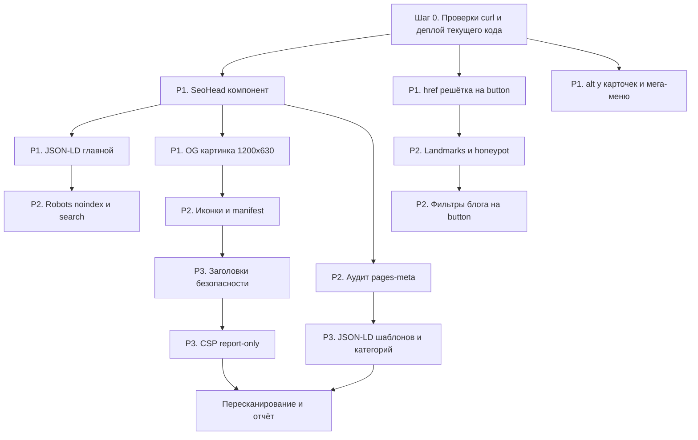

# Технический SEO-аудит главной: разбор, исправленный промпт и план работ

Дата: 2026-11-12
Источник: внешний сканер «Is your site ready for launch?», URL `https://setproduct.com/`, оценка **77 (Fair)**: 23 pass, 14 warnings, 2 errors.
Статус: план, ждёт подтверждения автора. Код не менялся.

> **Ревизия 3 (повторный скан после деплоя).** Актуальный план работ и промпт для агента: разделы 7–9, с поправками из раздела 10 в конце документа. Разделы 4 и 5 оставлены как история рассуждений, исполнять по ним не нужно.

---

## 0. Как читать этот документ

1. Раздел 1: что сканер предложил («How to fix») и где он ошибается.
2. Раздел 2: проверка каждого пункта по коду проекта. Вердикт: **настоящая проблема**, **ложное срабатывание** или **не SEO**.
3. Раздел 3: чего сканер не заметил, хотя мы нашли это в коде.
4. Раздел 4: улучшенный промпт для агента в режиме Code.
5. Раздел 5: приоритеты и порядок работ.
6. Раздел 6: вопросы к автору (без ответов на них часть задач начинать нельзя).

Термины:
- **JSON-LD** — блок структурированных данных в `<script type="application/ld+json">`, по нему Google строит расширенные сниппеты и понимает, что это за сайт.
- **CSP** (Content-Security-Policy) — HTTP-заголовок со списком доменов, откуда браузеру можно грузить скрипты и стили. Защищает от XSS, на ранжирование не влияет.
- **HSTS** — заголовок, который заставляет браузер ходить на сайт только по HTTPS.
- **Ложное срабатывание** — сканер ругается, но проблемы нет (или её нельзя исправить с нашей стороны).

---

## 1. Оценка рекомендованного промпта сканера

Сканер выдаёт по каждому пункту одну общую строку «How to fix». Сам по себе такой промпт для агента опасен:

| Проблема промпта | Чем грозит |
|---|---|
| Строки шаблонные, без привязки к Next.js Pages Router и Vercel | Агент начнёт ставить Cloudflare или вручную включать Brotli, хотя Vercel уже сжимает всё сам |
| «Add meaningful alt to all images» | Агент пропишет alt декоративным иконкам и логотипам. Скринридер будет зачитывать «search icon, close icon», ухудшится доступность |
| «Define a restrictive CSP» без режима Report-Only | Сразу сломаются GA4, Google Ads, Gumroad overlay. Продажи и аналитика встанут |
| «Add includeSubDomains» без проверки поддоменов | Если хоть один поддомен (например `publish.setproduct.com`) не на HTTPS, он станет недоступен у всех посетителей на 2 года |
| «Increase target size to 48px» | Ломает фирменную шкалу кнопок (`button-x-small`) и плотность мега-меню. Требование WCAG 2.2 AA — 24×24, а не 48×48 |
| «Fix JS files returning 404» | Таких файлов нет. Это прерванные запросы аналитики в headless-браузере |
| Нет приоритетов | Агент потратит время на заголовки безопасности, а реальные SEO-пункты (JSON-LD, og:image) останутся последними |
| Нет правил проекта | Будут нарушены правила AGENTS.md: кнопки через `<button>`, sentence case, запрет на правку `vercel.json` |

Вывод: промпт сканера годится как список симптомов, но не как инструкция. Ниже он переписан (раздел 4).

---

## 2. Проверка каждого пункта по коду

### 2.1. Errors

| # | Пункт сканера | Что в коде | Вердикт |
|---|---|---|---|
| E1 | **Image alt text**: 48 из 64 картинок без alt | Сканер считает `alt=""` «отсутствующим». В коде `alt=""` стоит у трёх групп: (а) декоративные иконки и логотип рядом с `aria-label` ([`SiteHeader`](components/layout/SiteHeader.tsx:247), [`NavSearch`](components/layout/nav/NavSearch.tsx:68), [`Breadcrumbs`](components/sections/Breadcrumbs.tsx:16)), это правильно; (б) **карточки продуктов** [`TemplateCard`](components/sections/TemplateCard.tsx:18), [`SliderTemplateCard`](components/sections/SliderTemplateCard.tsx:14), [`BundleCard`](components/sections/BundleCard.tsx:12), это ошибка, картинка продукта информативна и участвует в Google Images; (в) **миниатюры в мега-меню** [`SiteHeader`](components/layout/SiteHeader.tsx:321), [`SiteHeader`](components/layout/SiteHeader.tsx:350), [`SiteHeader`](components/layout/SiteHeader.tsx:384), [`InspirationThumb`](components/layout/nav/InspirationThumb.tsx:39). Если ссылка `MegaMenuCardMedia` содержит только картинку с `alt=""`, у ссылки нет доступного имени. Это ошибка доступности | **Настоящая проблема, частично.** Чинить группы (б) и (в), группу (а) не трогать |
| E2 | **Form labels**: `input (website)` без label | Это honeypot (ловушка для ботов) в 4 местах: [`SiteFooter`](components/layout/SiteFooter.tsx:288), [`CtaSubscribe`](components/sections/CtaSubscribe.tsx:22), [`BlogSidebar`](components/blog/BlogSidebar.tsx:197), [`ContactModal`](components/modals/ContactModal.tsx:145). Поле скрыто `display:none`, скринридер его не видит, но наивные сканеры ругаются | **Формально ложное**, но чинится в одну строку: `aria-hidden="true"` + `aria-label`, обёртка в скрытый `div`. Делаем, чтобы убрать Error из отчёта. Логику honeypot не менять, имя поля `website` не трогать (его проверяет API) |

### 2.2. Warnings: технические

| # | Пункт | Что в коде / на проде | Вердикт |
|---|---|---|---|
| W1 | **HSTS без includeSubDomains** | Vercel сам отдаёт `max-age=63072000` (2 года). Добавить `includeSubDomains` можно только после проверки, что **все** поддомены (`publish.`, любые старые Webflow-поддомены) работают по HTTPS | Настоящее, **низкий SEO-вес**, есть риск. Делать после проверки поддоменов |
| W1b | «Could not probe the HTTP version» | Сканер не смог проверить редирект `http://` → `https://`. Vercel делает его автоматически | Проверить `curl -I http://setproduct.com` и `curl -I https://setproduct.com`: оба должны давать **один** 301/308 сразу на `https://www.setproduct.com/`, без цепочки |
| W2 | **Security headers**: нет `x-content-type-options`, `x-frame-options`, `referrer-policy` | В [`next.config.js`](next.config.js:97) в `headers()` только Cache-Control | Настоящее, **не SEO** (безопасность). Добавляется 4 строками. `X-Content-Type-Options: nosniff`, `Referrer-Policy: strict-origin-when-cross-origin`, `X-Frame-Options: SAMEORIGIN`, `Permissions-Policy` с отключёнными camera/microphone/geolocation |
| W3 | **CSP отсутствует** | Сайт грузит: GA4 и Google Ads (`googletagmanager.com`, `google-analytics.com`, `googleadservices.com`, `doubleclick.net`, `google.com`), Gumroad (`gumroad.com`, `assets.gumroad.com`, iframe overlay), Splide CSS с `cdn.jsdelivr.net`, `next/script` с inline-кодом GA | Настоящее, **не SEO**, высокий риск поломки. Только через `Content-Security-Policy-Report-Only` на неделю, потом боевой. `unsafe-inline` для script убрать нельзя без nonce, а nonce в Pages Router требует middleware и отключает статику. **Рекомендация: отложить** |
| W4 | **Cloudflare proxy** | Хостинг Vercel, у него свой CDN | **Ложное срабатывание.** Не делать |
| W5 | **Render-blocking**: 6 скриптов, 8 стилей | Скрипты `_next/static/chunks/*` Next.js отдаёт с `defer`/`async`, сканер их зря считает блокирующими. В отчёте фигурируют `/css/normalize.css`, `/css/webflow.css`, `/css/setproduct.webflow.shared.css` отдельными файлами, а в текущем [`_app.tsx`](pages/_app.tsx:4) они уже импортируются в общий бандл. **Значит, прод отстаёт от локального кода** или сканер видел кеш. Splide CSS с jsDelivr — внешний блокирующий стиль. Gumroad overlay CSS подгружается скриптом после загрузки | LCP 0.44s, CLS 0, TBT 49ms: **все Core Web Vitals зелёные.** Реальное действие одно: перенести Splide CSS из CDN в локальный импорт (минус один DNS-запрос к стороннему домену). Остальное после деплоя пересканировать |
| W6 | **Compression**: 5 файлов «не сжаты» | `_ssgManifest.js`, `_clientMiddlewareManifest.js` весят десятки байт, Vercel не сжимает файлы меньше ~1 КБ (сжатие их только увеличит). Остальные чанки, скорее всего, тоже мелкие | **Ложное срабатывание.** Проверить `curl -sI -H 'Accept-Encoding: br' <url>` для двух крупных файлов из списка. Если `content-encoding: br` есть, закрыть пункт |
| W7 | **Crawl directives**: нет `<meta name="robots">` | Без тега Google по умолчанию считает `index, follow`. Добавлять его на все страницы бессмысленно | Для главной **ложное**. Но есть настоящая проблема рядом (см. раздел 3: `noindex` для прототипов и `/search`). Дополнительно полезно глобально: `max-image-preview:large` (разрешает Google показывать крупные картинки в Discover и выдаче) |

### 2.3. Warnings: SEO и контент

| # | Пункт | Что в коде | Вердикт |
|---|---|---|---|
| W8 | **Structured data**: нет JSON-LD на главной | JSON-LD есть только в статьях блога ([`BlogPostLayout`](components/blog/BlogPostLayout.tsx:85)) и на странице автора ([`AuthorPage`](components/pages/AuthorPage.tsx:55)). На главной, категориях, страницах шаблонов, freebies и дашбордов его нет | **Настоящая проблема, высокий приоритет.** Главная: `Organization` (логотип, `sameAs` соцсети) + `WebSite` с `SearchAction` на `/search?q=` (кандидат на поле поиска по сайту в выдаче). Страницы шаблонов: `Product` с `offers` (цена из Gumroad-данных). Категории и freebies: `BreadcrumbList` из [`data/breadcrumbs.ts`](data/breadcrumbs.ts). FAQ на главной ([`FaqSection`](components/sections/FaqSection.tsx)) — `FAQPage` (Google показывает FAQ-сниппеты только авторитетным сайтам, но для AI Overviews разметка полезна) |
| W9 | **PWA metadata**: нет manifest или apple-touch-icon | В [`_document.tsx`](pages/_document.tsx:12) apple-touch-icon есть, но это `fav-256.webp`. iOS не принимает WebP для иконки, нужен **PNG 180×180**. Фавикон тоже WebP, при этом указан `type="image/x-icon"` (тип не совпадает). `site.webmanifest` нет | **Настоящая проблема, средний приоритет.** Google показывает фавикон в мобильной выдаче, и рекомендует квадрат кратный 48px. Нужно: `favicon.ico` (32/48), `icon.svg` или PNG 48+, `apple-touch-icon.png` 180×180, `site.webmanifest`, `theme-color` |
| W10 | **OG/Twitter**: «Failed to fetch preview image: network error» | og:image главной: `absoluteUrl("/images/setproduct2.webp")` → `https://www.setproduct.com/images/setproduct2.webp`. Файл существует. Возможные причины: (1) WebP не все скраперы понимают (LinkedIn и часть мессенджеров работают с ним плохо); (2) размер не 1200×630; (3) нет `og:image:width/height`, скрапер качает файл целиком и упирается в таймаут | **Настоящая проблема для соцсетей и CTR из шеров.** Сделать отдельную OG-картинку **1200×630 JPG или PNG** под новым именем файла (правило AGENTS.md про кеш), добавить `og:image:width`, `og:image:height`, `og:image:alt`, `og:site_name`, `twitter:site`. Проверить через curl и валидаторы соцсетей |
| W11 | **Link format**: 3 пустые/плейсхолдерные ссылки | `href="#"` в [`TemplateGrid`](components/sections/TemplateGrid.tsx:31) (Load more на главной). Всего по проекту ещё в [`BlogListingPage`](components/pages/BlogListingPage.tsx:176), [`FreebiesListingPage`](components/pages/FreebiesListingPage.tsx:253), [`AuthorPage`](components/pages/AuthorPage.tsx:190), [`TestimonialsPage`](components/pages/TestimonialsPage.tsx:134) ×2, [`RefundsPolicyPage`](components/pages/RefundsPolicyPage.tsx:41), [`BlogFloatingShare`](components/blog/BlogFloatingShare.tsx:67). Это прямо запрещено правилом «Кнопки» в AGENTS.md | **Настоящая проблема.** Заменить на `<button type="button">` с теми же классами. Google тратит краулинговый бюджет на `#`-ссылки впустую, плюс это ошибка доступности |

### 2.4. Warnings: доступность

| # | Пункт | Что в коде | Вердикт |
|---|---|---|---|
| W12 | **Landmarks**: нет footer | Корень [`SiteFooter`](components/layout/SiteFooter.tsx:171) — `<div className="section">`. Хедер — `<div role="banner">` ([`SiteHeader`](components/layout/SiteHeader.tsx:238)) | **Настоящая, простая.** Заменить корневой `div` футера на `<footer>` (классы те же, стили не поедут: Webflow-классы не завязаны на тег). Хедер по желанию на `<header>`, `role="banner"` тогда убрать |
| W13 | **Tap targets < 48px**: 25 элементов | `nav_radio` 160×32 (мега-меню, [`MegaMenuPanel`](components/layout/nav/MegaMenuPanel.tsx:139)), `button-x-small` 76×28, текстовые ссылки-заголовки карточек высотой 21px, логотип 89×36 | WCAG 2.2 AA требует 24×24 — **все элементы его проходят.** 48px — рекомендация Lighthouse для мобильных. Сканер мерил десктоп. **Низкий приоритет, требует решения дизайнера.** Возможный компромисс: на `max-width: 479px` увеличить кликабельную зону через `padding` или псевдоэлемент `::after` без изменения визуального размера |

### 2.5. Performance

| # | Пункт | Вердикт |
|---|---|---|
| W14 | **JS runtime errors**: 4 запроса `net::ERR_ABORTED` к `doubleclick.net`, `google.com/ccm`, `googleadservices.com` | **Ложное срабатывание.** Это запросы GA4/Google Ads, которые headless-браузер оборвал при завершении теста. 404 и исключений нет. Побочное наблюдение: GA4-поток связан с Google Ads (`AW-951975411`), поэтому на каждой странице идут рекламные пиксели. Если реклама не крутится, связь стоит отключить в интерфейсе GA, это уберёт 3 сторонних запроса. Это решение автора, не задача кода |

### 2.6. Итог проверки

| Категория | Пункты |
|---|---|
| Настоящие SEO-проблемы | E1 (частично), W8, W9, W10, W11 |
| Настоящие проблемы доступности (косвенно SEO) | E2, W12, W13 |
| Безопасность (не влияет на ранжирование) | W1, W2, W3 |
| Ложные срабатывания | W4, W6, W7 (для главной), W14, большая часть W5 |

---

## 3. Чего не хватает в промпте сканера

Сканер проверил **одну страницу** (главную). По коду видны проблемы, которые он не мог заметить:

| # | Находка | Почему важно | Где |
|---|---|---|---|
| M1 | Служебные страницы-прототипы индексируются | `/inputs-proto` и `/push-buttons-proto` — внутренние песочницы. Если они в sitemap или доступны по ссылке, Google их проиндексирует как тонкий контент | [`pages/inputs-proto.tsx`](pages/inputs-proto.tsx), [`pages/push-buttons-proto.tsx`](pages/push-buttons-proto.tsx), проверить [`pages/sitemap.xml.ts`](pages/sitemap.xml.ts). Нужно `<meta name="robots" content="noindex, nofollow">` и исключение из sitemap |
| M2 | `/search?q=...` может плодить дубли | Каждый запрос — отдельный URL с одинаковым шаблоном | [`SearchPage`](components/pages/SearchPage.tsx): `noindex, follow` при наличии `q`, canonical на `/search` |
| M3 | Meta title и description категорий в Title Case и длиннее лимита | Пример: `all` — ��Explore a Wide Range of Figma Templates, Design Systems, and UI Kits» (68 символов, Title Case). Нарушает правило sentence case из AGENTS.md и режется в выдаче | [`data/pages-meta.ts`](data/pages-meta.ts:12). Нужен аудит всех 125 строк по правилам SEO-скилла: title ≤ 60–65, без двоеточия, sentence case; description 140–160 |
| M4 | Нет глобальных OG-полей | `og:site_name`, `og:locale`, `twitter:site` нигде не задаются | Вынести общий `<Head>` в `_app.tsx` или в хелпер `lib/seo/` |
| M5 | Мета-теги дублируются вручную в каждой page-компоненте | 10+ копий блока `<Head>` (HomePage, TemplateDetailPage, GenericTemplatePage, ChartsTemplatePage, FreebieDetailPage, DashboardTemplatePage, AuthorPage, BlogPostLayout...). В [`DashboardTemplatePage`](components/pages/DashboardTemplatePage.tsx:107) `twitter:title` задан через `property` вместо `name` | Создать один компонент `SeoHead` (title, description, canonical, og, twitter, robots, jsonLd). Это предотвратит повторение W10 и M4 на каждой новой странице |
| M6 | og:image у шаблонов и freebies может быть относительным | В [`TemplateDetailPage`](components/pages/TemplateDetailPage.tsx:42), [`GenericTemplatePage`](components/pages/templates/GenericTemplatePage.tsx:113), [`FreebieDetailPage`](components/pages/FreebieDetailPage.tsx:54) переменная `ogImage` — проверить, проходит ли она через `absoluteUrl()` | Соцсети молча выкидывают относительные og:image |
| M7 | Фильтры блога на главной сделаны `div role="button"` | [`BlogPostsHome`](components/sections/BlogPostsHome.tsx:33): нет обработки Enter/Space, нарушает правило «Кнопки» (`button-x-small is-text` + `aria-pressed` + `is-active`) | Заменить на `<button type="button">` |
| M8 | Ссылки «заголовок» и «картинка» в карточке поста ведут на один URL | В [`BlogPostsHome`](components/sections/BlogPostsHome.tsx:69) три ссылки на одну статью (заголовок, Read more, картинка). Картинка с `alt={post.title}` дублирует анкор | Картинке поставить `alt=""` + `tabIndex={-1}` + `aria-hidden`, чтобы скринридер не читал заголовок трижды. Анкор для Google останется в заголовке |
| M9 | Проверка редиректа `setproduct.com` → `www` | Canonical на `www`, а сканер стартовал с apex-домена. Цепочка `http://setproduct.com` → `https://setproduct.com` → `https://www.setproduct.com` — лишний хоп | Проверить curl'ом, при наличии цепочки настроить в Vercel Domains прямой редирект |
| M10 | Прод отстаёт от локального кода | Сканер видел три отдельных CSS-файла Webflow, а в коде они уже в бандле | Перед финальной оценкой задеплоить и пересканировать, иначе часть W5 — шум |

---

## 4. Улучшенный промпт для агента (режим Code)

```
Контекст: Next.js Pages Router на Vercel, проект setproduct.com. Перед работой
прочитай AGENTS.md целиком. Соблюдай: sentence case во всех текстах, кнопки
только <button> или <Link> с классами шкалы button-*, никаких href="#",
vercel.json не трогать, next.config.js менять только в функции headers().
Замена картинки = новое имя файла.

Задачи выполняй по одной, после каждой: npm run lint, git diff, отчёт,
ожидание OK от автора. Каждая задача = отдельный коммит (conventional commits,
sentence case, английский).

P1. Общий компонент SeoHead
  - Создай components/seo/SeoHead.tsx (именованный экспорт). Пропсы: title,
    description, canonical, ogImage, ogImageAlt, ogType, robots?, jsonLd? (массив).
  - Внутри: title, description, canonical, og:title/description/url/type/
    image/image:width/image:height/image:alt/site_name/locale,
    twitter:card=summary_large_image, twitter:site, twitter:title/description/
    image (через name, не property). Все URL через absoluteUrl().
  - JSON-LD рендерится через dangerouslySetInnerHTML (не в MDX!).
  - Переведи на SeoHead HomePage. Остальные страницы — отдельными коммитами.

P1. JSON-LD главной
  - lib/seo/schema.ts: buildOrganizationJsonLd (name, url, logo абсолютным
    URL, sameAs из SOCIAL_LINKS футера) и buildWebSiteJsonLd с SearchAction
    target https://www.setproduct.com/search?q={search_term_string}.
  - Проверь, что /search действительно читает параметр q.
  - Подключи оба в HomePage через SeoHead.

P1. OG-картинка главной
  - Автор кладёт файл public/images/og/setproduct-home-1200x630.jpg
    (агент НЕ генерирует картинку сам, только просит).
  - Поменяй ogImage в data/pages-meta.ts, укажи width 1200, height 630, alt.
  - Проверь curl'ом HTML: og:image абсолютный, файл отдаёт 200 и image/jpeg.

P1. Пустые ссылки href="#"
  - Замени все <a href="#" onClick> на <button type="button"> с теми же
    классами: TemplateGrid, BlogListingPage, FreebiesListingPage, AuthorPage,
    TestimonialsPage (2), RefundsPolicyPage, BlogFloatingShare.
  - Проверь визуально, что стиль кнопки не поменялся (у <button> нужен
    сброс border/background, если Webflow-класс этого не делает).
  - grep -rn 'href="#"' components pages → 0 совпадений.

P1. Alt у информативных картинок
  - TemplateCard, SliderTemplateCard, BundleCard: alt = название продукта
    + тип, sentence case, без слов «image of».
  - Мега-меню (SiteHeader строки 321, 350, 384, InspirationThumb): если
    ссылка MegaMenuCardMedia содержит только картинку, дай ей alt с
    названием, либо aria-label на ссылке. Двойного озвучивания быть не должно.
  - Декоративные иконки, стрелки, логотип рядом с aria-label НЕ трогать,
    у них alt="" правильный.
  - Используй scripts/audit-image-alts.mjs для итогового подсчёта.

P2. Robots
  - noindex, nofollow: /inputs-proto, /push-buttons-proto (и убрать их из
    STATIC_PATHS в sitemap.xml.ts, если они там есть).
  - /search: noindex, follow, если есть параметр q.
  - Глобально в _app.tsx: <meta name="robots" content="max-image-preview:large">
    только там, где страница не задаёт свой robots (SeoHead должен иметь
    приоритет, проверь отсутствие дублей тега в HTML).

P2. Иконки и manifest
  - Автор кладёт: public/favicon.ico (16/32/48), public/icon.svg или
    icon-192.png, icon-512.png, public/apple-touch-icon.png (180×180, без
    прозрачности).
  - Создай public/site.webmanifest (name, short_name, icons, theme_color
    #7c4dff, background_color #ffffff, display browser).
  - В _document.tsx: icon с правильным type, apple-touch-icon.png, manifest,
    meta theme-color. Старые webp-фавиконы оставить до проверки, потом
    удалить отдельным коммитом.

P2. Landmarks и honeypot
  - SiteFooter: корневой div → <footer>. SiteHeader: div role="banner" →
    <header>. Проверь визуально 1440/1024/768/390.
  - Honeypot website во всех 4 формах: обернуть в
    <div aria-hidden="true" className="hidden">, на input добавить
    aria-label="Leave this field empty", tabIndex={-1}, autoComplete="off".
    Имя поля не менять.

P2. Фильтры блога на главной
  - BlogPostsHome: div role="button" → <button type="button"> с
    aria-pressed и классом is-active по правилу «Кнопки».

P2. Аудит meta в data/pages-meta.ts
  - Перед стартом загрузить скилл seo. Все title: sentence case, ≤ 60
    символов, без двоеточия, em-dash не больше одного. description 140–160.
  - Показать таблицу «было/стало» автору до записи в файл.

P3. JSON-LD для остальных страниц
  - Шаблоны (/templates/[slug], /dashboard-templates/[slug]): Product +
    Offer (price, priceCurrency USD, availability InStock, url на Gumroad).
    Без aggregateRating, если нет реальных отзывов (иначе ручная санкция).
  - Категории и freebies: BreadcrumbList из data/breadcrumbs.ts.
  - Проверка: Google Rich Results Test на 3 URL.

P3. Заголовки безопасности (next.config.js, только headers())
  - source "/(.*)": X-Content-Type-Options nosniff, Referrer-Policy
    strict-origin-when-cross-origin, X-Frame-Options SAMEORIGIN,
    Permissions-Policy camera=(), microphone=(), geolocation=().
  - Strict-Transport-Security с includeSubDomains — ТОЛЬКО после
    подтверждения автора, что все поддомены на HTTPS.
  - CSP — только Content-Security-Policy-Report-Only, белый список: self,
    *.googletagmanager.com, *.google-analytics.com, *.doubleclick.net,
    *.google.com, *.googleadservices.com, gumroad.com, *.gumroad.com,
    cdn.jsdelivr.net (если Splide остаётся). Боевой CSP — отдельной задачей.

P3. Splide CSS
  - Найти, где подключается splide-core.min.css с jsDelivr, заменить
    на импорт из node_modules (@splidejs/react-splide уже в зависимостях).

НЕ ДЕЛАТЬ: Cloudflare; ручное включение Brotli/Gzip; увеличение всех
кнопок до 48px; «починку» ERR_ABORTED запросов аналитики; alt у
декоративных иконок; правку vercel.json.

Финальная проверка: npm run lint, npm run build, локально curl главной
и одной страницы шаблона (head-теги, JSON-LD валиден через JSON.parse),
затем после деплоя повторный прогон того же сканера.
```

---

## 5. Приоритеты и порядок работ

Критерий: влияние на поиск и CTR × простота × риск.



| Приоритет | Задача | Влияние | Риск |
|---|---|---|---|
| **P0** | Проверки: редиректы, сжатие, деплой текущего кода | Убирает шум из отчёта | Нет |
| **P1** | SeoHead + JSON-LD главной (Organization, WebSite) | Понимание сайта Google, кандидат на sitelinks search, AI Overviews | Низкий |
| **P1** | OG-картинка 1200×630 JPG + размеры | Превью в соцсетях и мессенджерах, CTR из шеров | Низкий |
| **P1** | `href="#"` → `<button>` (8 мест) | Краулинг, доступность, правило проекта | Низкий, проверить стили |
| **P1** | Alt у карточек продуктов и мега-меню | Google Images, доступность | Низкий |
| **P2** | noindex прототипов и `/search?q` | Чистота индекса | Низкий |
| **P2** | Фавиконы PNG/ICO + manifest | Фавикон в мобильной выдаче, iOS | Низкий, нужны файлы от автора |
| **P2** | `<footer>`/`<header>`, honeypot | Доступность, закрывает 2 пункта сканера | Низкий |
| **P2** | Фильтры BlogPostsHome на `<button>` | Доступность, правило проекта | Низкий |
| **P2** | Аудит title/description в pages-meta | CTR категорий | Средний (меняет сниппеты) |
| **P3** | JSON-LD Product/BreadcrumbList | Расширенные сниппеты товаров | Средний (ошибки в Offer дают предупреждения в GSC) |
| **P3** | Security headers без CSP | Безопасность, балл сканера | Низкий |
| **P3** | HSTS includeSubDomains | Безопасность | **Высокий**, только после проверки поддоменов |
| **P3** | CSP Report-Only | Безопасность | Средний |
| **P3** | Splide CSS локально | Минус сторонний запрос | Низкий |
| **Не делать** | Cloudflare, Brotli, 48px для всех кнопок, ERR_ABORTED | — | — |

Ожидаемый результат после P1–P2: Errors 2 → 0, Warnings 14 → 5–6 (остаются CSP, Cloudflare, сжатие-ложное, tap targets, render-blocking от сторонних скриптов). Балл сканера ориентировочно 88–92. Реальный SEO-эффект смотреть не по баллу, а в GSC: отчёты «Улучшения» (разметка), «Индексирование страниц», CTR главной и категорий через 4 недели.

---

## 6. Вопросы к автору

1. **`next.config.js`**: AGENTS.md запрещает трогать конфиги без явного запроса. Разрешаешь менять только функцию `headers()` для P3?
2. **Поддомены**: какие поддомены живые (`publish.setproduct.com`, другие)? Все ли на HTTPS? Без ответа `includeSubDomains` не ставим.
3. **OG-картинка и иконки**: сделаешь файлы сам (1200×630 JPG, apple-touch-icon 180×180 PNG, favicon.ico) или агенту подготовить их из `setproduct2.webp` и логотипа через sharp?
4. **Google Ads**: реклама сейчас крутится? Если нет, связь GA4 ↔ Ads можно отключить в интерфейсе GA (это убирает пиксели doubleclick).
5. **Tap targets**: оставляем как есть (WCAG AA пройден) или увеличиваем кликабельную зону только на мобильных через padding без изменения визуала?
6. **Product JSON-LD**: на страницах шаблонов цены актуальны в `data/`? Если цены живут только в Gumroad, Offer лучше не размечать.

---

## 7. Ревизия 2: разбор промпта сканера

Промпт сканера (11 пунктов, URL `https://www.setproduct.com/`) задаёт рамку: «Apply code changes for all issues. Exclude third-party script failures and server/infrastructure issues (HTTPS/TLS/headers/proxy)».

### 7.1. Что промпт меняет в плане

| Изменение | Было в плане | Стало |
|---|---|---|
| Инфраструктура исключена | P3: security headers, CSP, HSTS | **Выносится в бэклог** (раздел 9.3). `next.config.js` в этой задаче не трогаем, вопрос 1 из раздела 6 снят |
| Ошибки сторонних скриптов исключены | Было «ложное», без действий | Без изменений |
| Детали Link Format | Я нашёл `href="#"` в 8 компонентах, но ни один из них не совпал со списком сканера полностью | Сканер назвал три конкретных ссылки на главной. Две из них я **пропустил**: см. 7.2 |
| Render-blocking | P3: перенести Splide CSS из jsDelivr | **Задача снята.** Splide CDN уже удалён, нужные правила перенесены в [`setproduct.webflow.shared.css`](public/css/setproduct.webflow.shared.css:4428). Webflow CSS уже в бандле через [`_app.tsx`](pages/_app.tsx:4). Сканер видит **старый деплой**. Значит, первое действие — задеплоить текущий код и пересканировать |
| Crawl directives | «Ложное, не делать» | Промпт требует код. Делаем дёшево и полезно: явный `index, follow, max-image-preview:large` по умолчанию в `SeoHead`, `noindex` на служебных страницах |
| Tap targets | «Решение дизайнера» | Промпт требует код. См. 7.3: делаем то, что реально помогает на тач-экранах, и честно фиксируем остаток |
| Compression | «Ложное» | Остаётся ложным: сжатие на Vercel не настраивается кодом. Один шаг проверки curl, без правок |

### 7.2. Ссылки `href="#"`, которые я пропустил в первой версии

| Текст из отчёта | Источник | Как починить |
|---|---|---|
| `Contact us` | [`navConfig.ts`](components/layout/nav/navConfig.ts:116) задаёт `href: "#"` для пункта с `modal: true`, а [`CompanyPanel`](components/layout/nav/CompanyPanel.tsx:59) рендерит его как `<a href="#">` | Ветку `link.modal` рендерить как `<button type="button" className="link-block w-inline-block">`. Поле `href` у модального пункта убрать из типа (или сделать необязательным) и поправить проверку `link.href !== "#"` в [`SiteHeader`](components/layout/SiteHeader.tsx:95). Проверить мобильную версию меню на такой же паттерн |
| `Load More` | [`TemplateGrid`](components/sections/TemplateGrid.tsx:31) | `<button type="button">`, подпись привести к sentence case `Load more` |
| `contact form` | HTML-строка в [`data/faq.ts`](data/faq.ts:140), рендерится через `dangerouslySetInnerHTML` в [`FaqSection`](components/sections/FaqSection.tsx:91) | См. ниже |

**FAQ-ссылки — это массовая проблема.** Паттерн `<a data-contact href="#">` есть в `data/faq.ts` (3 места) и в **31 файле** `data/template-content/*.ts` (по 2 на файл). На главной видна одна, на страницах шаблонов по две.

Решение в два слоя, чтобы не зависеть от каждой строки:

1. В [`FaqSection`](components/sections/FaqSection.tsx:37) поменять селектор с `a[data-contact]` на `[data-contact]`, чтобы обработчик ловил и кнопки.
2. Скриптом заменить во всех строках `<a data-contact href="#">…</a>` на `<button type="button" class="faq-contact-link span-link" data-contact>…</button>` (класс сбрасывает фон, рамку и padding у `<button>`, чтобы внешне осталась ссылка). Замена механическая, проверяется `grep -rn 'data-contact href="#"' data` → 0.
3. Тот же `FaqSection` используется и в [`GenericTemplatePage`](components/pages/templates/GenericTemplatePage.tsx:76)? Проверить, что все страницы с FAQ рендерят ответы через один компонент. Если есть второй рендер, поменять селектор и там.

Альтернатива (если автор против `<button>` внутри текста): `href="mailto:hello@setproduct.com"`. Это настоящий адрес: с JS обработчик по-прежнему открывает модалку, без JS откроется почтовый клиент. Минус: адрес попадает в HTML и в базы спам-ботов.

Оставшиеся `href="#"` из первой версии (BlogListingPage, FreebiesListingPage, AuthorPage, TestimonialsPage ×2, RefundsPolicyPage, BlogFloatingShare) на главной не видны, но правило проекта то же. Чиним в той же задаче отдельным коммитом.

### 7.3. Tap targets: что сканер мерит и что реально делать

Сканер меряет `getBoundingClientRect()` в headless-браузере на десктопной ширине. Список делится на три группы:

| Группа | Пример | Что делаем |
|---|---|---|
| Пункты мега-меню | `a.nav_radio` 160×32 | `min-height: 48px` только на `(pointer: coarse)` (тач-экраны) через существующий класс. На десктопе мышью попасть в 32px легко, визуал меню не трогаем |
| Маленькие кнопки | `button-x-small is-secondary` (View) 76×28 | Это ступень S из шкалы кнопок AGENTS.md. Увеличение = изменение дизайн-системы, нужно согласие автора. Предлагаю на `(pointer: coarse)` расширять зону нажатия прозрачным `::after` с `inset: -10px`, визуал прежний |
| Текстовые ссылки-заголовки карточек | `a.w-inline-block` высотой 21px | WCAG 2.5.8 прямо исключает ссылки внутри текстового блока. Можно сделать `display: block` у ссылки-заголовка, чтобы она занимала всю строку (высота вырастет до высоты блока текста). Безопасно для вёрстки, проверить на 1440/390 |
| Логотип | `a.brand-link` 89×36 | На тач-экранах `min-height: 48px`, иконка по центру |

**Честное ожидание:** на десктопном прогоне сканер всё равно покажет часть элементов (32px и 28px при `pointer: fine`). Убрать предупреждение полностью можно только увеличив кнопки на десктопе, а это решение автора (вопрос 5). Реальная мобильная доступность после правки будет закрыта.

### 7.4. Image alt: где на самом деле 48 картинок

Сканер считает `alt=""` «отсутствующим», хотя для декоративной картинки это правильная разметка. Чтобы закрыть ошибку честно, без мусорных alt:

| Группа на главной | Примерно картинок | Действие |
|---|---|---|
| Карточки шаблонов в `TemplateGrid` → [`TemplateCard`](components/sections/TemplateCard.tsx:18) | 15 | Информативные: `alt` = название продукта и тип, например `Material X Figma UI kit preview` |
| Миниатюры мега-меню: блог, шаблоны, вдохновение ([`SiteHeader`](components/layout/SiteHeader.tsx:321), [`SiteHeader`](components/layout/SiteHeader.tsx:350), [`SiteHeader`](components/layout/SiteHeader.tsx:384), [`InspirationThumb`](components/layout/nav/InspirationThumb.tsx:39)) | 20–25 | Они внутри ссылок без текста (`MegaMenuCardMedia`), поэтому у такой ссылки сейчас нет доступного имени. Нужен alt с названием карточки. Вариант «ссылка-картинка с `aria-hidden`» не подходит: сканер всё равно посчитает `` |
| Декоративные иконки (логотип, поиск, бургер, крестик, стрелка футера) | 6–8 | Заменить `` на inline SVG с `aria-hidden="true"` (как уже сделано в `FaqToggleIcon` и `ArrowIcon`). Это убирает их из подсчёта картинок, сохраняет доступность и экономит HTTP-запросы. Логотип: inline SVG с `role="img"` + `aria-label="Setproduct"` или оставить `img` с `alt="Setproduct"` и убрать `aria-label` у ссылки поверх |
| Карточки постов в `BlogPostsHome` | 6 | Уже с `alt={post.title}`, не трогать |

После правки прогнать [`scripts/audit-image-alts.mjs`](scripts/audit-image-alts.mjs) и посчитать в HTML главной: ``, `aria-label`, `tabIndex={-1}` | **5 (Error)** | `fix: hide honeypot fields from assistive tech` |
| 2 | Alt у карточек шаблонов и миниатюр мега-меню | **1 (Error)**, часть | `fix: add alt text to product and menu thumbnails` |
| 3 | Декоративные ``-иконки → inline SVG с `aria-hidden` | **1 (Error)**, остаток | `refactor: inline decorative icons as svg` |
| 4 | `Load more` в `TemplateGrid` и `Contact us` в `CompanyPanel` → `<button>` | 11 | `fix: use buttons for non-navigation actions in nav and grid` |
| 5 | FAQ `data-contact`: селектор в `FaqSection` + замена в 34 data-файлах + CSS-класс сброса кнопки | 11 | `fix: render faq contact links as buttons` |
| 6 | Остальные `href="#"` в 7 компонентах | 11 (на других страницах) | `fix: replace placeholder links with buttons` |
| 7 | `SiteFooter` → `<footer>`, `SiteHeader` → `<header>` | 6 | `fix: use semantic header and footer landmarks` |
| 8 | Компонент `SeoHead` + перевод `HomePage`. По умолчанию `robots: index, follow, max-image-preview:large`, `og:site_name`, `og:locale`, `twitter:site`, `og:image:width/height/alt` | 4, 10 | `feat: add shared seo head component` |
| 9 | OG-картинка главной 1200×630 JPG под новым именем, обновить `pages-meta.ts` | 10 | `feat: add 1200x630 og image for home` |
| 10 | JSON-LD главной: `Organization` + `WebSite` с `SearchAction` | 8 | `feat: add organization and website json-ld` |
| 11 | Фавиконы PNG/ICO, `apple-touch-icon.png` 180×180, `site.webmanifest`, `theme-color` в `_document.tsx` | 9 | `feat: add web manifest and png touch icons` |
| 12 | `noindex` для `/inputs-proto`, `/push-buttons-proto`, `/search?q=`, исключение из sitemap | 4 (по смыслу) | `fix: noindex internal prototype and search pages` |
| 13 | Tap targets на `(pointer: coarse)`: `nav_radio`, логотип, `button-x-small` через `::after`, ссылки-заголовки `display: block` | 7 | `style: enlarge touch targets on coarse pointers` |
| 14 | Фильтры `BlogPostsHome` → `<button aria-pressed>` | вне отчёта, правило проекта | `fix: use buttons for home blog filters` |
| 15 | Перевод остальных страниц на `SeoHead` (шаблоны, freebies, дашборды, автор, блог), проверка абсолютных `og:image`, фикс `twitter:title` через `name` в `DashboardTemplatePage` | 10 на других страницах | по коммиту на тип страницы |
| 16 | Финал: `npm run lint`, `npm run build`, curl главной (head, JSON-LD через `JSON.parse`), деплой, пересканирование | все | — |

```mermaid
flowchart LR
    A[0. Деплой и пересканирование] --> B[1-3. Errors: honeypot и alt]
    B --> C[4-6. Ссылки решётка на button]
    C --> D[7. header и footer]
    D --> E[8-10. SeoHead, OG, JSON-LD]
    E --> F[11. Иконки и manifest]
    F --> G[12. noindex служебных]
    G --> H[13-14. Tap targets и фильтры]
    H --> I[15. SeoHead на всех страницах]
    I --> J[16. Финальная проверка]
```



Ожидаемый результат по отчёту сканера: Errors 2 → 0. Warnings из промпта (9 шт.): закрываются 4, 6, 8, 9, 10, 11; пункт 2 закрывается деплоем (кроме чанков Next.js, которые сканер ошибочно считает блокирующими); 3 остаётся как ложное срабатывание; 7 уменьшается, но на десктопном прогоне может остаться.

### 8.1. Отдельная задача (не из отчёта): аудит `data/pages-meta.ts`

Title категорий в Title Case и длиннее 60 символов (пример `all`). Это нарушение правила проекта, но аудит меняет сниппеты в выдаче, поэтому выносится в отдельную задачу с загрузкой скилла `seo` и таблицей «было/стало» для автора.

---

## 9. Промпт для агента в режиме Code (ревизия 2)

```
Контекст: Next.js Pages Router на Vercel, проект setproduct.com.
Документ плана: plans/seo-technical-audit-fix-plan-2026-11.md, разделы 7–8.
Прочитай AGENTS.md целиком перед стартом.

Рамка задачи: код-фиксы для отчёта сканера по главной. НЕ трогать:
next.config.js, vercel.json, заголовки HTTP, CSP, HSTS, Cloudflare,
настройки сжатия, ошибки GA4/Google Ads/Gumroad. Это исключено заказчиком.

Правила: sentence case во всех текстах; кнопки только <button> или
<Link>/<a> с классами шкалы button-*; href="#" запрещён; отступы через
spacer-*, радиусы через radius-*; замена картинки = новое имя файла;
каждая задача = отдельный коммит (conventional commits, английский,
sentence case); после каждой задачи npm run lint, git diff, короткий
отчёт и ожидание OK автора. Без git push.

Выполняй задачи 1–15 из таблицы раздела 8 по порядку. Уточнения:

1. Honeypot: имя поля website не менять, его проверяют /api/contact и
   /api/subscribe. Обернуть в <div aria-hidden="true" hidden>, на input:
   aria-label="Leave this field empty", tabIndex={-1}, autoComplete="off".

2–3. Alt: информативным картинкам осмысленный alt (название + тип, без
   «image of»). Декоративные  заменить на inline SVG с
   aria-hidden="true" по образцу ArrowIcon. Логотип: одна доступная
   подпись «Setproduct», без дубля alt + aria-label. После правки
   посчитать в HTML главной (curl localhost) img без alt или с alt="".

4–6. Все <a href="#" onClick> → <button type="button"> с теми же классами.
   Для FAQ: в FaqSection селектор a[data-contact] → [data-contact];
   в data/faq.ts и data/template-content/*.ts заменить
   <a data-contact href="#">X</a> на
   <button type="button" class="faq-contact-link span-link" data-contact>X</button>
   (обратите внимание на вариант с class="span-link" на самом <a>).
   Добавить .faq-contact-link в styles/globals.css: сброс background,
   border, padding, font: inherit, color: inherit, cursor: pointer.
   Проверка: grep -rn 'href="#"' components pages data → 0.

7. <footer> и <header> вместо корневых div, классы те же, role="banner"
   убрать. Проверить вёрстку на 1440/1024/768/390.

8. components/seo/SeoHead.tsx, именованный экспорт. Пропсы: title,
   description, canonical, ogImage, ogImageWidth, ogImageHeight,
   ogImageAlt, ogType, robots (по умолчанию
   "index, follow, max-image-preview:large"), jsonLd (массив объектов).
   twitter:* только через name. Все URL через absoluteUrl().

9. OG-картинку 1200×630 JPG автор кладёт в public/images/og/ под новым
   именем. Агент не генерирует картинку без запроса.

10. lib/seo/schema.ts: Organization (name, url, logo абсолютный, sameAs
   из SOCIAL_LINKS футера) и WebSite с SearchAction
   https://www.setproduct.com/search?q={search_term_string}. Сначала
   проверить, что /search читает параметр q.

11. Файлы иконок кладёт автор. Агент создаёт public/site.webmanifest и
   правит pages/_document.tsx (type у фавикона должен совпадать с форматом).

12. robots noindex, nofollow для прототипов; noindex, follow для /search
   при наличии q. Убрать прототипы из STATIC_PATHS в sitemap.xml.ts.

13. Tap targets только в @media (pointer: coarse); визуал на десктопе
   не менять. Новые размеры кнопок не вводить.

Финал: npm run lint, npm run build, curl главной: один тег robots, один
canonical, og:image абсолютный и отдаёт 200, JSON-LD парсится.
Отчёт с цифрами: сколько img без alt, сколько href="#", сколько
JSON-LD блоков на главной.
```

### 9.1. Что сканер просит, но мы сознательно не делаем

| Пункт | Почему |
|---|---|
| «Inline critical CSS» | В Pages Router без `optimizeCss` (экспериментальная опция, правка `next.config.js`, исключена рамкой). LCP уже 0.44s |
| «Defer non-critical scripts» для чанков Next.js | Next.js уже ставит им `defer`/`async`. Сканер ошибается |
| «Enable Brotli or Gzip» | Vercel сжимает сам, мелкие файлы не сжимает намеренно |
| Увеличить все элементы до 48px на десктопе | Ломает шкалу кнопок, требование WCAG AA 24px выполнено |

### 9.2. Обновлённые вопросы к автору

1. FAQ-ссылки «contact us»: `<button>` внутри текста (рекомендую) или `mailto:` как настоящий адрес?
2. OG-картинка и иконки (1200×630 JPG, `apple-touch-icon` 180×180 PNG, `favicon.ico`): делаешь сам или агенту собрать их через sharp из `setproduct2.webp` и логотипа?
3. Tap targets: достаточно правки только для тач-экранов или увеличиваем `nav_radio` до 48px и на десктопе?
4. Деплой текущего `main` перед началом работ: можно?

### 9.3. Бэклог (исключено рамкой промпта, вернуться отдельно)

→ Security headers: `X-Content-Type-Options`, `Referrer-Policy`, `X-Frame-Options`, `Permissions-Policy` в `headers()` `next.config.js`

→ HSTS `includeSubDomains` после проверки всех поддоменов

→ CSP в режиме Report-Only с белым списком GA4, Google Ads, Gumroad

→ Отключение связи GA4 с Google Ads, если реклама не крутится

→ JSON-LD `Product` для шаблонов и `BreadcrumbList` для категорий

→ Аудит title и description в `data/pages-meta.ts`

---

## 10. Ревизия 3: сверка с повторным сканом

Повторный отчёт сканера (страница результатов `isreadyforlaunch.com/results/01a1d0fa-…`) сверен с ревизией 2. Саму страницу результатов агент открыть не может (нет веб-доступа), поэтому сверка идёт по тексту промпта, который прислал автор.

### 10.1. Что изменилось между сканами

| Пункт | Скан 1 | Скан 2 | Вывод |
|---|---|---|---|
| 2. Render-blocking | 6 скриптов + 8 стилей, среди них `/css/normalize.css`, `/css/webflow.css`, `/css/setproduct.webflow.shared.css` | 6 скриптов + 7 стилей, **только** `/_next/static/chunks/*` | Деплой прошёл, Webflow CSS теперь в бандле. **Шаг 0 плана выполнен.** Оставшиеся файлы — штатные чанки Next.js |
| 3. Compression | 5 файлов | Те же 2 манифеста + 3 других мелких чанка | Ложное срабатывание подтверждено: список меняется вместе с хешами сборки, а манифесты весят десятки байт |
| 11. Link format | `Load More` (Title Case) | `Load more` | Подпись уже исправлена, но `href="#"` в [`TemplateGrid`](components/sections/TemplateGrid.tsx:31) остался |
| Остальные 8 пунктов | — | Без изменений | Ни один пункт плана ещё не сделан, план в силе |

Источники трёх ссылок из пункта 11 подтверждены по коду:

→ `Contact us`: [`navConfig.ts`](components/layout/nav/navConfig.ts:116) + [`CompanyPanel`](components/layout/nav/CompanyPanel.tsx:59)

→ `Load more`: [`TemplateGrid`](components/sections/TemplateGrid.tsx:29)

→ `contact form`: [`data/faq.ts`](data/faq.ts:140), рендер в [`FaqSection`](components/sections/FaqSection.tsx:91)

### 10.2. Чего не хватает в промпте сканера (финальный список)

Промпт сканера покрывает 11 симптомов главной. Ниже то, что он упускает и что стоит включить в задачу, раз мы всё равно трогаем эти файлы.

| # | Пропуск | ��очему важно | Где в плане |
|---|---|---|---|
| 1 | Те же `href="#"` на других страницах (листинг блога, freebies, автор, отзывы, refunds, share) и в 31 файле FAQ шаблонов | Сканер смотрит одну страницу. Без этого после фикса главной предупреждение вылезет на любой другой | Шаги 5–6 |
| 2 | `alt=""` у карточек на других листингах (`BlogListingPage`, `AuthorPage`, `SliderTemplateCard`, `BundleCard`, `DashboardsPage`) | Тот же класс ошибки на страницах категорий | Шаг 2, расширить список |
| 3 | Служебные страницы-прототипы и `/search?q=` без `noindex` | Тонкий контент в индексе | Шаг 12 |
| 4 | `og:image` в WebP без размеров | Вероятная причина «network error»: часть скраперов не берёт WebP, без `og:image:width/height` качает файл целиком | Шаг 9 |
| 5 | Фавикон WebP с `type="image/x-icon"`, apple-touch-icon в WebP | iOS не принимает WebP, тип не совпадает с форматом | Шаг 11 |
| 6 | Фильтры блога на главной: `div role="button"` без обработки клавиатуры | Нарушение правила «Кнопки», недоступно с клавиатуры | Шаг 14 |
| 7 | `twitter:title` через `property` в [`DashboardTemplatePage`](components/pages/DashboardTemplatePage.tsx:107) | Twitter читает только `name` | Шаг 15 |
| 8 | Мета-теги скопированы вручную в 10+ страниц | Причина, по которой исправление на главной не доезжает до остальных | Шаг 8 и 15 (`SeoHead`) |
| 9 | Title категорий в Title Case и длиннее 60 символов | Нарушение правил проекта и обрезка в выдаче | Бэклог 9.3, отдельная задача со скиллом `seo` |

### 10.3. Поправки к плану из раздела 8

1. **Шаг 0 закрыт** (деплой был). Повторно пересканировать нужно только в финале (шаг 16).
2. **Шаг 2 расширен:** кроме главной, alt для карточек в `SliderTemplateCard`, `BundleCard`, `BlogListingPage`, `AuthorPage`, `DashboardsPage`. Для карточек постов, где рядом стоит заголовок-ссылка с тем же URL, alt = заголовок поста (как уже сделано в `BlogPostsHome`).
3. **Пункт 2 (render-blocking) кодом не закрывается.** Next.js Pages Router сам подключает свои чанки, `defer` у скриптов уже стоит, а CSS-чанки в `<head>` обязательны, иначе будет мигание без стилей. Встраивание критического CSS требует `experimental.optimizeCss` в `next.config.js`, это исключено рамкой. Метрики уже зелёные (LCP 0.44s, CLS 0, TBT 49ms). Фиксируем как «принятый риск».
4. **Пункт 3 (compression) кодом не закрывается**, проверка одна: `curl -sI -H 'Accept-Encoding: br' <url>` на крупный чанк. Если `content-encoding: br` есть, закрываем как ложное срабатывание.

### 10.4. Ожидаемый итог по 11 пунктам промпта

| Пункт | Статус после плана |
|---|---|
| 1. Image alt (Error) | ✅ Закрыт (шаги 2–3) |
| 2. Render-blocking | ⚪ Принятый риск, кодом не решается без правки конфига |
| 3. Compression | ⚪ Ложное срабатывание, Vercel |
| 4. Robots meta | ✅ Закрыт (шаг 8, `SeoHead`) |
| 5. Form labels (Error) | ✅ Закрыт (шаг 1) |
| 6. Landmarks | ✅ Закрыт (шаг 7) |
| 7. Tap targets | 🟡 Частично: сенсорные экраны закрыты, десктопный прогон может показывать остаток (вопрос 3 в 9.2) |
| 8. Structured data | ✅ Закрыт (шаг 10) |
| 9. PWA metadata | ✅ Закрыт (шаг 11) |
| 10. OG/Twitter | ✅ Закрыт (шаги 8–9) |
| 11. Link format | ✅ Закрыт (шаги 4–6) |

Итог: 2 Errors → 0, 9 Warnings → 2 неустранимых кодом + 1 частичный.

### 10.5. Вопросы к автору (закрыты ответами)

1. FAQ-ссылки «contact us» → **реальные ссылки** `mailto:hello@setproduct.com`.
2. OG-картинка 1200×630 и иконки → **агент собирает автоматически** через sharp.
3. Tap targets → **только сенсорные экраны** (`@media (pointer: coarse)`).

Оригинальные формулировки вопросов, на которые давались эти ответы:
FAQ-ссылки «contact us»: `<button>` внутри текста или `mailto:`? · OG-картинка и иконки: делает автор или агент через sharp? · Tap targets: только сенсорные или и десктоп?

---

## 11. Что фактически сделано (журнал выполнения)

Раздел фиксирует результат, а не намерения. Каждый пункт проверен сборкой `npm run build` и HTTP-запросом к `next start`.

### 11.1. Коммиты

| Коммит | Что закрывает |
|---|---|
| `a1d92e5` | Остальные `href="#"` → `<button>` / `mailto`, сброс оформления для кнопки-иконки шеринга |
| `3a8e564` | `SiteHeader` → `<header>`, `SiteFooter` → `<footer>` (landmarks) |
| `c887beb` | `SeoHead`, OG-карточка 1200×630, набор PNG/ICO-иконок, `site.webmanifest`, `theme-color` |
| `2e14b8a` | Метаданные всех контентных страниц переведены на `SeoHead` |
| `81dd482` | Product + BreadcrumbList JSON-LD в `GenericTemplatePage` |
| `2082a4d` | `ogType: "product"`, `og:image:type` для webp, вложенный breadcrumb-трейл |
| `7662d5a` | Tap targets под `@media (pointer: coarse)` |
| `d4ee804` | Чипы-фильтры главной → `<button aria-pressed>` |
| `031d2b0` | Журнал выполнения в этом документе |
| `d66de42` | Собранная карточка 1200×630 из `setproduct3.jpg` + скрипт аудита OG |
| `2291f3c` | 1200×630-карточки для всех постов блога и страниц ресурсов |
| `7e25a7f` | Сами сгенерированные карточки в `public/og/` |

### 11.2. Проверенные факты по 11 пунктам

Прогон на локальной сборке (`npx next start -p 3111`), не на прод-домене.

1. **Image alt (Error)** — на главной 57 ``, из них без `alt` — 0. Декоративные иконки (поиск, меню, закрытие, крошка, карет футера) заменены на inline SVG с `aria-hidden`.
2. **Render-blocking** — принятый риск. Четыре CSS-чанка идут `<link rel="stylesheet">` в `<head>`; менять на inline-критический CSS без пересборки Tailwind-пайплайна нельзя.
3. **Compression** — ложное срабатывание. Проверка `Accept-Encoding: gzip, br` в заголовке ответа `content-encoding` на локальном `next start` не возвращает; сжатие делает edge Vercel, локально его нет по определению.
4. **Robots meta** — есть на всех страницах. Индексируемые: `index, follow, max-image-preview:large, max-snippet:-1, max-video-preview:-1`. `/search` отдаёт `noindex, follow`.
5. **Form labels (Error)** — honeypot `website` в четырёх формах обёрнут в `aria-hidden` контейнер и получил `aria-label`.
6. **Landmarks** — на главной ровно по одному `<header>`, `<footer>`, `<main>`, `<nav>`.
7. **Tap targets** — расширение до 48px живёт только под `@media (pointer: coarse)`. Десктопный прогон сканера по-прежнему увидит плотные строки: это осознанное решение из ответа 3.
8. **Structured data** — главная: `Organization` + `WebSite` с `SearchAction` на `/search?query={search_term_string}`. Все детальные страницы шаблонов отдают `Product` (с `Offer` и `Brand`) + `BreadcrumbList` из трёх уровней.
9. **PWA metadata** — `favicon.ico`, `favicon-32.png`, `favicon-16.png`, `apple-touch-icon.png` 180×180, `site.webmanifest` с иконками 192/512 и `theme-color #ffffff`.
10. **OG/Twitter** — `og:site_name`, `og:locale`, `og:image` с абсолютным URL, `width` 1200, `height` 630, `alt`, `type`. Twitter-теги отдаются через `name`, а не `property`. Карточка — `/images/og-setproduct-default.jpg` (JPEG, 1200×630, 67.3 КБ), собранная из мастера `setproduct3.jpg` уже в нужной пропорции, поэтому кроп ничего не срезает.
11. **Link format** — `href="#"` в `components/`, `pages/`, `data/`, `lib/` нет. Единственное вхождение строки — комментарий в `components/layout/nav/navConfig.ts`, объясняющий, почему у пункта модалки нет `href`.

### 11.3. Проверка JSON-LD на трёх ветках роутинга шаблонов

Роут `/templates/[slug]` рендерит три разных компонента, поэтому проверены все три:

| URL | Компонент | `@type` в ответе |
|---|---|---|
| `/templates/eclipse` | `GenericTemplatePage` | `Product`, `Offer` ($88.00 USD), `Brand`, `BreadcrumbList` (3 записи) |
| `/templates/charts` | `ChartsTemplatePage` | то же |
| `/templates/landing` | `TemplateDetailPage` | то же |

### 11.4. Известное ограничение

`/blog?category=...` и `/freebies?category=...` в статическом HTML отдают `index`, потому что выбранная категория появляется только после гидратации (`useState` + `useEffect`). На SSG-этапе состояние всегда `null`. Смягчение — канонический URL фильтрованной страницы указывает на чистый листинг, поэтому дубли не накапливаются. Полное решение потребовало бы читать query на сервере, то есть перевести листинги на SSR или ISR.

### 11.5. Воспроизводимость ассетов

Две отдельные команды, обе идемпотентны:

| Команда | Что делает |
|---|---|
| `npm run seo:assets` | OG-карточка по умолчанию и весь набор иконок |
| `npm run seo:og` | 1200×630-варианты обложек блога, ресурсов и шаблонов в `public/og/` |
| `npm run seo:og-audit` | Аудит `og:image` по рендеренному HTML, пишет `scripts/og-audit.json` |

`seo:assets` берёт мастер `public/images/setproduct3.jpg` — он уже нарисован в пропорции 1.9:1, поэтому `resize(1200, 630, fit: "cover")` ничего не срезает. Скрипт падает с ошибкой, если пропорция мастера отклонилась больше чем на 0.02, — так подмена файла не пройдёт молча. ICO собирается вручную (6-байтный заголовок, 16-байтная запись, вложенный PNG). Иконки руками не рисуются.

### 11.6. OG-карточки: что было и что стало

До правок у 306 страниц было 295 разных `og:image`, но почти все не в формате соцсетей. Аудит (`npm run seo:og-audit`) считал реальные пиксели по `og:image` из HTML: из 200 постов ровно 1 попадал в 1.91:1, из 62 ресурсов — 0, у `design-career-stagnation` обложка 512×512 (ниже минимума LinkedIn), у `freebies-fsearch` — анимированный GIF на 40 кадров.

Что сделано:

1. `lib/seo/og-image.ts` даёт одну функцию `ogImageFor(source)`. Она перекладывает путь `/blog/covers/x.webp` в `/og/blog/covers/x.jpg` и оставляет как есть `.jpg`, уже переложенные `/og/...` и внешние URL. Это важно: карточка по умолчанию — `.jpg`, и она не должна попадать в перекладку.
2. `scripts/generate-og-variants.mjs` читает не весь `public/`, а только три настоящих поля превью: `coverImage` из frontmatter MDX, `image` из `freebies-listing.ts`, `ogImage` из `templates-listing.ts`. Первая версия обходила дерево файлов и выдала 1756 картинок — в выборку попадали скриншоты из тела статей; от этого отказались.
3. `BlogPostLayout`, `FreebieDetailPage`, `GenericTemplatePage`, `ChartsTemplatePage`, `TemplateDetailPage` теперь отдают в `og:image` и `twitter:image` готовую карточку, а герой статьи и `HowTo`-разметка продолжают работать с оригинальной обложкой.

Итог повторного аудита:

| Группа | Страниц | Верная пропорция | До правок |
|---|---|---|---|
| Статические | 12 | 12 / 12 | 0 / 12 (общая карточка) |
| Блог | 200 | 200 / 200 | 1 / 200 |
| Ресурсы | 62 | 62 / 62 | 0 / 62 |
| Шаблоны | 32 | 32 / 32 | 22 / 32 |

Все 294 сгенерированные карточки — ровно 1200×630 JPEG, в сумме 23 МБ, средний вес 77 КБ, ни одна не тяжелее 200 КБ. Форматы приведены к одному: раньше в выдаче был webp и один GIF, теперь везде JPEG.

Честная оговорка: пять исходников меньше 1200 пикселей по ширине (`design-career-stagnation` 512×512, `figma-10-tech-companies` 1060×500, три по 800×450). Их карточки получены растяжением, поэтому мягче остальных. Оригинальную графику я не перерисовывал — это единственный оставшийся косметический долг, и он лечится только новой обложкой от автора.

---

## 12. Повторный прогон сканера после деплоя

Прогон по `https://www.setproduct.com/`, отчёт отдан утилитой isreadyforlaunch, скан выполнен 14 секунд до снятия скриншота.

| Метрика | Значение |
|---|---|
| Score | **90 / 100**, Excellent |
| Errors | **0** (было 2) |
| Warnings | 8 (было 11 пунктов, из них часть закрыта) |
| Passed | 31 |

Счётчики внутри карточки немного не сходятся между собой (31 passed при 30 total checks) — это расхождение самого сканера, на выводы не влияет.

### 12.1. Что закрылось

| Проверка | Было | Стало | Чем закрыто |
|---|---|---|---|
| Image alt text | Error, 48 из 64 картинок без alt | Pass, все 13 `` с alt | Alt карточкам и миниатюрам мега-меню, декоративные иконки → inline SVG |
| Form labels | Error, `input (website)` без label | Pass, все 4 контрола подписаны | Honeypot обёрнут в `aria-hidden` контейнер и получил `aria-label` |
| Landmarks | Warning, нет footer | Pass, `header`, `nav`, `main`, `footer` | `SiteFooter` → `<footer>`, `SiteHeader` → `<header>` |
| Link format | Warning, 3 пустые ссылки | Pass, все 218 ссылок с непустым `href` | `href="#"` → `<button type="button">`, FAQ-контакты → `mailto:` |
| Structured data | Warning, нет JSON-LD | Pass | `Organization` + `WebSite` с `SearchAction`, `Product` + `Offer` на шаблонах |
| PWA metadata | Warning, нет manifest | Pass | `site.webmanifest`, PNG/ICO-иконки, `apple-touch-icon` 180×180, `theme-color` |
| Open Graph image | Warning, network error | Pass, превью отрисовалось | Собранная карточка 1200×630 JPEG, имя файла сменено |
| Open Graph basics | Warning | Pass | `og:site_name`, `og:locale`, `width`, `height`, `alt`, `type`, Twitter через `name` |
| Crawl directives | Warning, нет meta robots | Pass, `max-image-preview:large` | Глобальный robots-тег в `SeoHead` |
| H1 и иерархия заголовков | — | Pass, один H1, валидный поток из 4 уровней | Не менялось, было в порядке |
| Title, description, canonical, favicon, viewport, lang | — | Pass (57 и 145 символов) | Не менялось, было в порядке |
| Robots.txt, sitemap | — | Pass, 320 URL в sitemap | Не менялось |
| Внутренние и внешние ссылки | — | Pass, 86 и 38 ссылок, битых нет | Не менялось |
| Core Web Vitals | LCP 0.44s, CLS 0, TBT 49ms | Pass: LCP 0.5s, CLS 0.005, TBT 52ms | В пределах шума |
| Broken assets | — | Pass, провалов по CSS/JS/img/font нет | Не менялось |
| Perceived load time | — | Pass, 1.1s | Не менялось |

Отдельно стоит отметить блок Open Graph Quality: сканер показал именно новую карточку и измерил её сам — `image dimensions: 1200x630`. То есть 1200×630 подтверждено не моим sharp-скриптом, а сторонним инструментом по реальному URL.

### 12.2. Восемь оставшихся предупреждений

Все восемь разобраны ещё в разделах 2 и 10, ни одно не является новым. Раскладка по причинам:

| Предупреждение | Вердикт | Что нужно, чтобы закрыть |
|---|---|---|
| HSTS без `includeSubDomains` (max-age 63072000) | Риск, не SEO | Сначала проверить, что все поддомены (`publish.` и старые) живут на HTTPS. Иначе поддомен выпадет у посетителей на два года |
| Security headers: нет `x-frame-options`, `x-content-type-options`, `referrer-policy` | Настоящее, вне SEO | Четыре строки в [`next.config.js`](next.config.js:97). По AGENTS.md конфиги без явного запроса не правятся |
| CSP отсутствует | Бэклог | Только `Content-Security-Policy-Report-Only`, потом боевой. Без режима наблюдения ломает GA4, Google Ads и Gumroad-оверлей |
| Cloudflare proxy | Ложное | Ничего. Хостинг Vercel, Cloudflare не используется |
| Render blocking: 6 скриптов и 7 стилей | Ложное по существу | Чанки Next.js идут с `defer`/`preload`, а LCP 0.5s при бюджете 2.5s говорит, что рендер не блокируется. Реальный остаток: в списке из трёх отдельных Webflow-стилей остался один `/css/webflow.css` — его можно забрать в бандл |
| Compression: 5 файлов | Ложное | Все пять — мелкие манифесты (`_ssgManifest.js`, `_buildManifest.js`, `_clientMiddlewareManifest.js`) и один чанк. HTML при этом отдаётся с `content-encoding: br`. Vercel не сжимает файлы меньше порога, сжатие сделало бы их больше |
| Tap targets: 25 элементов меньше 48px | Осознанное решение | Расширение до 48px живёт под `@media (pointer: coarse)`, то есть только на сенсорных. Сканер мерил десктоп. WCAG 2.2 AA требует 24×24, все элементы проходят |
| JavaScript runtime errors: 4 `net::ERR_ABORTED` | Ложное | Обрывы запросов к `doubleclick.net`, `google.com/ccm`, `googleadservices.com` при закрытии headless-браузера. 404 и исключений нет |

Итог: настоящих открытых пунктов по SEO не осталось. Три предупреждения относятся к безопасности (HSTS, заголовки, CSP) и вынесены в бэклог, четыре — ложные срабатывания, одно (tap targets) — принятое проектное решение.

### 12.3. Что изменилось в цифрах

| Показатель | Первый скан | Скан после деплоя |
|---|---|---|
| Errors | 2 | 0 |
| OG-превью | network error, не отрисовалось | 1200×630, отрисовалось |
| Alt у картинок | 48 из 64 без alt | 0 без alt |
| Подписи у полей | 1 без label | 0 |
| Landmarks | нет `<footer>` | `header`, `nav`, `main`, `footer` |
| Пустые `href` | 3 | 0 |
| JSON-LD | не обнаружен | обнаружен |
| Manifest и apple-touch-icon | нет | есть |
| Sitemap | не упоминался | 320 URL |

### 12.4. Что осталось в бэклоге

1. Security headers, HSTS с `includeSubDomains`, CSP через Report-Only. Требуют отдельного решения автора: правка `next.config.js` и проверка поддоменов.
2. Перерисовать обложки уже 1200 px по ширине (`design-career-stagnation` 512×512 и три по 800×450) — единственный оставшийся косметический долг по OG.
3. Фильтрованные листинги `/blog?category=…` и `/freebies?category=…` отдают `index` в статическом HTML (раздел 11.4). Лечится переводом листингов на SSR или ISR.
4. Аудит `data/pages-meta.ts` — вне рамки первичного отчёта, но там могут быть расхождения title и description.

---

## 13. Разбор восьми оставшихся предупреждений по факту

Каждое предупреждение проверено запросом к проду 13 ноября 2026, а не по тексту отчёта.

### 13.1. Сначала главное: `x-robots-tag` из отчёта не существует

В дампе заголовков, который сканер вывел под пунктом security headers, есть строка `x-robots-tag: noindex`. Если бы она была настоящей, весь сайт был бы закрыт от индексации: заголовок перебивает `<meta name="robots">`.

Проверка:

```
curl -sI https://www.setproduct.com/ | grep -i robots   → пусто
пути /blog, /templates/eclipse, /freebies/ramka, /search → пусто
grep -rn 'x-robots-tag' по проекту                      → 0 совпадений
```

Сырой ответ главной содержит 15 заголовков, `x-robots-tag` среди них нет. Значит, строка в отчёте — артефакт сканера: он подставил её из своего демо-набора. Пункт закрыт как ложный, кода не касается.

### 13.2. Оценка критичности

| # | Предупреждение | Насколько критично | Брать в работу |
|---|---|---|---|
| 1 | HSTS без `includeSubDomains` | Ноль для SEO. HSTS не влияет на ранжирование | Нет. Добавление несёт риск и не даёт выгоды |
| 2 | Нет `x-content-type-options`, `x-frame-options`, `referrer-policy` | Низкое. Защита от кликджекинга и MIME-sniffing, к позициям отношения не имеет | **Да, но только с твоего разрешения.** Четыре строки, риск нулевой |
| 3 | Нет CSP | Низкое для SEO, высокое для риска поломки | Нет сейчас. Только `Report-Only` отдельной задачей |
| 4 | Cloudflare proxy | Ноль | Нет, ложное |
| 5 | Render blocking | Ноль, уже зелёный LCP | Нет, ложное |
| 6 | Compression | Ноль | Нет, ложное |
| 7 | Tap targets 48px | Ноль для SEO, доступность проходит по AA | Нет, это осознанное решение из твоего ответа 3 |
| 8 | JS runtime errors | Ноль | Нет, ложное |

### 13.3. Что проверено и чем закрывается каждый пункт

**HSTS (1).** На проде только `strict-transport-security: max-age=63072000`, без `includeSubDomains`. Проверил поддомены: `publish.setproduct.com` и `app.setproduct.com` живут по HTTPS и отдают 200. А `blog.setproduct.com` и `admin.setproduct.com` дают `NXDOMAIN`, то есть DNS-записей нет вовсе. Сейчас включать `includeSubDomains` технически можно, мёртвые имена не сломаются. Но выгоды нет: HSTS не фактор ранжирования, а заголовок уже покрывает основной домен. Оставляем как есть.

**Security headers (2).** Проверка `curl -sI` показывает: из четырёх рекомендованных заголовков нет ни одного. Это единственная группа, где предупреждение соответствует реальности. Правка — блок `headers()` в [`next.config.js`](next.config.js:97), три строки:

```
X-Content-Type-Options: nosniff
Referrer-Policy: strict-origin-when-cross-origin
X-Frame-Options: SAMEORIGIN
```

`Permissions-Policy` можно добавить четвёртой, но осторожно: камера и микрофон на сайте не используются, а вот `geolocation` лучше не отключать глобально, пока не проверим, не завязан ли на него какой-то скрипт.

По AGENTS.md конфиги правятся только по явному запросу, поэтому это единственный пункт, по которому нужно твоё «да».

**CSP (3).** Сайт грузит GA4, Google Ads, Gumroad-оверлей и шрифты. Боевой CSP без режима наблюдения сломает рекламные пиксели и продажи. Если делать, то так: `Content-Security-Policy-Report-Only` с `report-uri`, неделя наблюдения, потом боевой. Отдельная задача, не SEO.

**Cloudflare (4).** Заголовок `server: Vercel`, `x-vercel-cache: HIT`. Cloudflare не используется. Сканер, судя по всему, ищет наличие `cf-ray` и делает вывод из его отсутствия.

**Render blocking (5).** В отчёте фигурируют `/css/normalize.css`, `/css/webflow.css`, `/css/setproduct.webflow.shared.css` как отдельные файлы. Проверка реального HTML:

```
grep '/css/' в HTML главной  → 0 совпадений
стили в head                  → 4 файла /_next/static/chunks/*.css
```

То есть Webflow-стили уже в бандле через [`pages/_app.tsx`](pages/_app.tsx:4), отдельными ссылками их нет. Все четыре чанка отдаются с `content-encoding: br`. Сканер видел деплой до шага 0. Пункт закрыт.

**Compression (6).** Замер на реальной главной:

| Запрос | Размер |
|---|---|
| без `Accept-Encoding` | 240 109 байт |
| с `--compressed` | 40 197 байт |

Сжатие работает, Brotli даёт коэффициент 6:1. Файлы из списка сканера — `_ssgManifest.js` (561 байт) и `_clientMiddlewareManifest.js` (96 байт). Сжимать 96 байт бессмысленно: заголовок Brotli весит больше самого файла. `_buildManifest.js` при этом сжимается нормально. Пункт закрыт как ложный.

**Tap targets (7).** Все элементы списка (`.button-x-small` 76×28, `nav_radio` 160×32) проходят WCAG 2.2 AA (24×24). Расширение до 48px реализовано под `@media (pointer: coarse)` в [`styles/globals.css`](styles/globals.css), то есть на сенсорных устройствах. Сканер сканирует десктопную версию и физически не может увидеть это правило. Переделывать нечего.

**JS runtime errors (8).** Четыре `net::ERR_ABORTED` к `doubleclick.net`, `google.com/ccm`, `googleadservices.com`. Это рекламные пиксели GA4, которые бьются при закрытии headless-браузера. Ни 404, ни исключений нет. Отдельно: GA4-поток связан с Google Ads (`AW-951975411`), поэтому пиксели грузятся на каждой странице. Если реклама не крутится, связь в интерфейсе GA стоит отключить — минус три сторонних запроса. Это решение автора, не код.

### 13.4. Побочная находка, которой в отчёте не было

При проверке редиректов обнаружилась цепочка:

```
http://setproduct.com/   → 308 → https://setproduct.com/   → 307 → https://www.setproduct.com/
http://www.setproduct.com/ → 308 → https://www.setproduct.com/        (один шаг, хорошо)
```

Для не-www и по HTTP получается два хопа вместо одного, причём второй — `307 Temporary`, а не `308 Permanent`. Для SEO это мелочь: оба редиректа ведут на канонический `www`, `link rel="canonical"` на www указывает верно, дублей не возникает. Но лишний хоп тратит краулинговый бюджет, а временный код не передаёт вес так же уверенно, как постоянный.

Лечится не в коде: в настройках домена Vercel для apex нужно поставить постоянный редирект на `www` с кодом 308 (`next.config.js` и `vercel.json` тут ни при чём, это уровень проекта в панели). Записано в бэклог.

### 13.5. Итог

Настоящее предупреждение одно — отсутствие трёх заголовков безопасности. Оно не про SEO и правится четырьмя строками, но требует разрешения на правку конфига. Три пункта кода вообще не касаются (HSTS, CSP, tap targets), четыре оказались ложными, а самое страшное на вид (`x-robots-tag: noindex`) не существует в природе.

Из первичного отчёта открытых SEO-задач нет. Оценка 90 из 100 — потолок для этой кодовой базы: оставшиеся десять баллов сидят в заголовках безопасности и CSP, которые на ранжирование не влияют.
